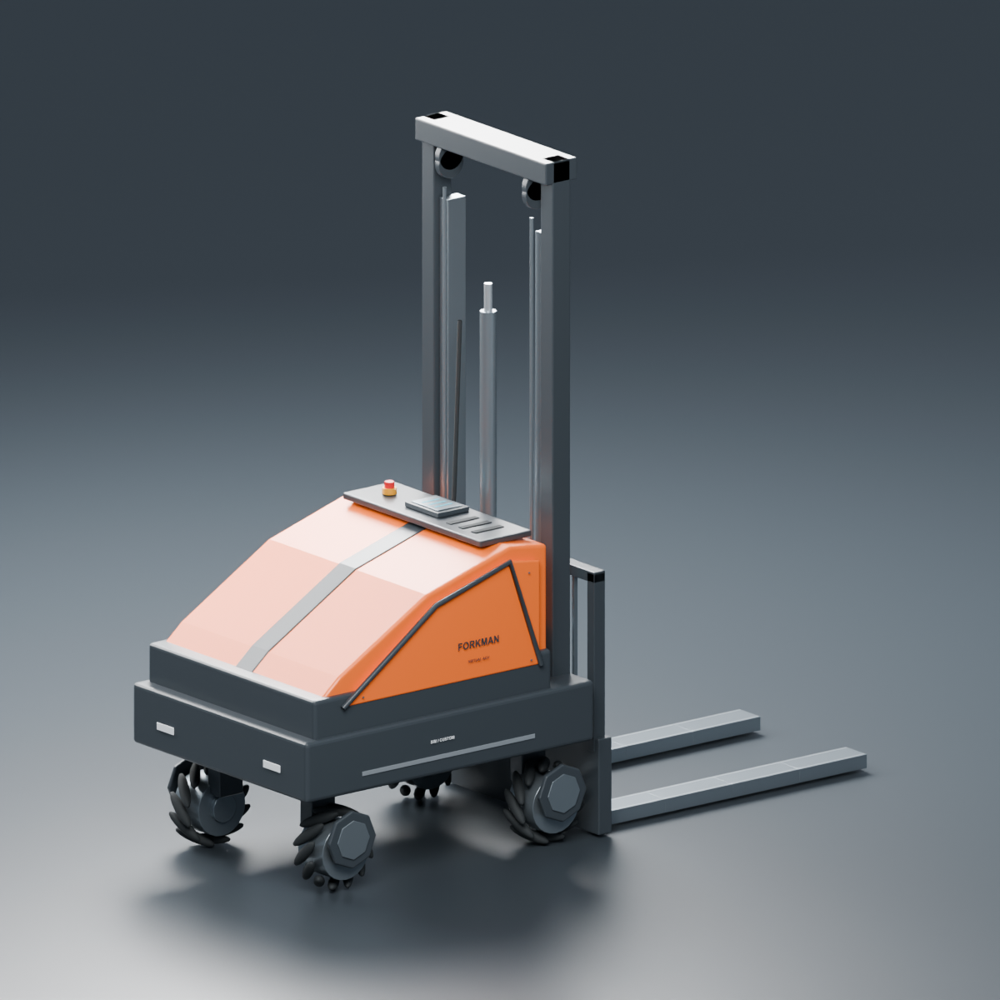
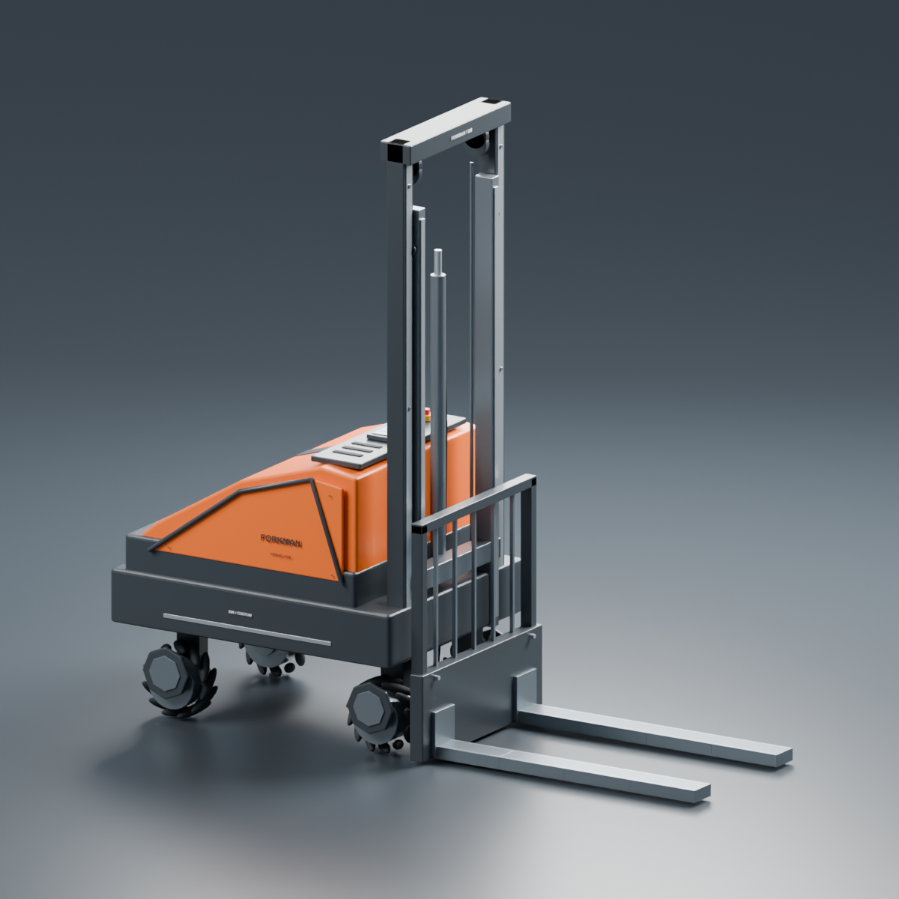
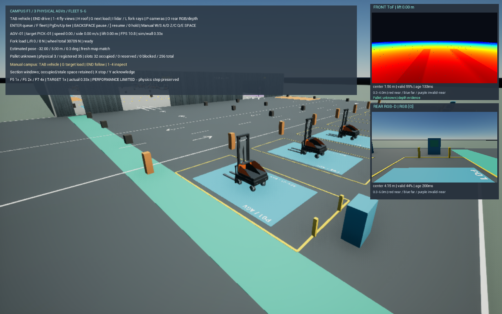

# 올턴 포크맨 AT-1000S 적합성 확인

2026-11-18, 사용자가 제공한 [제품 페이지](https://allturnkorea.com/2-5)와 [올턴가연테크 영상](https://www.youtube.com/watch?v=rNK2ramr-2M)을 확인했습니다. 컴퓨터 화면·마우스·키보드를 제어하지 않고 공개 HTTP 자료와 영상 미리보기 프레임을 분석했습니다.

## 필요한 기능과의 관계

|필요한 기능|공식 자료에서 확인한 내용|판단|
|---|---|---|
|좌우·대각선·제자리 회전|45도 롤러 메카넘과 4륜 독립 구동을 명시|현재 프로젝트의 메카넘 구조와 맞음|
|팔레트 인양과 랙 적재|실제 영상에 승강 마스트와 랙 취급 장면, 예시 최대 인상 높이 3120mm|JX-2000A보다 적합한 고인양 참고 장비|
|현재 400kg 화물 운반|예시 정격 1000kg, 하중 중심 500mm|중량 범위의 1차 비교는 가능. 높이별 잔존 능력은 미공개|
|무인 자율주행|기본 무선 리모트, AGV로 확장 가능하다고 설명|완성된 자율주행 지게차라는 근거는 없음. 프로젝트의 센서·제어를 붙이는 가상 설계로 구분|
|차량 3대 및 향후 6대 관제|단일 제품 자료|다중 차량 관제 성능을 확인한 자료는 아님|
|실차 물리 보정|예시 제원 외 질량·관성·마찰·기어비·회로 미공개|자료만으로 동일 실차의 물리 보정을 완료할 수 없음|

## 제원표의 중요한 제한

[공식 제원 이미지](https://cdn.imweb.me/thumbnail/20260724/01b2c62e320f1.jpg)는 다음 수치를 싣고 **사양이 예시이며 실제 모델과 다를 수 있다**고 명시합니다. 확정된 특정 출고 장비 사양으로 취급하지 않습니다.

|항목|페이지 예시|
|---|---|
|전장 × 전폭 × 전고|2000 × 1350 × 2000mm|
|휠베이스|약 1200mm|
|포크 길이|1100mm|
|정격 / 하중 중심|1000kg / 500mm|
|최대 인상 높이 / 자유 인상|3120 / 150mm|
|마스트 기울기|앞 6° / 뒤 10°|
|구동 모터 / 유압 모터|750W × 4 / 2000W|
|배터리|48V 200Ah, Li-ion 또는 Lead-Acid|
|주행|최대 5km/h, 적재 2~4km/h|
|승강|상승 300mm/s, 하강 450mm/s|
|휠|명목 10인치 메카넘, 우레탄 롤러|

영상 제원 슬라이드의 포크 길이는 **1200mm로 보이며** 페이지의 1100mm와 다릅니다. 또한 전장에 포크가 포함되는지를 보여주는 치수 도면이 없습니다. 몸체 길이를 단순히 `2000−1100=900mm`로 정하고 휠베이스 1200mm를 대칭 배치하면 차체·바퀴·포크 관계가 어긋날 수 있습니다. 원본 도면 없이 정확한 축 배치를 확정하지 않습니다.

‘회전 반경 0m’는 차체 중심을 기준으로 제자리 회전할 수 있다는 설명입니다. 차체·포크·화물이 쓸고 지나가는 공간이 없다는 뜻은 아니므로 관제의 장애물 여유와 회전 점유는 계속 필요합니다. 휠 항목의 허용 하중 1500kg도 바퀴당인지 전체인지 명확하지 않아 차량 정격 1000kg을 올리는 근거로 쓰지 않습니다.

## 영상 확인 범위

공식 영상의 2초 간격 미리보기에서 0~16초, 54~70초, 126~142초, 198~214초, 252~263초 구간을 표본으로 확인했습니다. 주황색 경사 패널 차체, 검은 인양 마스트, 리모트 조작자, 랙 작업 및 AT-1000S 이름이 보입니다. 편집·배속된 비교 장면으로 속도·정지거리·적재 능력을 실측하지 않았습니다. 끝부분의 LIFTMAN 고소작업대는 별도 장비이므로 포크맨 제원으로 섞지 않습니다.

사진은 설계 형태의 참고이고 CAD가 아닙니다. 페이지의 스타일화된 홍보 이미지와 영상 속 실물은 세부 외형이 달라 실물을 우선 참조합니다. 내려받은 원본·영상 미리보기는 gitignore 대상인 `Saved/Reference/Allturn`에만 보관합니다. 구조화한 출처·예시값·미확인 항목은 [reference.json](../ContentSource/AllturnForkman/reference.json)에 기록합니다.

## 교체 판단

메카넘 이동과 실제 인양 마스트가 있으므로 **기존 자동화를 붙이는 가상 AGV의 참고 모델로 적합**합니다. 실장비와 동일한 디지털 트윈이라고 부르려면 실제 구성 사양서·치수 도면·질량/하중표·구동/유압 데이터가 더 필요합니다. 가상 설계를 택하더라도 기존 시험값을 포크맨 실측값으로 이름만 바꾸지 않습니다.

## 선택한 구현 범위

사용자는 **포크맨 참고 가상 AGV**를 선택했습니다. 기본 `Start.bat`의 실제 운용 차량 3대에 새 외형을 적용합니다. JX-2000A는 기본 창고의 전시에서 내리고 원본 자산·기존 확인용 맵은 보존합니다.

주황색 경사형 덮개, 대각선 패널 이음, 휠 가드와 모듈 브래킷, 검은 승강 마스트, 가동 레일, 캐리지·포크를 새로 작성합니다. 실제 메카넘 바퀴와 롤러는 기존 물리 부품을 그대로 표시합니다. 정적인 조립 메시의 바퀴는 에디터 미리보기에만 쓰고, Play에서 같은 위치의 미리보기를 제거하므로 이중 바퀴나 가짜 차량을 만들지 않습니다.

새 차체와 고정 마스트는 차체 강체, 이동 마스트는 이동 스테이지, 캐리지는 승강 강체, 8개 포크 구간은 각각의 변형 부품을 따릅니다. 외형에 별도 질량·충돌·Tick을 추가하지 않습니다. 복잡한 덮개 표면과 기존 박스 충돌 근사는 동일한 표면이 아니며, 정밀 판금 충돌이나 포크맨의 구조 해석이라고 주장하지 않습니다.

깊이 카메라의 **로봇 자체 형상은 기존 물리 형상으로 렌더링**합니다. 새 경사 덮개·장식 모서리·포크 가장자리 표현을 그대로 센서에 넣은 시험에서는 상단 삽입 중 높이 인식이 바뀌어 정지했고, 물리 형상만 표시한 대조 조건에서는 통과했습니다. 포크맨 외관은 주 화면에 표시하고 자체 물리 형상은 SceneCapture에만 표시하도록 분리했습니다. 창고·팔레트·화물은 실제 장면의 GPU 깊이 관측을 유지합니다. 팔레트 좌표나 정답 삽입 상태를 제어 입력으로 넣지 않았고, 정렬·인터록 기준을 완화하지 않았습니다. 후면 RGB-D에서도 로봇 자체가 보이는 부분은 단순화된 물리 외형이므로 장식 외관과 픽셀 단위로 같지 않습니다.

**이번 교체에서 물리 수치와 작동 치수는 유지합니다.** 공개 예시표를 실측값으로 덮어쓰면 이미 확인한 하중·제동·인식·삽입 조건까지 바뀌고, 미공개 관성·감속비·유압을 임의로 확정하게 되기 때문입니다.

|항목|현재 운용 가상 AGV|포크맨 공개 예시|
|---|---:|---:|
|포크 포함 명목 길이|2605mm|2000mm, 포크 포함 여부를 확인할 도면 없음|
|차체 폭|985mm|1350mm|
|고정 마스트 높이|2475mm|전고 2000mm|
|포크 길이|1200mm|웹 1100mm, 영상 슬라이드는 1200mm로 보임|
|포크 승강 스트로크|2100mm|최대 인상 높이 3120mm; 서로 다른 정의|
|휠|명목 300mm, 기존 12롤러|명목 10인치, 롤러 개수 미공개|
|휠베이스 / 윤거|938 / 700mm|휠베이스 약 1200mm, 윤거 미공개|
|총 질량|3140kg, 기존 가상 설계|미공개|

따라서 이 버전은 **포크맨의 형태·메카넘 이동을 참고한 기존 자동화 시뮬레이터**이며, 위 예시 제원을 전부 적용한 복제품이 아닙니다. 3120mm 인상, 6°/10° 마스트 틸트, 1000kg 정격, 750W 구동 모터, 2000W 유압 모터의 실차 성능을 이번 교체에서 재현했다고 표시하지 않습니다.

## 실행과 소스

기존처럼 **Start.bat → Unreal Editor에서 Play**입니다. 기본 통합 창고·실제 웹·3대 운용과 기존 키를 사용합니다. `Start.bat -Map lab`도 새 외형으로 동작합니다. 별도 시작 배치 파일을 만들지 않습니다.

- `ContentSource/AllturnForkman/FORKMAN-VirtualAGV.blend`: 편집 가능한 모델.
- 같은 폴더의 FBX·GLB·manifest: 부품별 원점, 치수, 재질과 삼각형 수.
- `/Game/AllturnForkman`: 언리얼 자산.
- `Config/Modeling.json`: 기본 모델 선택과 유지한 운용 치수.
- `Scripts/create_allturn_forkman.py`: 헤드리스 모델 생성.
- `Scripts/ImportAllturnForkman.py`: 헤드리스 가져오기와 기존 맵의 미리보기 갱신.

## 적용 후 확인

2026-11-18 최종 DLL에서 단위 시험 **110/110**, 새 외형을 표시한 상단 팔레트 **자동 삽입·인양·회수와 하역 2/2**, 실제 GPU 깊이·거리 표적·지연·동기 RGB-D 카메라 시험을 통과했습니다. 단일 장비 인양·하역 회귀는 960Hz·32회 조건입니다.

기본 `WarehouseCampus`에서도 실제 차량 **AGV-01~03 모두 새 부품 메시로 생성**되고 전후 카메라가 표시되는 것을 확인했습니다. 아래는 데스크톱 캡처가 아니라 Unreal의 오프스크린 렌더입니다. 이 확인은 주차 상태의 생성·표시 시험이며, 전체 운반 임무 재검증이나 성능 향상을 의미하지 않습니다. 이 시험의 480Hz·16회·단일 스레드 물리 조건에서 화면에 성능 제한이 표시됐으므로 실시간 배속이나 6대 성능을 보장하지 않습니다.

모델 생성·가져오기·실행 시험은 명령행과 오프스크린 렌더로 진행했으며 마우스·키보드·데스크톱 UI 자동화를 사용하지 않았습니다. [빌드 해시·조건·결과·실패 진단 기록](References/ForkmanModelEvidence-20261118.json).
