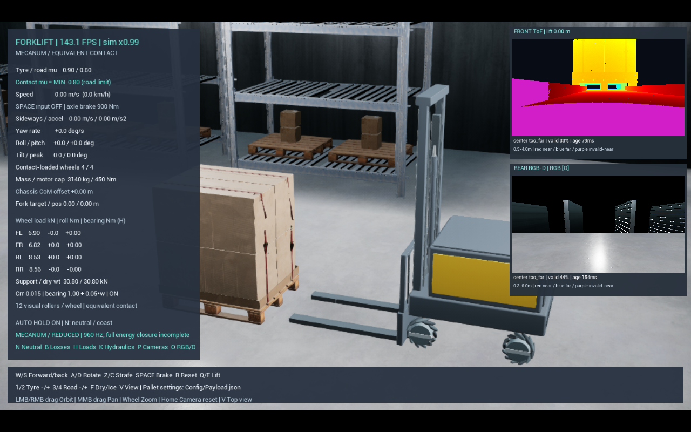
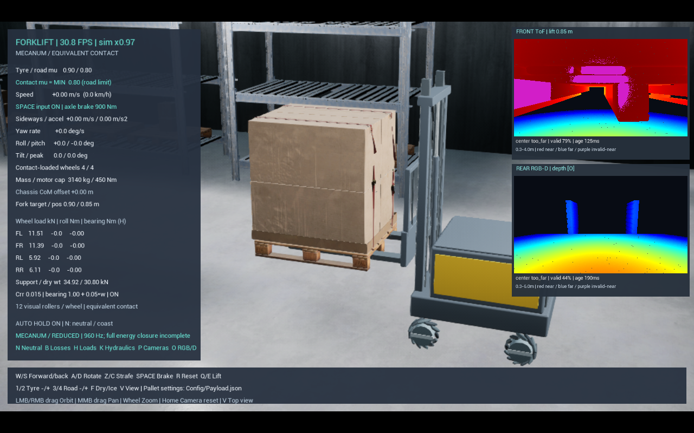

# 전방 깊이 카메라와 후방 RGB-D

`Start.bat` → Unreal Editor에서 Play. 기본 integrated에 카메라 두 대를 포함합니다. **P**는 촬영·표시 켜기/끄기, **O**는 후방 RGB/깊이 화면 전환입니다. 전방은 항상 깊이 색상 화면입니다. 별도 시작 배치 파일은 없습니다.

## 두 대의 역할

|센서|장착·용도|기본 작업 거리|기본 출력|
|---|---|---|---|
|전방 ToF 방식 깊이 모델|캐리지에 부착, 포크와 함께 승강. 팔레트 구멍 방향 관찰|0.3~4m|320×180, 최대 8Hz 깊이|
|후방 RGB-D 모델|차체에 고정, 후방 영상·거리 관찰|깊이 0.3~6m|320×180, 최대 8Hz RGB+깊이|

1단·랙 2단을 위한 별도 고정 카메라를 추가하지 않습니다. 승강형 전방 센서 한 대가 두 높이를 담당합니다. 후방 RGB와 깊이는 **같은 렌더 노출의 RGB/깊이 채널**에서 얻으므로 추가 세 번째 카메라나 별도 후방 렌더 패스를 사용하지 않습니다. 앞뒤 두 대는 서로 마주 보는 스테레오 쌍이 아닙니다.

이 모델은 깊이 데이터를 제공하는 단계입니다. 팔레트 인식·삽입 제어·후방 사람 인식·자동 제동·3D SLAM은 아직 포함하지 않습니다. 이후 2단 랙의 승강 범위와 선반 간격을 [물리 기준 시험](CurrentPhysicsQualification.md)에서 확인했고, [관절 센서](JointSensors.md)를 별도로 추가했습니다.

## 측정값의 의미

실제 장면을 렌더링한 깊이를 GPU에서 비동기로 읽습니다. 물체 이름이나 액터 위치로 거리를 만들어 보내지 않습니다. 전방은 R32f 장면 깊이, 후방은 RGBA16f의 선형 RGB와 깊이를 한 번에 촬영합니다. 포크·적재물의 가림을 유지하고 near clip은 1cm입니다.

렌더러의 깊이는 광축 방향 cm입니다. 픽셀별 시선 방향으로부터 방사 거리로 변환한 뒤 센서 오차를 적용하고, 다시 광축 방향 m와 방사 거리 m를 함께 보관합니다. 카메라 행렬의 진단용 실제 위치는 Unreal 좌표계(X 전방, Y 오른쪽, Z 위)이며 SLAM 추정 위치가 아닙니다.

후방 원시 깊이 채널에는 FP16 저장 오차도 있습니다. 1mm 양자화 설정이 1mm 측정 정확도를 뜻하지 않습니다. 거리 변환 시험의 이상적 깊이 오차와 추가 센서 잡음을 구분합니다.

기본 센서 오차는 **설계 가정값**입니다. 특정 상용 제품의 보정·성능·안전 등급을 재현한 값이 아닙니다.

- 거리 표준편차: `0.003 + 0.001 × 거리²`m
- 거리 양자화: 1mm, 독립 픽셀 누락 확률: 0.2%
- 최소 전달 지연: 시뮬레이션 시간 50ms. GPU 처리에 따라 실제 전달은 늦어질 수 있으며 나이를 별도 표시합니다.
- 고정 난수 시드: 317/318. 동일 입력 프레임과 시드에 대한 오차 재생을 검증합니다.
- 유효·최소 거리 미만·최대 거리 초과·반환 없음·표본 누락을 구별합니다.

유효 깊이는 가까운 곳 빨강 → 먼 곳 파랑으로 표시합니다. 보라는 최소 거리 미만, 어두운 픽셀은 범위 밖/반환 없음, 회색은 표본 누락입니다. HUD의 중심 거리는 한 중심 픽셀의 방사 거리이며 가장 가까운 장애물 거리나 안전 판정이 아닙니다. 유효 픽셀 비율과 측정 나이도 함께 표시합니다. 0.5초 이상 된 측정은 STALE로 표시합니다.

측정할 수 없는 픽셀을 거리 0으로 제공하지 않습니다. 내부 배열에는 validity 마스크가 있으며 웹의 무효 중심 거리는 null, CSV의 무효 거리는 빈칸입니다. 현재 포크 옆 렌즈는 삽입 후 적재물이 0.3m보다 가까우면 일부 측정이 무효가 되는 것이 정상입니다. 마지막 삽입 구간의 단거리 센서는 후속 단계입니다.

## 설정·계측

`Config/Cameras.json`에서 공통 해상도·주기·범위·잡음·양자화·지연·난수 시드와 앞뒤 시야각을 설정합니다. 변경 후 Play를 다시 시작하거나 R로 리셋합니다. 잘못된 설정은 로그에 오류를 남기고 카메라를 활성화하지 않습니다. 기본값은 추가 사용자 설정 없이 작동합니다.

웹의 **카메라 센서 측정값** 항목은 실제 Unreal의 `camera_sensors` 데이터를 표시합니다. 전체 이미지는 웹으로 전송하지 않으며 센서 중심 거리·유효 비율·측정 시간만 추가합니다. 기존 물리 정답 계측과 구분합니다.

자동 캡처 시 `Saved/Sensors/<시각>/cameras.json`, `front-depth.csv`, `rear-depth.csv`에 마지막 실제 측정 프레임을 저장합니다. JSON에 해당 CSV의 촬영 시각·해상도·내부 파라미터·좌표계·유효 비율이 있습니다. 촬영·GPU 복사·CPU 처리는 한 센서당 한 프레임만 대기시켜 무한 대기열과 따라잡기 폭주를 피합니다. 게임 틱에서 GPU 완료를 강제로 기다리지 않습니다.

## 검증 방법과 한계

2026-10-29 검증: 단위 시험 **36/36**, 웹 상태·브리지 시험 **4/4** 통과. 최종 GPU 표적 시험에서는 전방 정상/근거리/원거리 **36/16/15**프레임, 후방 **36/15/15**프레임을 검사해 실패 0건이었습니다. 원시 광축 깊이와 표적의 최대 차이는 전방 약 0.030mm, 후방 5mm였습니다. 추가한 잡음 이후의 센서 정확도나 실차 정확도를 뜻하지 않습니다.

승강 확인에서 포크 높이 약 0.866m일 때 전방 렌즈 높이는 약 0.911m, 후방 렌즈는 약 1.190m를 유지했습니다. 실제 창고·두 센서·실제 웹 전달을 켠 1280×800 오프스크린 30초 단독 실행에서는 평균 **90.25 FPS**, p95 **30.44ms**, 실제 시간 대비 진행 **0.972배**였습니다. 에디터 PIE·모니터 표시 FPS 보장값은 아닙니다. 직전 실행은 약 46 FPS로 편차가 있었으며, 픽셀 시선의 반복 계산을 줄인 뒤 최종 단독 기록을 남겼습니다. 두 기록의 차이를 모두 캐시 최적화의 인과 효과로 단정하지 않습니다.

설정과 원본 결과 위치는 [검증 요약](References/CameraSensorsValidation.json)에 보존합니다. 일반 실행에서도 HUD와 웹의 FPS·진행 배율·센서 측정 나이를 따로 확인할 수 있습니다.

`Scripts/Test-Cameras.ps1`은 실제 GPU 렌더링으로 알려진 거리의 평면 표적을 촬영합니다. 전방 2m·후방 3m, 최소 거리 아래 0.15m, 최대 거리보다 먼 표적을 차례로 배치해 거리 단위와 near/far 결측을 검사합니다. 이 정답 표적은 테스트 전용이며 일반 센서 입력으로 위치 정답을 사용하지 않습니다. RGB-D 같은 프레임 번호와 최소 전달 지연도 검사합니다.

단위 시험은 광축 깊이/방사 거리 변환, 범위 경계, 무효 상태, 고정 시드 재생과 잡음 통계를 확인합니다. 기존 물리 회귀도 별도 유지합니다.

빛의 왕복 전파·다중 반사·포장재 반사율·햇빛·투명체·실제 렌즈 왜곡은 정밀 재현하지 않습니다. 렌더러의 가시 표면에 기본 거리 오차를 더한 모델입니다. 안전 인증, 실차 보정, 후방 보호 영역·제동거리 판단은 완료되지 않았습니다.

