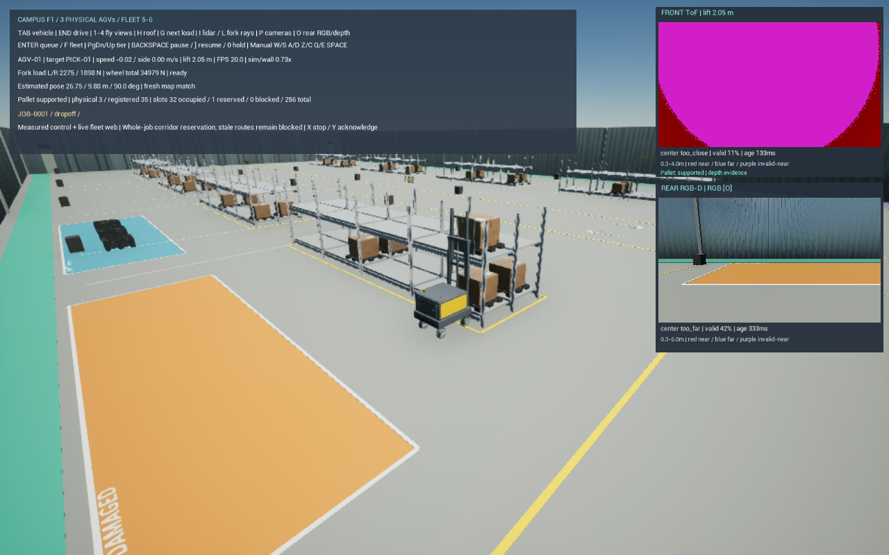

# 창고 자동 운반·관제 5~6 묶음

현재는 이 운반 제어 위에 [중앙 작업 큐·웹 등록·자동 배정·KPI](TaskOperations.md)를 연결했습니다. 또한 [구간 예약·6대·충전](FleetOperations.md)을 연결했으며 현재 기본 예약은 구간 방식입니다. 아래의 2026-11-12 검증 수치와 작업 전체 예약 설명은 당시 기반 운반 기능의 이력입니다. 새 작업 관제 시험과 구분합니다.

실행은 루트 **Start.bat → Play → 화면 클릭**입니다. 현재 층의 등록 팔레트와 조사 지도, 알려진 주차 위치를 사용하는 연구용 관제입니다. 실내 5,000㎡·실외 주차장에서 물리 지게차 3대를 사용합니다. 3D SLAM·사람 안전 인증·실제 충전 제어는 포함하지 않습니다.

## 조작

| 키 | 동작 |
|---|---|
| Tab / End | 차량 선택 / 선택 차량 추적 화면 |
| G | 정지·무적재 상태에서 다음 사용 가능한 팔레트 선택 |
| PageDown / PageUp | 새 작업의 하역 목표를 랙 1단 / 2단으로 선택 |
| Enter | 선택 차량의 현재 팔레트 운반 작업 등록 |
| F | 현재 3대의 작업 일괄 등록 |
| Backspace / ] | 선택 작업 정지 / 건강·정합·경로 재검사 후 명시적 재개 |
| 0 | 작업 취소. 적재·센서 이상이면 차량과 예약을 유지하고 수동 복구 필요 |
| W/S · A/D · Z/C · Q/E · Space | 수동 전후 · 회전 · 횡이동 · 승강 · 제동. 자동 작업 중 누르면 작업 정지 |
| X / Y | 선택 차량 비상정지 / 정지 후 센서·제어기 고장 확인 |
| I / L · P / O | LiDAR / 포크 광선 · 카메라 표시 / 후방 RGB·깊이 전환 |
| 1~4 / H | 자유 카메라 / 지붕 표시 전환 |

시작 후 센서가 준비되고 지도 정합이 유효해진 뒤 등록합니다. `G`는 목표 ID 선택이며 인식 성공이나 즉시 이동 명령이 아닙니다. `F`로 세 작업을 넣어도 공용 통로가 겹치면 기다립니다. 웹 차량 선택은 화면 표시만 바꾸며 Unreal에서 조작할 차량을 바꾸지 않습니다.

## 운반 순서

기본 창고의 통로 주행 목표는 적재 시 **0.85m/s(3.06km/h)**, 무적재 시 **1.00m/s(3.60km/h)**입니다. 적재 목표는 창고 운영 연구의 표 1에서 사용한 3km/h 작업 기준을 참고했습니다. 경유점과 도킹 정지점에 가까워지면 남은 거리에 맞춰 감속합니다. 포크 접근·삽입은 별도의 정밀 제어로 최대 0.12m/s입니다. [창고 운영 연구](https://www.dbc.wroc.pl/Content/34565)

2026-11-19 기본 480Hz·반복 각 16회·병렬 물리의 3대 창고 시험에서 1단 운반의 적재 최고 속도는 0.878m/s였습니다. 이전 179.30초와 비교해 같은 1단 임무를 시뮬레이션 시간 152.81초에 완료했습니다. 장애물 감지 정지·재개·센서 이상 정지도 통과했습니다. 장애물 투입 시점의 차체 속도는 0.853m/s, 정지까지의 포크 끝 최소 여유는 1.175m였습니다.

2단 시험 첫 시도는 적재 이송 전 삽입 중 팔레트 추적 상실로 정지했습니다. 동일 조건의 재시험은 적재 최고 0.874m/s로 운반하고 2단 하역과 복귀를 194.55초에 완료했습니다. 이 시험에서 추적 상실이 한 차례 관찰됐습니다.

등록 재고에서 팔레트와 목적 슬롯을 독점 예약합니다. 빈 목표 슬롯을 가까운 순서로 검토하고 조사 지도에서 차량 전체 외곽이 통과할 수 있는 경로를 계획합니다. 엔코더·IMU·LiDAR 추정 위치로 이동하고, 접근점에서 방향을 맞춥니다. 실제 깊이 영상과 포크 센서로 정렬·삽입·인양·후퇴를 수행합니다. 랙에서 꺼낸 적재물은 회전 중 랙과 간섭하지 않도록 1.75m 후퇴합니다(바닥 픽업·빈 포크 하역 후퇴는 1.5m). 낮은 높이로 운반한 뒤 등록된 랙 위치·방향에 맞춰 유압 상승·진입·하강·후퇴를 수행하고 하역 후 빈 포크는 0m 위치로 내려 자기 포크가 저상 LiDAR 평면을 가리지 않게 한 뒤 주차 위치로 돌아갑니다.

인양 완료는 새 작업에서 확인한 완전 삽입·좌우 하중·실제 승강 증거가 필요합니다. 하역 높이 여유는 삽입 직전에 높이 센서로 확인한 값을 재사용하며, 하중이 충분히 빠지기 전에는 후퇴하지 않습니다. 하역 완료는 센서의 하중 이양과 실제 랙 지지·차량 지지 해제를 확인한 재고 배치가 모두 필요합니다. 단순 목표 도착이나 예약만으로 완료하지 않습니다.

## 경로·통로·복구

전역 경로는 `Config/WarehouseCampus.json`의 통로 그래프와 정적 조사 형상을 사용합니다. 점 로봇 대신 전방 포크·차체 폭·여유를 포함한 고정 방향 외곽으로 각 구간과 연결선을 검사합니다. 이동은 메카넘 횡이동을 사용하며, 접근점에서 저속 회전합니다.

초기 정책은 **작업 전체 경로를 원자적으로 예약**합니다. 회전 공간을 포함한 보수적 경로 상자가 겹치는 작업은 동시에 시작하지 않습니다. 자원을 일부씩 잡고 서로 기다리는 교착을 피하기 위한 정책이며, 세밀한 교차로 시공간 배차보다 처리량이 낮습니다. 분리된 작업 경로는 동시 예약이 가능합니다. 정지·알 수 없는 차량의 예약은 시간 만료로 비우지 않고 격리합니다.

현재 차량 위치는 센서 추정값만 사용합니다. 정지 판정에는 엔코더·IMU뿐 아니라 신선한 LiDAR 정합 위치의 변화에서 구한 차체 속도를 사용하여, 바퀴가 잠겨도 차체가 미끄러지는 상태를 정지로 오인하지 않습니다. 정합 상실·필수 센서 이상·구동 명령 유효시간 초과·장애물·적재물 상실은 작업을 정지시킵니다. 이동 중에는 실제 LiDAR가 관측한 전방 경로를 주기적으로 검사하고, 보호 영역에 닿기 전에 제한된 지역 격자로 우회 경로를 계획합니다. 새 경로의 예약을 원자적으로 확보하지 못하면 정지합니다. 보호 정지 이후 재개 시에는 현재 측정한 LiDAR 장애물로 경로를 다시 계획하고 전체 경로 예약을 다시 검사합니다. 데이터가 돌아왔다는 이유만으로 자동 재개하지 않습니다. 삽입 도중 멈춘 작업은 임의로 다시 밀어 넣지 않으며 수동 복구가 필요합니다. 무적재·정지·센서 정상 상태에서 `0`으로 정리한 뒤 새 작업을 등록합니다. 적재 중이면 화물을 안전하게 내려놓은 뒤 정리합니다.

공용 통로 예약은 관제 기능이고 최종 보호 정지는 실제 LiDAR 측정에 의존합니다. 일반 주행·회전·저속 도킹에 서로 다른 실제 외곽과 정지 여유를 적용합니다. 저속 도킹의 횡방향 범위는 차체와 1.1m 팔레트의 큰 반폭에 70mm를 더하고, 명령/측정 속도 중 큰 값에 따른 정지 거리를 추가합니다. 도킹 정지 거리의 속도 항은 가정한 응답 0.3초·감속 0.5m/s²에 따른 값이며 실차 인증값이 아닙니다. 속도 0에서 0으로 수렴하며, 작은 속도 잡음의 방향에 일정한 추가 여유를 붙이지 않습니다. 랙 기둥 중심에서 85mm(실제 반폭 60mm와 측정 여유 25mm)는 가로보 제외 구역에 포함하지 않습니다. 하역 정지점은 고정 포크 중심 대신 근거리 센서에서 확인한 적재물 중심을 사용합니다. 포크가 올라간 동안에는 등록 랙의 낮은 가로보를 기하적으로 연관시켜 구분하되, 기둥과 바퀴 앞 정지 여유는 제외하지 않습니다. 등록 랙 형상을 사용하는 제한된 도킹이며 임의 장애물의 3D 안전 분류는 아닙니다. 적재물 자기 반사 제외는 이미 확인한 인양 영수증, 좌우 하중, 높이, 근거리 측정으로 제한하며 짧은 측정 유효시간이 지나면 제외하지 않습니다. 장애물 ID나 배우 이름으로 광선을 무시하지 않습니다.

## 네 방향 팔레트와 센서

4방향은 팔레트 형상과 실제 진입 지원을 뜻하며, 현재 자동 배차는 등록된 접근 위치·방향을 사용합니다. 임의 방향을 최적화해 선택하는 배차는 포함하지 않습니다.

격자 팔레트의 존재 센서는 반폭 40mm의 십자 영역에서 최대 17개의 실제 물리 광선을 사용합니다. 한 점이 격자 구멍을 통과했다고 팔레트 전체가 없다고 판정하는 문제를 줄이는 가상 센서 설계입니다. 실제 제품의 검출 면적을 실측한 값은 아닙니다. 단일 거리 센서와 기존 시험장 센서 설정은 유지합니다.

도킹 중 전체 형상 인식을 카메라 표본에 맞춰 실행하고, 그 외에는 탐색을 낮은 주기로 수행합니다. 최종 삽입에서 영상이 가려진 뒤에는 앞서 관측한 통로·자세와 신선한 좌우 근거리 및 네 존재 센서를 결합합니다. 근거리 거리로 최종 깊이를 계산하고, 카메라 전송·근거리 측정·존재·자세 조건이나 짧은 유효시간이 깨지면 계속 진행하지 않습니다. 오도메트리만으로 과거 검출을 무기한 연장하지 않습니다.

개방 통로의 정합을 위해 실제 충돌·렌더 형상이 있는 폭 0.5m 조사 기준물을 통로 밖에 인스턴스로 배치하고, 창고 모드 LiDAR 범위를 15m로 설정했습니다. 새 기준물도 동일한 조사 지도에 포함됩니다. 알려진 출발 위치 이후 정답 차량 위치를 위치 추정에 넣지 않습니다. 모든 개방 구역·가림·임의 배치에서 연속 정합을 보장하는 SLAM은 아닙니다.

## 실시간 웹

기본 로컬 포트는 **4174**이며 PortSim의 4173과 분리합니다. `Start.bat -Website` 또는 기존 `Website.bat`로 웹만 열 수 있습니다. 웹은 실제 Unreal의 한 월드에서 차량 3대의 스냅샷을 받아 차량 선택·센서·하중·유압·인식·작업·경로·재고·통로 대기/격리를 표시합니다. 가짜 시연 데이터나 브라우저 물리 계산을 사용하지 않습니다.

차량을 바꾸면 하단 상세 패널·그래프·센서 CSV도 해당 차량으로 바뀝니다. 관제 CSV는 차량 ID를 포함하여 전체 차량 행을 저장합니다. 중단되거나 정합을 잃은 위치는 지도에 실시간 위치로 그리지 않습니다. 현재 웹에는 작업 등록·배정 전 취소도 연결되어 있습니다. 통신이 오래되거나 중단되면 새 요청을 막고 기존 Unreal의 제어·보호 정지는 계속합니다. 차량·관제 명령의 유효시간 검사는 Unreal 안에서 수행합니다.

## 계산량과 검증

기본 창고 경량 설정은 480Hz·솔버 반복 16·병렬 물리이며, 정밀 비교는 `Start.bat -CampusPrecision`의 960Hz·32를 사용합니다. 상세 롤러 시험 옵션과 기존 단일 차량 시험장(`Start.bat -Map lab`)은 유지합니다. 그래픽은 DX11 균형 설정입니다. 주기·정밀도 변경은 실제 시험 결과와 함께 평가하며 실차 보정 완료를 뜻하지 않습니다.

선택 차량 전방/후방 카메라는 최대 8/4Hz, 비선택 대기 차량은 2/1Hz, 작업 중 후방은 2Hz를 사용합니다. 도킹 전방은 8Hz로 복귀합니다. LiDAR·엔코더·IMU·승강·하중 주기는 유지합니다. 웹에 현재 카메라 목표 주기와 표본 나이를 표시합니다. 광선의 용접 강체 중복 읽기와 매칭의 전수 탐색을 줄였으며, 매칭 임계값은 유지합니다.

검증 원본은 `Saved/Validation/Campus`와 차량별 `Saved/Telemetry`에 기록합니다. 실제 월드 자동 운반과 고장·예약 시험은 `Scripts/Test-CampusFleet.ps1`, 기존 물리 기반 회귀는 `Scripts/Test-CampusFoundation.ps1`로 실행합니다. 전자는 초기 위치만 설정한 실제 센서 폐루프 자동 작업이며, 후자의 네 방향 시험은 실제 영상으로 포크 높이를 맞추고 측정 대상을 고정한 운영자 입력을 재현하는 물리 시험입니다. 완전 삽입 센서 판정을 확인한 뒤 인양하며, 실제 삽입 깊이는 시험의 부정확한 조기 판정을 검출하는 검사값으로만 사용합니다. 합격 조건·수치 비교·성능·증거 해시는 최종 검증 기록으로 보존합니다.

## 검증 결과 (2026-11-12)

- 최종 DLL 단위 시험 98/98. 기본 정지 거리의 영속도 연속성, 기둥·바퀴 보호, 예약 원자성·격리, 위치 추정 좌표계 등을 포함합니다.
- 실제 월드 기능 11종: 기본/근거리 운반, 2단 하역, 랙 재고 이동, 3대 배차, 출입구 통과, 감지 장애물 우회, 장애물 정지·재개, 센서 단절, 명령 갱신 중단. 단계별 빌드 기록을 보존하며 이후 기존 수동 검증 입력만 보완한 빌드와 구분합니다.
- 현재 물리·센서 설정의 창고 기반 회귀 7/7: 구조·재고·상단 인식 및 0/90/180/270도 삽입·인양·운반·하강·후퇴. 별도 960Hz·32회 비교 1조건과 기존 단일 차량 회귀 2/2도 통과했습니다.
- 웹 프로토콜 14개 + 기존 브리지 규칙 32개는 명시적 가상 통신 시험입니다. 별도로 실제 Unreal 단일 월드 80프레임·240개 차량 행·23열 CSV를 확인했으며, 포크 물리 하중 약 4.18kN과 하중 센서 값이 함께 수신됐습니다.

근거리 운반 시험은 시작 위치만 가까운 곳으로 설정합니다. 별도 `full_transfer`는 기본 주차장(-32m, 5m)·기본 PICK-01·실제 창고를 그대로 사용하며 581.43초의 시뮬레이션 동안 픽업·운반·하역·주차 복귀를 수행했습니다. 테스트 중 완료 위치로 차량이나 적재물을 순간 이동시키지 않습니다. 기본 배치 시험은 `Scripts/Test-CampusFleet.ps1 -Cases full_transfer -PhysicsHz 480 -SolverIterations 16 -ParallelPhysics`로 재현합니다.

자연 시간 간격(`-RealtimeClock`, 고정 30FPS 입력 해제)의 독립 실행에서는 초기 12초 대기 관측의 종료 부근 약 21.4FPS·시뮬레이션/실시간 0.66, 초기 3대 배차 시험의 종료 부근 약 20.7FPS·0.62였습니다. 세 차량 모두 구동·보호 센서가 정상 상태였고 배차 주행도 통과했습니다. 이 수치는 평균 FPS·Editor Play 성능·3대 동시 도킹·6대 처리량 보장이 아닙니다. 실제 진행 배율은 HUD/웹에서 계속 확인합니다.

동일 빌드의 수동 운반 0도 조건에서 비교한 기본/정밀 설정의 최대 포크 하중은 4327.7/4331.5N(약 0.09% 차이), 하역 후 팔레트 바닥 높이는 -1.987/-2.000mm였습니다. 반면 **순간 최대 바퀴 합산 접촉력은 103.46/92.70kN(약 11.6% 차이)**로 계산 간격·솔버에 민감합니다. 기본 설정을 정밀 설정과 동등한 충격 하중 검증으로 해석하지 않으며 충격·최대 하중은 정밀 옵션에서 비교해야 합니다. 실차 물성 보정 완료를 뜻하지 않습니다.

브라우저 시각 검사는 컴퓨터 조작 도구가 현재 URL을 확인하지 못해 중단됐습니다. 브라우저 조작을 재시도하지 않았으며 HTTP의 실제 Unreal 데이터와 차량 분리·CSV·정적 자산 검증으로 확인한 범위를 위에 명시했습니다.

[실행 원본·빌드별 결과·해시](References/CampusFleetEvidence-20261112.json)

6대 이상의 장시간 처리량, 상층 운행, 충전 배차·배터리 모델, 바코드 기반 고유 화물 식별, 사람/차량 안전 인증은 이번 완료 범위가 아닙니다.
