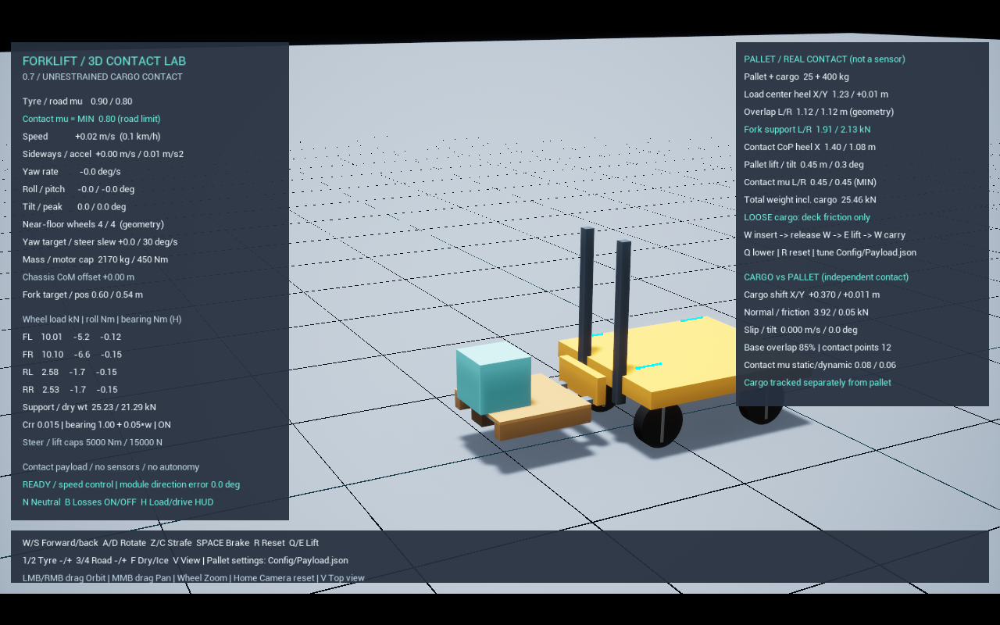

# 묶음 A / 비고정 화물 접촉과 운반

아래 측정 결과는 0.7 당시 모델의 기록이다. 0.8부터 모터·조향·노면 계측, 0.9부터 타이어 수직 탄성 근사가 확장되었다. [DrivetrainAndTerrain.md](DrivetrainAndTerrain.md), [TyreCompliance.md](TyreCompliance.md)의 모델·회귀 결과를 함께 참고한다.

0.9의 `cargo_brake` / `cargo_brake_low`는 동일한 12% 브레이크 명령을 사용한다. 타이어 모델에 제동 경로를 분리한 뒤 100% 제동에서는 팔레트 자체도 포크에서 이탈할 수 있어, 화물–상판 마찰 비교와 강제동 스트레스를 분리했다. 일반 조작 Space의 최대 토크는 낮추지 않았고, `cargo_tip` / `cargo_drop`는 100% 제동을 유지한다. 아래 0.7/0.8 제동 이동량과 동일한 시험 입력으로 직접 비교하면 안 된다.

`Start.bat -Mode payload` → Play로 실행한다. 기본 화물 고정은 해제되어 있다. W 삽입 → E 양중 → W/S·A/D·Z/C 운반 → Space 제동 → Q 하강. 오른쪽 아래 CARGO 표는 팔레트 자체의 포크 위 움직임과 별개로 화물의 움직임을 표시한다.

## 설정

`Config/Payload.json`을 수정하고 프로그램을 다시 연다. R은 파일 재로딩이 아니라 현재 설정으로 장비를 재생성한다.

| 변수 | 기본값 | 의미 |
|---|---:|---|
| cargo_secured | false | false는 접촉만으로 지지. true는 팔레트–화물을 고정하고 그 둘의 충돌을 비활성화하는 비교 조건 |
| cargo_length_m / cargo_width_m / cargo_height_m | 0.65 / 0.65 / 0.6 | 균일한 직육면체의 크기와 관성, 길이·너비 지원 0.2~1.0 m |
| pallet_top_static_mu / pallet_top_dynamic_mu | 0.6 / 0.5 | 팔레트 상판 재질 |
| cargo_static_mu / cargo_dynamic_mu | 0.6 / 0.5 | 화물 재질 |
| cargo_mu | 0.5 | 기존 측면·받침대 재질. 새 상판/화물 계수가 빠진 구형 JSON에서는 양쪽 계수의 대체값 |

유효 접촉 계수는 Min 결합이며 각 재질의 정지 계수는 운동 계수 이상이어야 한다. 같은 무게에서 마찰만 비교하려면 cargo_static_mu / cargo_dynamic_mu만 바꿔도 된다. 포크와 팔레트 구멍의 마찰은 기존 fork_mu / left_hole_mu / right_hole_mu다.

재질 결합 방식은 [Epic Physical Materials Reference](https://dev.epicgames.com/documentation/en-us/unreal-engine/physical-materials-reference-for-unreal-engine?application_version=5.6)의 Min 방식을 사용한다. 설정된 수치는 실물 재질 시험값이 아닌 비교 실험용 가정이다.

## 수치의 의미

- Cargo shift: 시작 배치 대비 화물 무게중심의 팔레트 좌표계 이동량. 팔레트 전체가 움직인 양은 포함하지 않는다.
- Contact normal / friction: 접촉점별 수직/접선 충격량을 물리 시간으로 나눈 값이다. friction은 크기의 합이다. 합력 벡터도 CSV에 별도로 저장한다. 무조건 mu*N을 마찰력으로 넣지 않는다.
- Slip: 대표 접촉점에서 두 강체의 점 속도 차이를 접촉 접선 평면에 투영한 크기. 무접촉에서는 0과 접촉점 수 0을 함께 기록한다.
- Tilt: 팔레트와 화물의 위쪽 축 사이 각도. 월드 기준 기울기도 CSV에 별도 기록한다.
- Base overlap: 화물 바닥면을 팔레트 평면에 투영한 다각형의 겹침 비율. 실제 접촉 여부는 접촉력으로 판단한다.
- Lost support: 팔레트가 0.15 m 이상 들린 이후, 수직 지지가 화물 무게의 1% 미만인 상태가 0.15초 지속됨.
- Tipped: 같은 양중 상태에서 상대 기울기가 45도를 넘은 이력. 안전 인증용 전도 임계각이 아니라 시험 판정 기준이다.
- Fell: 양중 후 화물에서 바닥 접촉력이 측정된 이력. 바닥까지 떨어지지 않은 단순 미끄럼·기울어짐과 구분한다.

HUD는 힘만 짧게 평활화하고 CSV는 원시 접촉 계측값을 기록한다. 모든 값은 센서 모델이 아닌 물리 정답값이다.

`CARGO_CHECK`의 `max_mu_ratio`는 지지력이 화물 무게의 10% 이상일 때의 `접선력 / (정지계수 × 수직력)` 최대값이다. 화물이 뒤집혀 모서리로 부딪히는 동안에는 위치 보정과 속도 충격량이 합쳐진 엔진 반력이 이 비율 1을 넘을 수 있다. 실제 전도·충격의 마찰 정밀도를 보증하지 않으며 값을 잘라서 숨기지 않는다. 정량 마찰 한계 회귀는 화물의 상대/월드 기울기가 모두 5도 미만이고 다른 물체·바닥 접촉이 없는 지지 구간의 `max_planar_mu_ratio < 1.05`로 구분한다. 전도·낙하 시험은 거동과 지지 하중 이동의 회귀 시험이다.

## 회귀 시험

`Scripts/Test-Cargo.ps1 -Fps 60`을 실행한다. 단일 사례는 `Scripts/Test-Payload.ps1 -Scenarios cargo_brake_low`처럼 실행한다.

| 사례 | 확인 내용 |
|---|---|
| cargo_hold | 비고정 정지 양중: 화물 지지력≈화물 무게, 전체 바퀴 지지력≈차체+팔레트+화물 무게 |
| cargo_entry / cargo_unload | 비고정 화물을 싣고 실제 삽입·양중 / 운반·하강·후진 이탈. 하역 후 바퀴는 무적재 하중으로 복귀 |
| cargo_accel / cargo_accel_low | 같은 가속 입력에서 고/저마찰 상대 이동과 마찰력 비교 |
| cargo_brake / cargo_brake_low | 같은 초기 1 m/s에서 제동: 고/저마찰 이동 비교 |
| cargo_corner / cargo_corner_low | 같은 초기 1 m/s에서 회전: 고/저마찰 이동 비교 |
| cargo_tip | 길이 0.2 m·높이 1.2 m·고마찰 화물, 초기 2 m/s의 별도 스트레스 조건에서 제동해 강체 전도 재현 |
| cargo_drop | 매우 낮은 마찰에서 제동 후 화물이 팔레트를 벗어나 바닥에 접촉, 바퀴 하중은 차체+팔레트 수준으로 복귀 |

제동·회전 시험의 1 m/s 초기 조건(전도 스트레스 사례만 2 m/s)은 양중 후 6초에 한 번만 차체·포크·바퀴·팔레트·화물 전체에 동일하게 부여한다. 저마찰 화물이 가속 단계에서 이미 밀린 결과를 제동/회전 효과로 오해하지 않도록 한 시험 초기화다. 이후에는 모터·접촉력으로만 움직인다. 가속 시험은 정지 상태에서 실제 구동한다.

기존 payload 회귀 중 loose를 제외한 이전 시험은 고정 화물 조건을 명시적으로 유지했다. 새 기본 비고정 운반은 cargo_* 시험에서 검증한다. 실제 스트랩을 건 장비의 안전 한계, 목재/화물의 변형과 파손은 포함하지 않는다.

## 측정 결과 (2026-10-24)

UE 5.6.1, 화물 400 kg + 팔레트 25 kg, 60 FPS의 비교 결과다. 별도 전도 사례 외 순항 명령은 1 m/s다.

| 검증 | 결과 |
|---|---|
| 정지 양중 | 화물 지지력 3924.01 N / 이론 3924 N. 바퀴 합 25.252 kN / 전체 무게 25.457 kN (약 0.81% 차이) |
| 제동 고/저마찰 | 화물 최대 상대 이동 약 0.1 mm / 370 mm. 저마찰 사례에서도 화물은 팔레트 위에 유지 |
| 저마찰 제동 후 하중 | 전륜 비율 76.20% → 79.56%. 화물이 앞쪽으로 이동한 뒤의 정지 하중 분배 변화 |
| 회전 고/저마찰 | 고마찰 화물 이동 약 0.2 mm. 저마찰 화물은 팔레트에서 벗어나 바닥 접촉 |
| 전도 스트레스 | 화물 상대 기울기 최대 98.69도. 일반 화물의 안전 한계를 뜻하지 않음 |
| 화물 낙하 후 | 화물 바닥 지지력 3924 N, 바퀴 합 21.528 kN / 차체+팔레트 무게 21.533 kN |

30 FPS 저마찰 제동 상대 이동은 381 mm, 전륜 비율은 76.19% → 79.70%로 같은 변화 방향을 보였다. 전도 이후 충돌 경로와 순간 최대 힘은 프레임 간격에 따라 달라진다. 특히 전도 사례의 원시 `max_mu_ratio`는 60 FPS 1.157 / 30 FPS 1.258로, 충격 마찰의 정량 정밀도는 미보정 한계로 남긴다. 평면 지지 구간 검증과 이 한계를 구분해야 한다.

검증: 화물 시나리오 11개를 60 FPS에서 전체 실행했고, 30 FPS에서는 기본 9개 묶음과 추가 삽입·하역 2개를 실행해 모두 통과했다. 기존 lift/entry/carry/s_curve/loose 5개도 30 FPS에서 통과했다. 형상·기구학·구름/베어링 저항 등을 포함한 자동화 단위 시험 12개 통과, 새 HUD 실제 렌더 캡처 확인, CSV 170개 열의 행 정합성을 확인했다. 하역 사례의 바퀴 합은 21.288 kN으로 무적재 무게 21.288 kN 수준으로 복귀했다.

낙하 후 `cargo_max_shift_m`는 이동 중인 팔레트와 바닥 화물 사이 거리도 포함한다. 이 값을 팔레트 상판 위에서 미끄러진 거리로 해석하면 안 된다. 상판 위 이동은 접촉점·지지력·낙하 이력과 함께 확인한다.
