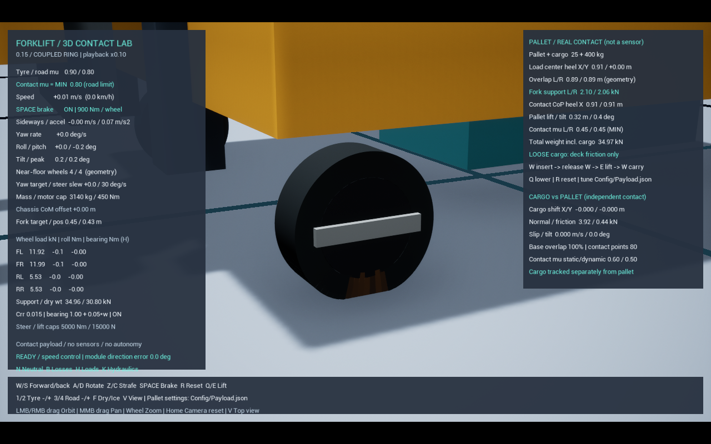
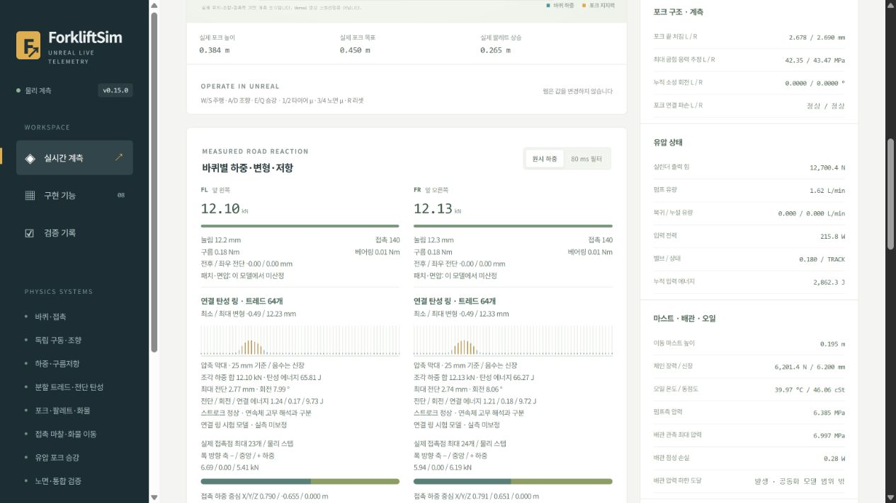

# 0.15.0 — 연결 탄성 링과 적재 한쪽 턱 재시험

**이 문서의 수치 표는 1+2 당시 이력이다.** 후속 3+4에서 기준축·각강성 변환을 수정한 뒤 고정 허브 정적 시험은 960Hz 4/4 통과했다. 적재 턱은 25.476mm로 여전히 미통과다. [현재 결과·에너지 관측·실측 보정 전제](NumericalCalibration.md)를 먼저 참고한다. 아래 과거 128/256/512회 요청은 UE 5.6 내부에서 실제 최대 127회로 제한됐으므로 반복 횟수를 높인 비교로 해석하지 않는다.

사용자가 정한 남은 순서는 **1+2 → 3+4 → 5**다. 이번 묶음은 ① 조각 사이 탄성 연결을 포함하는 타이어 접촉 구조 개선과 ② 기존 적재 노면 시험의 재실행이다. 구현·계측·비교 시험은 수행했지만, 아래 정확도·스트로크 기준을 모두 통과하지 못했다. 새 모델은 선택형 실험 모델로 유지한다.

## 실행

- 기본: `Start.bat` → Unreal Editor + 실제 실시간 웹 → Play. 기존 강체 외피·3축 지지 모델 유지.
- 새 연결 링: `Start.bat -CoupledTread` → Play. 휠당 64조각, 재생 배속 설정 0.1, 최대 내부 간격 1/960초. 현재 PC에서는 실제 진행이 더 느릴 수 있다.
- 이전 독립 반경 조각 비교: `Start.bat -DeformableTread`는 16조각·0.5배속 유지.
- `-TreadSegments 16/32/48/64`, `-PlaybackRate .1`로 비교 가능. 48/64는 연결 링에서만 허용. 별도 시작 배치 파일 없음.

## 물리 모델

각 볼록 트레드 조각은 실제 질량·관성을 가진 Chaos 강체다. 코어–조각 사이에 반경·접선 방향 스프링/댐퍼와 축 주위 회전 탄성을 두고, 이웃 조각끼리는 평면 내 인장/전단·굽힘 스프링/댐퍼로 연결했다. 하나가 눌리면 연결력을 통해 이웃이 움직인다. 도로의 지지력·마찰은 변형된 조각의 실제 충돌 접촉에서 발생한다.

연결 링에서는 기존 휠 전체의 XY 전단 스프링을 꺼서 조각 전단 탄성과 중복하지 않는다. 기존 독립 조각·강체 외피 모드는 유지한다. 미끄럼 속도도 모든 조각에 하나의 평균 접촉점을 대입하던 계산에서 **조각별 실제 접촉점**의 속도로 바꿨다.

반지름 0.15m, 폭 0.10m, 트레드 깊이 0.05m, 코어 44kg + 조각 합계 6kg = 휠당 50kg, 전체 장비 3140kg 유지. 마찰·모터·25mm 반경 스트로크를 시험 통과 목적으로 바꾸지 않았다. 지지력을 별도로 다시 가하거나 차체 속도·자세를 고정하는 보정은 없다.

`K`는 면적당 기초 강성, `C`는 대응 감쇠, `D`는 두께, `w`는 폭, `R`은 외경 반지름, `n`은 분할 수다.

- 코어 반경: `kr = K × (2πR/n) × w`.
- 등가 탄성계수: `E = K × D = 5MPa`, 전단계수 `G = E/[2(1+ν)]`.
- 코어 접선: `kt = kr/[2(1+ν)]`, 코어 회전: `kθ = kr × (2πR/n)²/12`.
- 이웃 간격 `Ls = 2π(R-D/2)/n`, 연결 강성 `G w D/Ls`, 굽힘 강성 `E w D³/(12Ls)`.
- 감쇠는 대응 식에서 K 대신 C를 사용. 모든 강성·감쇠는 양수.

**E=5MPa와 ν=0.49는 이 축약 모델의 설계 가정**이다. 실제 Blickle/Vulkollan 시험에서 확인한 값이 아니다. 공개 부품 치수와 실제 재료 계수를 혼동하지 않는다. 각 조각은 여전히 강체이며 폭 방향 변형·3D 연속 면압·접착 파괴·점탄성 재료법칙은 없다. 고무 FEM 모델이 아니다.

## 검증 결과 (2026-10-27)

최종 DLL로 단위 시험 27/27과 기존 기본 모델의 적재 운반 회귀가 통과했다. 새 모델의 정확도 검증은 일부 실패했다.

| 시험 | 결과 | 판정 |
|---|---|---|
| 이웃 전달: 64조각, 고정 허브, 상단 조각 500N 가압 후 해제 | 이웃 최대 변형 0.60094mm, 입력 일 0.4489206J, 초과 에너지 0J, 최종 에너지 차이 0.0000017J | 해당 기준 통과 |
| 10mm 압입, 회전 위상 0 / 반 조각 | 반력 9163.32 / 8972.91N, 독립 계산 대비 오차 0.567 / 2.381% | 3% 기준 통과 |
| 5mm 압입, 회전 위상 0 / 반 조각 | 반력 3750.73 / 3643.05N, 오차 3.563 / 6.664% | **3% 기준 미통과** |
| 독립 계산의 64→128 공간 분할 | 네 조건의 반력 변화 최대 약 4.14% | 이 비교의 5% 기준 통과 |
| 실제 64조각 시작 회전각 차이 | 10mm 2.078%, 5mm 2.871% | 이 비교의 5% 기준 통과 |
| 425kg 적재, 왼쪽 25mm 턱, 기존 입력·판정 유지 | 이동 9.1207m, 최대 기울기 1.153°, 최대 반경 압축 24.702mm | **스트로크 기준 24.50mm 초과, 전체 미통과** |
| 기존 기본 모델 적재 운반 | 최대 압축 17.366mm, 기울기 0.447° | 통과 |

독립 계산은 `Scripts/tread_ring_reference.py`의 평면 탄성 에너지 최소화와 실제 볼록 조각의 평면 접촉 제약이다. Unreal에 정답 힘을 주입하지 않는다. 원천·설정 파일 해시와 최적화 평형 잔차를 기록한다. 에너지 기울기·접촉 Jacobian·내부 힘/모멘트 평형 검산도 수행했다. 이 계산 자체가 실제 고무의 정답을 뜻하지 않는다. 자동 비교에만 Python + NumPy + SciPy가 필요하다.

`Measure-CoupledResolution.ps1 -RequirePass`는 4조건 중 2조건의 3% 오차 초과 때문에 실제로 실패를 반환한다. 더 세밀한 독립 계산과 가깝더라도 같은 분할의 솔버 오차 실패를 없애지 않는다. 웹의 `resolution_qualified=false` 유지.

수치 진단에서 5mm/위상0의 내부 간격 1/480→1/960초 변경 시 반력이 3750.73→4008.29N으로 달라졌다. 반복 횟수만 128→256으로 늘리면 3750.76N으로 거의 같았다. 시간 간격·접촉 제약 민감도의 원인이 아직 분리되지 않았다. 전체 장비의 유압·구동·마찰을 합친 에너지 폐합도 이번 국부 타이어 시험으로 대체하지 않는다.

### 원본 기록

저장소에 남기는 [실제 결과·설정 해시 요약 JSON](References/CoupledTreadValidation-20261027.json)에도 실패 판정을 포함한다. 단위 시험 27건은 `CoupledTread-Units.log`에서 확인했다.

Git에 포함하지 않는 `Saved/Validation`의 기록:

- `CoupledTread-Units.log`, `CoupledTread-ReleaseBuild.log`.
- `CoupledTread-20261027-010637-910/results.json`, `resolution.json`: 네 정적 조건과 종합 **FAIL**.
- `CoupledTread-FineOracle.jsonl` 및 해시 manifest: 128분할 독립 계산.
- `CoupledTread-20261027-011707-917/results.json`: 이웃 전달·가압 일·해제 에너지.
- `Components-20261027-010709-919/results.json`: 적재 한쪽 턱 **FAIL**.
- `Components-20261027-012409-812/results.json`: 기본 적재 운반 **PASS**.

## 계측과 다음 묶음

웹/CSV에는 각 조각의 반경 눌림·접선 변위·회전각, 실제 반력·위치와 반경/전단/회전/이웃 연결 저장 에너지를 기록한다. 연결 링의 접촉 패치·면압은 산정하지 않으며 웹에도 미산정으로 표시한다. 웹이 하중을 대신 계산하지 않는다.

실제 화면 실행에서 Unreal→웹 277프레임과 종료 이벤트를 검증했다(`ACTUAL_COMPONENT_WEB PASS`). 마지막 양중 높이 0.43802m, 실린더 압력 6.21046MPa, 체인 장력 6059.26N이었다. 연결 링 64조각의 실제 위치·변형·하중 합과 추가 에너지 항목도 검증했다. 적재 한쪽 턱 CSV는 640행 모두 헤더와 같은 1686열이다.

다음 **3+4 묶음**에서는 같은 재료·기하로 내부 시간 간격과 접촉/관절 계산 오차를 분리하고, 전체 장비 에너지 수지와 적재 노면 회귀를 연결한다. 실패 해소 후 공개 사양·실측 가능한 기준과 비교해 물성값을 보정한다. 실측 데이터가 없는 계수는 가정값으로 남긴다.

그다음 **5 묶음**은 장치별 남은 상세화다. 타이어의 폭 방향·재료 거동, 포크/마스트 구조와 유압의 저압·공동화 등은 계산 비용과 확보한 근거에 맞춰 선택한다. 센서·자동화는 추가하지 않는다.
