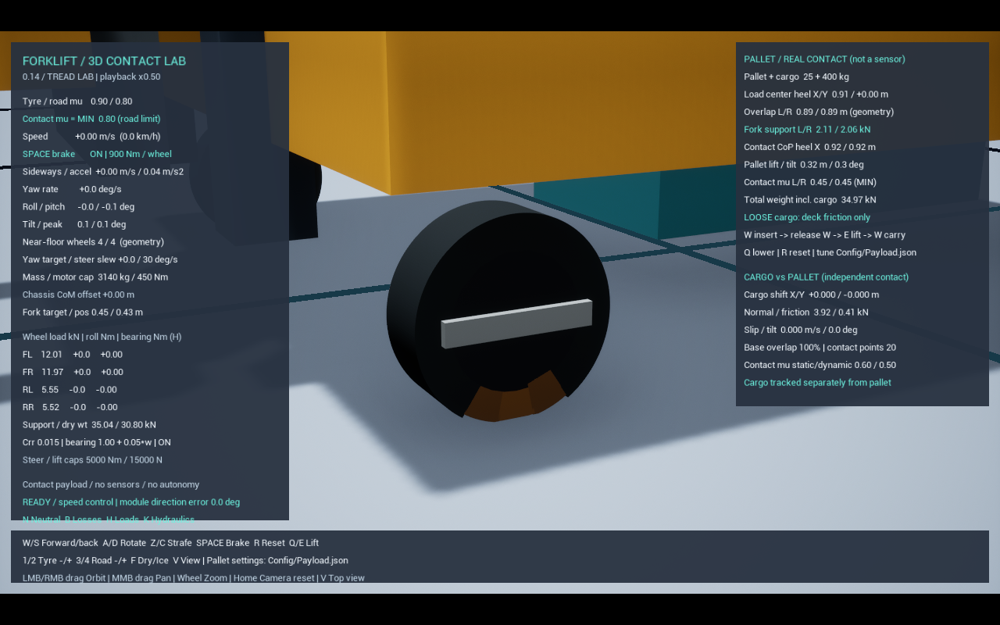
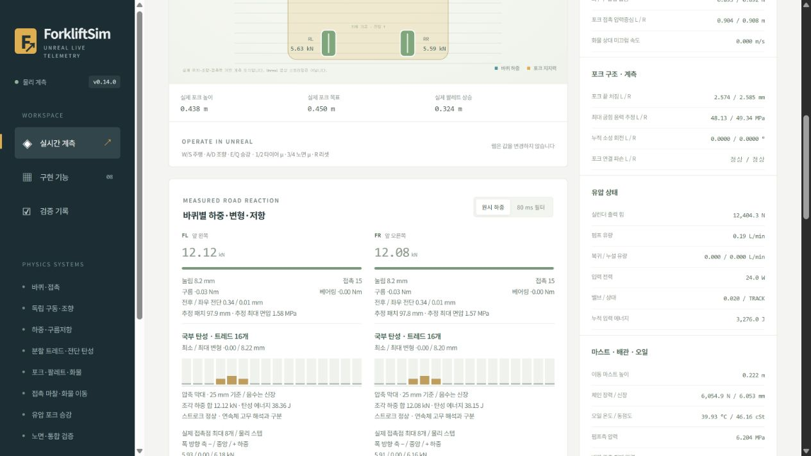

# 분할 트레드의 국부 변형 — 0.14.0

0.15.0의 이웃 조각 연결 링은 별도 선택형 모델이다. [CoupledTread.md](CoupledTread.md)의 구현·미통과 결과를 참고한다. 이 문서는 기존 독립 반경 조각 모델의 기록이다.

0.14.1에서 [분할 수·시작 회전각·연속 극한 비교](TreadResolution.md)를 추가했다. 아래 0.14.0의 솔버 기준 시험 통과는 해상도 수렴 판정이 아니다. 기본 실행은 기존 타이어, 분할 시험 기본값은 16조각·0.5배속 설정을 유지한다. 32조각 비교는 `Start.bat -DeformableTread -TreadSegments 32 -PlaybackRate .25`다. 32조각은 적재 한쪽 턱의 스트로크 기준을 통과하지 못해 기본값으로 승격하지 않았다.

선택형 실험 모드의 타이어 외피를 바퀴당 16개(시험 기본값) 또는 32개(비교 옵션) 동적 트레드 조각으로 나눴다. 각 조각은 별도 질량·관성·볼록 충돌 형상과 반경 방향 스프링·댐퍼를 갖는다. 변형된 조각의 실제 위치에서 Chaos가 노면 접촉·마찰을 계산한다. 4륜 독립 구동·조향은 유지한다.
**해상도에 따른 차이가 아직 크다.** 고정 휠을 10 mm 압입했을 때 16조각 반력 약 15.55 kN, 32조각 약 10.99 kN으로 약 29.3% 차이가 났다. 각 분할 모델의 독립 식과 솔버가 약 0.8~1.2% 오차로 맞는다는 결과는 실제 타이어 정확도나 해상도 수렴을 의미하지 않는다. 현재는 16조각 설계 프로필을 고정해 사용하며, 분할 오차·실차 물성 보정은 후속 우선 과제다.

## 힘 전달과 중복 방지


기존 단일 수직 스프링은 새 모드에서 끄고 그 방향의 지지 관절을 잠근다. 기존 전후·좌우 전단 관절은 유지한다. 조각의 축·접선 방향 이동과 코어에 대한 회전은 구속한다. 모터·브레이크는 코어에 작용하며 트레드 관절을 거쳐 접지부에 전달된다. 노면 힘을 AddForce로 다시 가하거나 속도를 강제로 맞추지 않는다.

동일 휠 내부의 코어–트레드 및 트레드–트레드 충돌만 제외한다. 다른 바퀴·차체·포크·팔레트·노면과의 충돌은 유지한다. 분할 외피를 다시 원래 원통으로 투영하면 변형이 지워지므로, 0.13.1의 매끄러운 원통/모서리 보정은 새 모드에서 적용하지 않는다.

## 설정과 단위

`Config/Tyres.json`의 `tread_enabled=false`로 기존 타이어를 기본으로 유지한다. 새 모델은 같은 파일을 `Start.bat -DeformableTread`로 실행하고 Play를 누른다. 현재 PC의 계산 부하를 고려해 명시적인 0.5배속 재생을 기본으로 설정하며 HUD·웹에 표시한다. 실제 진행 속도는 부하에 따라 더 느려질 수 있다. `-PlaybackRate 1`은 원래 재생 속도 설정이다. 재생 배속은 시간 간격을 조절하며 질량·마찰·중력·모터 사양을 줄이지 않는다. T로 노면 전환, E/Q로 양중·하강, W/A/S/D로 운반, J는 타이어 HUD다. 트레드 색은 실제 접촉 하중에 따라 바뀐다.

| 설정 | 기본값 | 의미 |
|---|---:|---|
| `tread_segments` | 16 | 휠당 조각 수, 8~32 중 4의 배수. 비교·회귀는 16/32를 사용 |
| `tread_depth_m` | 0.05 m | 외피 깊이, 코어 충돌 반지름은 0.10 m |
| `tread_travel_m` | 0.025 m | 반경 방향 상대 이동 한계 |
| `tread_mass_kg` | 6 kg | 한 휠의 전체 트레드 질량 |
| `tread_foundation_n_per_m3` | 100,000,000 N/m³ | 기준 면적당 반경 강성 |
| `tread_foundation_damping_ns_per_m3` | 200,000 N·s/m³ | 기준 면적당 감쇠 |

각 조각의 기준 면적 `Ai=2πRw/n`, 강성 `ki=KA Ai`, 감쇠 `ci=CA Ai`다. 반지름 0.15 m·폭 0.10 m·16조각에서 `ki≈589,049 N/m`, `ci≈1,178 N·s/m`다. 32조각에서는 각각 절반이다. 면적 비례는 조각 수만 늘려 재료 강성이 단순히 배로 늘어나는 문제를 막는다. 유한한 강체 조각의 넓이에 따른 이산화 오차까지 없애는 것은 아니다.

바퀴 한 개의 50 kg을 코어 44 kg + 트레드 합계 6 kg으로 나눈다. 장비 총질량 3,140 kg을 유지하고 실제 조각의 질량·관성·위치도 무게중심과 에너지 합에 포함한다. 이 배분·외피 깊이·강성·감쇠는 **설계 가정값**이다. Blickle의 공개 외경·폭·재질을 참고하지만, 실제 해당 휠의 내부 구조·질량 배분·강성으로 확인된 값은 아니다. Shore 경도를 이 값으로 환산하지 않았다.

## 웹과 CSV

Unreal의 `wheels[].tread`에서 조각별 압축/신장, 변형 속도, 실제 접촉 반력, 실제 세계 위치, 탄성 에너지, 스트로크 상태를 전송한다. 브라우저는 이 값을 표시한다. 막대는 25 mm 스트로크에 대한 양의 압축량이며 조각별 툴팁에 실제 하중·음수 신장이 표시된다. 새 센서나 브라우저 물리 계산은 없다.

- `compression_m`는 새 모드에서 휠의 최대 조각 압축량이다. 과거 모드의 코어–벨트 단일 수직 변위와 정의가 다르다.
- `radial_vertical_estimate_n`/CSV `tread_radial_vertical_n`은 반경 스프링 힘의 수직 성분 추정 합이다. 접선 구속 반력도 수직 성분을 가질 수 있으므로, 이 값을 총 접지 반력이나 전체 축 지지력으로 해석하면 안 된다. 실제 총 접지 반력은 기존 `normal_n`, 조각별 접촉 반력은 `pads[].normal_n`이다.
- 탄성 에너지는 조각별 `Σ(ki δi²/2)`이며 전체 기계 에너지에도 포함한다. 감쇠 손실은 실제 내부 스텝의 관절 상대 변위를 통해 적분한다.
- `aggregate_radial_spring=false`로 중복 수직 스프링이 꺼졌는지 확인한다.
- `Saved/Telemetry/Stability-*.csv`에는 모든 조각의 변형·속도·하중을 개별 열로 기록한다.
- 기존 `estimated_patch_length_m`와 `estimated_peak_pressure_pa`는 계속 기하 추정치다. 조각별 접촉점 하중을 면적에 나눠 실측 면압이라고 부르지 않는다.

## 독립 검증

`Scripts/Test-TreadReference.ps1`은 고정 코어·마찰 0·수평 바닥에서 주어진 휠 높이의 반력을 별도 식과 비교한다. 시작 시 관통을 해소하는 구간은 에너지 시험에서 제외한다. 안정된 다음 공중 조각 하나에 0.5 N·s 충격량을 가하고, 알려진 입력 에너지 이후 증가와 잔류 에너지를 확인한다. 코어를 고정한 경계조건 시험이며 실제 차량 안전 정격 시험은 아니다.

고정 코어 기준식은 조각 중심의 아래 방향 코사인을 `q=cosθ`, 반각을 `a=π/n`, 바닥에 가장 가까운 외피 높이를 `R cos(max(|θ|−a,0))`로 계산한다. 겹침이 양수인 조각의 반력은 `ki × 겹침 / q² + 조각 질량 × g`다. 반경만 움직일 수 있어 접선 구속 반력도 생기므로 `ki δi q`를 바닥 반력으로 잘못 합하지 않는다. 실제 볼록 형상의 곡면 분할·접촉 솔버·유한 시간 간격 오차는 비교 결과에 남는다.

```powershell
./Scripts/Test-TreadReference.ps1 -Fps 30,60 -Counts 16,32 -Heights .14
./Scripts/Test-Components.ps1 -Cases tread_soft,tread_stiff,tread_coast,carry,lower,step,halfstep,ramp_brake -Fps 60 -TreadMode deformable -TreadQuality high
# 과거 외피와 비교할 때는 같은 일반 운반/노면 케이스를 사용
./Scripts/Test-Components.ps1 -Cases carry,step,halfstep -TreadMode rigid
```

동결 V1 수치 검증은 `-ReferencePhysics`로 기존 단일 수직 스프링·강체 외피를 유지한다. 새 모델의 정량 결과와 과거 시험 결과를 섞어 실차 보정 완료라고 주장하지 않는다.

## 실행 품질과 브레이크

실제 사용할 설정은 기존 480 Hz 최대 내부 스텝·위치 반복 128회·속도 반복 32회를 유지한다. 과거 강체 외피/동결 V1도 같다. `Test-Components.ps1`의 기본 `-TreadQuality high`가 이 설정이다. `balanced`는 실패한 96/16회 후보를 재현할 때만 사용하는 시험 옵션이다. 실제 내부 스텝은 로그와 웹의 `physics_max_inner_s`로 확인한다.

원래 렌더 실행에서는 32개 최대 서브스텝 한도 때문에 게임 시간보다 물리 시간이 늦게 진행되는 현상이 관측됐다. 240 Hz·64/16회 시도는 반력 오차 약 32%와 유압/체인 거동 실패로 폐기했다. 480 Hz·64/16회도 독립 반력 오차 약 5.54%로 기준을 넘었다. 480 Hz·96/16회는 독립 반력 오차 약 2.23%로 3% 기준을 통과했지만 차량 무동력 에너지 증가가 약 3.41 J로 정한 1% 기준을 넘어 최종 설정에서 제외했다. 물성값과 허용 오차를 바꿔 실패를 통과시키지 않았다. 대신 새 모델을 선택형·명시적 저속 재생으로 제공한다.

같은 휠 내부 충돌을 접촉 계산 뒤에 끄는 대신 네 개의 전용 물리 채널로 충돌 검사 전에 거른다. 휠마다 다른 채널을 사용하고 다른 세 휠·차체·화물과는 충돌을 유지한다. 이 최적화와 반복 수 조정 후 별도의 적재·제동·에너지 회귀를 요구한다. 실제 프레임 속도는 PC·뷰포트·에디터 부하에 따라 다르며, 웹의 `physics_elapsed_s`, `physics_max_inner_s`, `game_max_frame_s`로 실제 누적 물리 시간과 한도를 구분한다.

분할 관절을 추가한 뒤 속도 구동만 쓰는 브레이크에서 경사 밀림 약 51 mm가 발견됐다. 새 모드는 결합 순간의 상대 각도를 포착하고 유한 강성 100,000 Nm/rad·감쇠 3,000 Nm·s/rad의 프리슬립 탄성과 소성 기준각 갱신을 사용한다. 이 계수 역시 설계 가정이다. 실제 관절의 토크 한도는 기존 900 Nm/휠이며 위치를 월드에 고정하지 않는다. 과거 비교 모드는 기존 속도 제동을 유지한다.

브레이크 탄성 에너지는 전체 기계 에너지에 포함한다. `brake_plastic_work_j`는 기준각 반환 사상으로 추정한 소성 일이며 실제 측정 제동열로 해석하지 않는다. 마찰을 0.02로 낮춘 경사 시험에서 실제 하향 미끄럼이 발생하는지 별도로 확인한다. 기존 구름저항 계수는 추가 손실 가정이며, 실측 보정할 때 트레드 감쇠가 이미 만드는 손실과 함께 보정해야 한다.

## 범위와 남은 부분

실제로 변형되는 다물체 축약 모델이며 연속체 고무 FEM은 아니다. 각 조각 자체는 강체이고 조각 사이의 고무 전단·굽힘 결합, 폭 방향의 독립 변형, Poisson 효과, 점탄성 히스테리시스·발열·마모, 연속 면압 분포와 실측 보정은 남아 있다. 전체 차량의 모든 마찰·구속 손실까지 닫은 에너지 수지 검증과 충격 피크의 수렴도 별도로 다룬다.

모델 분류 참고: [Project Chrono 공식 타이어 모델 문서](https://api.chrono.projectchrono.org/wheeled_tire.html)는 강체·주행용 힘 모델·FEA 모델을 구분한다. 이번 구현은 그 라이브러리를 이식하거나 공식 모델을 재현한 것이 아니라, Unreal의 실제 접촉·관절로 만든 자체 분할 모델이다. 타이어 실측 물성은 새로 확보하지 않았다.

## 최종 실행 기록 — 2026-10-26

DLL SHA-256: `EDC43EB1CEF0CDE77717C074F6B369FF1B5849C5915B68324A579901266CA877`.

- `Saved/Validation/TreadReference-20261026-045420-470/results.json`: 30/60 FPS × 16/32조각의 고정 코어 시험 4/4 통과. 16조각 반력 15,548.16 N / 기준 15,725.69 N(1.129%), 32조각 10,994.41 N / 기준 11,079.42 N(0.767%). 공중 조각 충격 입력 0.3333/0.6667 J 이후 추가 에너지 증가와 최종 잔류량은 출력 정밀도에서 0 J다.
- `Saved/Validation/Tread-ProductionUnits.log`: 자동화 시험 25/25 성공. 독립 식·단위 검증을 실제 차량 회귀와 구분한다.
- `Saved/Validation/Components-20261026-045408-324/results.json`: 30 FPS 적재 경사 제동·저마찰 경사 미끄럼·전체 턱 3/3 통과. 건조 노면 28.867초 제동 유지 중 최대 밀림 5.464 mm. 같은 제동 한도에서 노면 마찰 0.02로 바꾸면 최종 X=-4.0233 m까지 실제로 미끄러진다.
- `Saved/Validation/Components-20261026-045906-635/results.json`: 60 FPS 연한/단단한 타이어·무동력 주행·적재 선회 운반·한쪽 턱·하강 6/6 통과. 같은 425 kg 적재에서 강성 0.5배의 평균 최대 조각 눌림 10.8843 mm, 강성 2배에서는 4.2989 mm. 20초 이후 12.0167초 구간을 평균했다. 연한 설정은 초기 낙하·안착 과정에서 스트로크 한계에 닿을 수 있으므로, 정상 구간 통과를 전 구간 스트로크 미도달로 해석하지 않는다. 무동력 시험은 시작 속도 0.356532 m/s, 이후 에너지 변화 -233.803737 J, 관측 구간 최대 추가 증가 0 J로 통과했다. 이 값은 무동력 구간 검사이며 모든 동력·손실 항의 에너지 수지가 닫혔다는 뜻이 아니다.
- `Saved/Validation/Components-20261026-050023-751/results.json`: 기본으로 유지한 기존 강체 외피의 60 FPS 적재 운반 회귀 1/1 통과.
- `Saved/Validation/ComponentWeb-1792958074130/result.json`: 실제 Unreal에서 받은 360개 프레임 검증 통과. 장비 3,140 kg, 포크 높이 0.4377 m, 실린더 압력 약 6.208 MPa, 조각별 반력 합·실제 위치와 변형량의 일치 확인. 분할 타이어 CSV는 574열이다.
- `Saved/Validation/Tread-VisualSlowVerified.log`: 명시적 0.50배속 렌더 실행. 최종 웹 값의 월드 시간 10.9879초, 실제 누적 물리 시간 10.8448초, 최대 내부 간격 1/480초. 누적 차이 약 0.1431초를 숨기지 않고 표시한다. 이 한 실행 결과로 모든 PC와 장면에서 실시간 성능을 보장하지 않는다.




