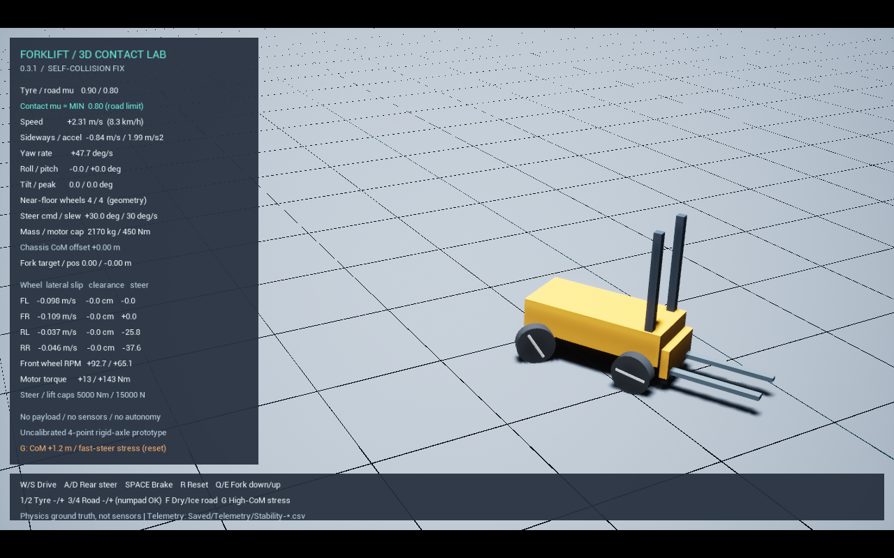
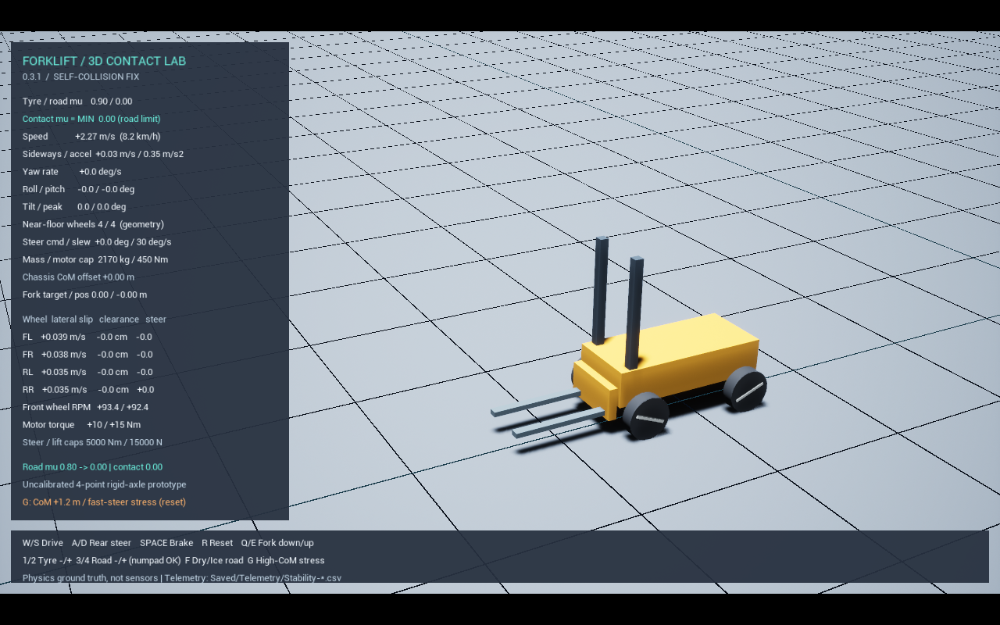

# 0.3.1 추진 선회·마찰 변경 수정 검증

2026-10-21 / Unreal Engine 5.6.1 / Chaos / Windows.
설정은 기존 `Config/Vehicle3D.json` 그대로이며 앞바퀴당 최대 구동 토크는 **450 Nm**입니다.
질량 2,170 kg, 기본 타이어/노면 마찰 0.9/0.8, 기준 조향각 30°를 유지했습니다.

## 문제와 원인

W+D를 계속 눌러도 멈추는 현상을 같은 입력으로 재현했습니다.
뒷바퀴가 조향하면서 휠하우스가 없는 상자형 차체 충돌체에 들어가 타이어–차체 충돌을
일으켰습니다. 앞서 제외했던 충돌은 차체–너클, 너클–타이어뿐이었고 차체–타이어 쌍이 빠져 있었습니다.

타이어의 바닥 마찰을 바꿔도 차체와 끼이는 충돌은 남아 있었습니다. 따라서 노면 마찰을
낮추거나 모터 토크를 키우는 것으로 원인을 해결할 수 없었습니다.

같은 기존 타이어 충돌 형상에서 차체–타이어 충돌 예외만 비교한 대조 시험:

| 조건 | 12초의 전진 속도 | 관측 |
|---|---:|---|
| 내부 충돌 허용 | 약 0.000 m/s | 뒤 타이어–차체 충돌 이벤트 발생, 조향각 약 17~19°에서 끼임 |
| 같은 차량의 차체–타이어 충돌 제외 | 1.9608 m/s | 계속 선회, 내부 충돌 이벤트 0 |

대조 로그는 `Saved/Logs/Powered-Before-SelfCollision.log`와 같은 빌드의
`Stability-powered_turn-60.log` 시험에서 확인했습니다. 후자는 이후 최종 시험 값으로 갱신됩니다.
재현용 옵션 `-EnableChassisTyreCollision -StockTyreCollision`은 의도적으로 수정 전 충돌 조건을 켭니다.
일반 실행에서는 사용하지 않습니다.

현재는 모든 자유도가 열린 관절로 같은 차체와 타이어 쌍의 충돌만 제외합니다. 이 관절에는
위치·자세 제한과 구동력이 없습니다. 바닥·외부 물체와의 충돌은 유지합니다.
차체의 실제 휠하우스 형상은 아직 모델링하지 않았으며, 현재 상자 형상에 대한 조립체 충돌 필터입니다.

## 타이어 구름 형상

엔진 실린더의 기존 충돌은 둘레 32각형이었습니다. 각진 면을 넘어가는 효과가 저속 구름과
저마찰 주행에 영향을 주므로, 0.3.1은 컴포넌트별 128각형 원통 볼록 충돌체를 사용합니다.
반지름·폭·질량은 같은 설정을 사용하고 관성은 해당 형상으로 계산합니다. 렌더링은 기존 실린더이며,
엔진 원본 에셋은 변경하지 않았습니다. 타이어 탄성이나 실측 구름저항 모델은 아닙니다.

## 지속 추진 선회 결과

2초 정지 → W 유지 → 4초부터 D 또는 A 유지 → 12초까지 같은 입력입니다.
기존 급조향 시험과 달리 선회 중에도 구동 토크를 계속 적용합니다.

| 시험 | 최종 전진 속도 (60 FPS) | 뒷바퀴–차체 충돌 |
|---|---:|---:|
| W+D, 기본 접촉 μ=0.8 | 2.3300 m/s | 0 / 0 |
| W+A, 기본 접촉 μ=0.8 | 2.0805 m/s | 0 / 0 |
| W+D, 노면 μ=0.08 | 1.8267 m/s | 0 / 0 |

낮은 마찰의 추진 선회에서는 앞바퀴 종슬립 약 0.469 m/s가 남아, 구동 바퀴가 차체 진행보다
더 빠르게 도는 상태를 확인했습니다. 기본 노면 W+D의 같은 최종 값은 약 0.039 m/s였습니다.

| 최종 전진 속도 | 20 FPS | 30 FPS | 60 FPS | 120 FPS |
|---|---:|---:|---:|---:|
| W+D | 2.2981 | 2.3159 | 2.3300 | 2.3491 |
| W+A | 2.0369 | 2.0816 | 2.0805 | 2.1655 |

단위는 m/s입니다. 네 갱신 주기에서 멈춤 없이 선회했습니다. 수치가 완전히 같은 것은 아니며
시간 간격 수렴·좌우 대칭·실차 보정은 추가 검증이 필요합니다.
최종 속도뿐 아니라 완전 조향 구간(6~12초)의 최저 속도 >0.5 m/s도 회귀 조건으로 검사합니다.
정지 상태에서 W+D를 함께 시작하는 `powered_turn_start`도 별도 시험에 포함합니다.
이 정지 출발 시험은 60 FPS에서 최종 2.3281 m/s·완전 조향 구간 최저 2.0081 m/s,
20 FPS에서 최종 2.3094 m/s로 PASS였습니다.



## 실행 중 마찰 변경과 키 검사

`friction_live`: W를 유지하며 노면 μ를 **0.8 → 0(6초) → 0.8(9초)**로 바꿉니다.
차량을 재생성하거나 속도를 강제로 지정하지 않습니다.
60 FPS에서 해제 구간 앞바퀴 종슬립 최대 약 **0.744 m/s**, 복원 후 최종 종슬립 약
**0.025 m/s**, 최종 전진 속도 약 **2.643 m/s**였습니다. 타이어와 노면의 물리 재질 읽기값도 설정과 일치했습니다.



`friction_keys`는 실제 키 바인딩의 콜백을 실행해 윗줄 One/Two/Three/Four,
NumPadOne/NumPadTwo/NumPadThree/NumPadFour 모두 ±0.1 변경과 물리 재질 반영을 확인했습니다.
F의 0.8/0.08 전환도 검사했습니다. 운영체제나 키보드 하드웨어 입력을 흉내 낸 검사는 아닙니다.

화면에는 변경 전/후 값, 실제 최소 마찰, 한계를 정하는 재질을 표시합니다.
누르고 있을 때 반복 변경을 지원하고 F로 일반/저마찰 노면을 빠르게 비교할 수 있습니다.
μ는 접지 한계이므로 값이 조금 바뀔 때마다 직진 속도가 반드시 달라지는 것은 아닙니다.

## 재현

```powershell
powershell -NoProfile -ExecutionPolicy Bypass -File .\Scripts\Build.ps1
# 기존 시험과 새 추진/마찰 시험 전체:
powershell -NoProfile -ExecutionPolicy Bypass -File .\Scripts\Test-Stability.ps1 -Fps 60
# 추진 선회를 화면에서 재생 (12초 후 종료):
powershell -NoProfile -ExecutionPolicy Bypass -File .\Scripts\Run.ps1 -Stability -Scenario powered_turn
```

로그: `Saved/Logs/Stability-<scenario>-<fps>.log`의 `STABILITY_TEST ... PASS`,
`DRIVE_CHECK`, `POWERED_MIN_SPEED`, `FRICTION_KEY` 항목입니다.
CSV에는 입력, 바퀴별 토크·각속도·종/횡슬립, 실제 조향각, 내부 충돌 횟수도 저장합니다.
일반 수동 실행은 `Start-StabilityLab.bat`이며 화면 상단 버전은 `0.3.1`입니다.

기본 정지·직진·공회전·제동·승강·급조향·저마찰 두 종류·전복 시험도 수정 후 60 FPS에서
PASS입니다. 기존 0.3.0의 수치는 [StabilityValidation.md](StabilityValidation.md)에 역사 기록으로 남겼습니다.
이번 검증 범위는 60 FPS의 15개 시나리오, 20 FPS의 추진 선회 3개, 30 FPS의 추진 선회 2개,
120 FPS의 추진 선회·마찰 4개로 총 24개 시나리오/갱신 주기 조합입니다.
기존 승강·평면 바퀴 모델 자동 검사 9개도 `RegressionModels-031.log`에서 PASS였습니다.
