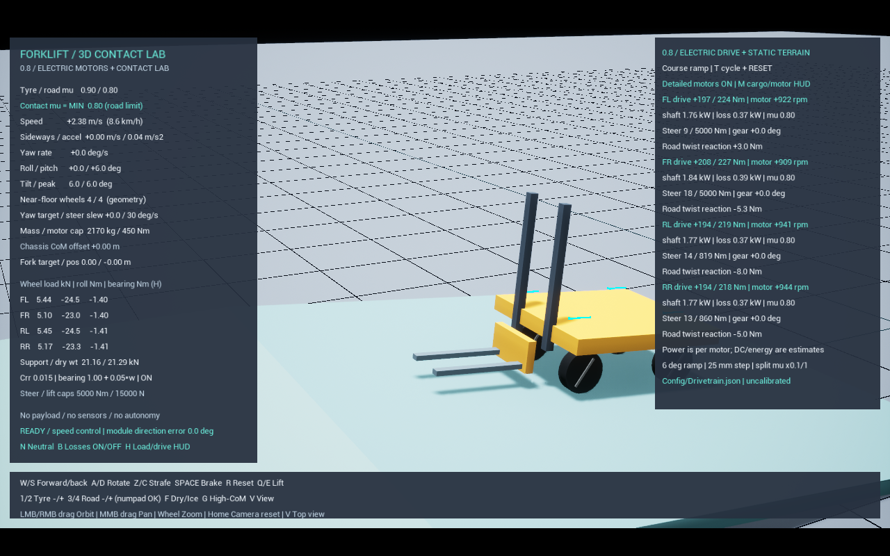

# 0.8 / 전동 구동·조향 모터와 노면 시험

물리 작업 묶음 B의 0.8 구현·측정 기록이다. 0.9부터는 [타이어 수직 탄성 근사](TyreCompliance.md)가 기본 적용된다. 아래 0.8 수치를 새 모델의 측정값으로 해석하지 않는다. 현재는 실물 모터를 선정한 것이 아니라 **사양을 교체할 수 있는 시스템 수준 모델**이다. 전기 권선·인버터·배터리·열 해석이나 제조사 성능 보정은 포함하지 않는다. 센서·자동 운반도 아직 추가하지 않는다.

## 실행과 조작

`Start.bat -Mode terrain` → Play로 경사로 시험장을 연다. Shift+F1 / F8로 에디터 검사에 전환한다. 기존 적재 시험장에도 새 모터 모델이 적용된다.

현재 노면 시험장은 **무적재 전용**이고, 기존 적재 시험장은 평지로 유지한다. 팔레트가 경사로 내부에 겹쳐 생성되는 것을 막기 위해 Payload+Terrain 조합은 실행하지 않으며, 적재 시험장의 T는 전용 실행기 안내를 표시한다. 적재 상태 등판·하역 검증은 초기 적재 배치와 시험 조건을 별도로 설계해야 한다.

- W/S 전후, A/D 회전, Z/C 횡이동, Space 기계식 제동, N 중립.
- T: 평지 → 경사로 → 턱 → 좌우 분할 마찰 → 평지. **장비·화물·기록을 초기화**한다.
- M: 오른쪽 모터 HUD ↔ 기존 적재 HUD. H는 왼쪽 바퀴 하중/구동 표 전환.
- 1/2 타이어 계수, 3/4 기준 노면 계수. 분할 노면은 왼쪽 계수가 기준값의 0.1배다.
- 기본 모터 모델 비교를 끄려면 `Scripts/Run.ps1 -Stability -Terrain ramp -IdealActuators`. 비교 모드에서는 과거의 즉시 토크·조향 관절을 사용한다. 실제 장비의 이상적인 성능이라는 의미는 아니다.

설정 파일을 변경한 뒤 프로그램을 다시 실행한다. R/T는 파일을 다시 읽지 않는다.

## 모터·감속기 모델

바퀴마다 구동 모터와 조향 모터 사양을 별도로 둔다. `Config/Drivetrain.json`의 drive_/steer_ 접두사가 각각 해당한다. 값은 바퀴 한 개당 사양이다.

| 변수 | 구동 / 조향 기본값 | 의미 |
|---|---:|---|
| motor_peak_nm | 45 / 60 Nm | 모터 축 최대 토크 |
| motor_power_w | 2000 / 800 W | 모터 축 기계 출력 한계. 전기 입력 한계가 아님 |
| motor_max_rpm | 1800 / 1800 rpm | 마지막 10% 구간에서 구동 토크가 0으로 줄어드는 최대 회전수 |
| gear_ratio | 12 / 100 | 모터 회전수 ÷ 출력축 회전수 |
| gear_efficiency | 0.90 / 0.85 | 감속기 기계 효율 |
| motor_efficiency | 0.90 / 0.85 | 구동 모터 전력 추정에 쓰는 정효율. 조향 전력은 현재 따로 추정하지 않음 |
| response_s | 0.04 / 0.03 s | 구동 토크 / 조향 명령의 1차 지연 시정수 |
| rotor_inertia_kg_m2 | 0.0004 / 0.0002 | 입력축 회전자 관성. G²을 곱해 바퀴 축 / 너클 조향 축에 추가 |
| steer_backlash_deg | 0.2 deg | 조향 출력축의 전체 유격 폭. ±0.1도 범위에서 기존 기어 출력 유지 |

저속 토크 한계와 고속 출력 한계를 `Tmax = min(Tpeak, Pmax / abs(omega_motor))`로 결합한다. 구동 출력 토크는 모터 토크×감속비×감속기 효율이며, `Vehicle3D.json`의 기존 450 Nm 바퀴 토크 상한도 동시에 지킨다. 조향도 기존 5000 Nm 상한과 모터의 회전수·출력 한계를 함께 적용한다. 회전수 제한은 양의 동력 전달을 줄일 뿐 강제로 바퀴 속도를 고정하지 않는다.

구동은 토크 반작용을 차체에 적용하며, 회전자의 환산 관성은 기존 강체 관성에 추가한다. 별도의 독립 회전자·탄성 축·비틀림 기어 모델은 아니다. 기본 추가 관성은 구동 축 0.0576 kg·m², 조향 축 2 kg·m²다. 조향은 기존 힘 제한 관절의 위치 서보를 유지하고 지연·유격·가용 토크 한계를 추가했다. 실제 조향 각도와 조향 관절 토크 추정치를 별도로 기록한다.

유격은 명령 전달의 play 연산자다. 기어가 벌어진 동안 두 축이 독립 회전하다가 치면이 충돌하는 상세 기어 접촉 해석은 아니다. 환산 관성은 계속 결합된 근사이며, 치합 충격·축 탄성까지 구현했다고 해석하면 안 된다.

타이어–바닥 접촉점의 접선 충격량으로 조향 축에 대한 노면 반력 모멘트를 측정한다. 접촉 해석에 이미 존재하는 비틀림 저항을 보려고 같은 저항 토크를 다시 더하지 않는다. 타이어의 유한 접촉 패치와 고무 변형을 검증한 것은 아니며 이는 C1의 후속 범위다.

조향 관절 토크도 물리 스레드에서 매 내부 스텝의 각충격량을 합산하고 계측 시간으로 나눈다. UE 5.6의 `JointConstraintProxy`가 마지막 스텝의 각충격량을 `GetConstraintForce`의 Torque 필드로 전달하는 구현을 확인했으므로, 그 값을 그대로 Nm로 표시하지 않는다. 조향 축 성분의 프레임 평균 반력 추정치이며 모터 전류 센서값이 아니다.

속도 제어기가 음의 토크를 요구할 때는 회생 방향의 효율을 적용한다. 바퀴 출력은 모터 축 입력에 단순히 같은 효율을 양방향으로 곱하지 않는다. 중립·Space 제동 시 구동 토크와 지연 상태를 즉시 해제한다. Space의 기계 브레이크 900 Nm는 모터 출력 제한과 별개이며, 조향은 유지한다.

`dc_estimate_w`와 에너지 누적치는 구동 모터의 정효율 기반 추정이다. 정지 토크를 유지할 때의 동손, 인버터 대기전력, 실제 배터리 회생 허용 한계는 포함하지 않는다. 이를 배터리 소비 전력의 정답값으로 쓰면 안 된다.

## 노면과 접촉 계측

| 조건 | 형상 / 마찰 |
|---|---|
| flat | 기존 높이 0의 평지 |
| ramp | X=3~11 m에서 6도 상승, 이후 높은 평면. 상단 높이 약 0.841 m |
| step | X=4 m부터 높이 25 mm인 수직 턱. 현 단계는 강체 타이어의 통과 시험 |
| split | 높이 차이 없는 두 평면. Y<0 왼쪽 mu=0.08, 오른쪽 mu=0.8 (기준 0.8일 때) |

분할 노면은 원래 바닥 충돌을 끄고 두 평면으로 대체한다. 중첩된 같은 높이 바닥에서 마찰을 임의로 선택하지 않는다. 바퀴 하중 샘플러는 원래 바닥과 시험장 표면 전체의 접촉을 합산한다. 접촉 마찰계수는 활성 접촉의 수직 충격량 가중 평균이다. 무접촉에서는 0이다.

바퀴의 바닥 여유·접촉 속도는 아래쪽 정적 노면 조회의 법선과 높이를 사용한다. 이 조회는 물리 엔진 내부 진단용이며 LiDAR·거리 센서가 아니다. 턱의 수직 면 접촉은 별도의 실제 충돌 반력에도 포함되므로 턱에서의 순간 normal_sum을 수직 지지력 합으로 해석하면 안 된다. 경사면의 수직하중도 월드 Z 성분이 아닌 접촉 법선 방향이다.

## 시험

`Scripts/Test-Drivetrain.ps1 -Fps 60` 또는 `-Fps 30`. 단일 사례는 `-Cases ramp,ramp_weak`처럼 지정한다.

- flat / flat_weak: 2 kW와 400 W 모터의 동일 3 m/s 명령에서 이동 거리 비교.
- ramp / ramp_weak: 같은 경사로에서 출력별 실제 등판 속도 비교.
- step: 턱 통과 후 접지 유지, 실제 표면 하중 계측 확인.
- split / uniform: 동일 명령에서 실제 접촉 계수와 바퀴 미끄럼 비교. 방향 유지 피드백은 켜진 상태다.
- steer: 좌·우 제자리 회전 전환에서 조향 지연·관절 토크·노면 반력 모멘트 확인.
- reset: 주행 중 경사 → 분할 노면 → 평지로 변경하며 물리 액터·계측을 재생성. 원래 바닥 충돌의 해제·복구를 확인.

각 사례는 실제 구동으로 출발하며 차체 위치/속도를 강제로 옮기지 않는다. 모든 틱에서 구동 모터 축 토크·출력·바퀴 안전 토크 상한을 검사한다. 순항 명령과 모터 능력은 별개이며 등판 중 명령 속도에 도달하지 못할 수 있다.

모터 명령은 게임 틱에서 현재 회전수로 계산하고 Chaos 내부 스텝에서 통합한다. 매 내부 스텝에서 인버터를 해석하는 모델은 아니며, 충돌 중 순간 회전수 변화까지 연속 시간 출력 한계를 보증하지 않는다. 그래서 30/60 FPS의 성능·시간 간격 회귀를 구분해서 확인한다.

## 0.8 측정 결과 (2026-10-24)

무적재 질량 2170 kg, 순항 명령 3 m/s, 60 FPS, 구동 모터 한 개당 사양을 비교했다.

| 비교 | 모터 2 kW | 모터 400 W |
|---|---:|---:|
| 평지 시험 종료까지 이동 거리 | 36.142 m | 27.323 m |
| 평지 종료 속도 | 2.903 m/s | 2.582 m/s |
| 6도 경사 진입~상단 전 평균 등판 속도 | 2.398 m/s | 0.653 m/s |
| 모터 축 기계 출력 최대값 | 2000 W | 400 W |

등판 속도 평균의 표본 시간은 각각 3.067초 / 10.967초다. 같은 경사에서 더 약한 모터가 오래 머무르는 결과이며 같은 길이의 시간 창 평균은 아니다. 경사 진입 순간부터 차체 기울기가 2도 이상이고 중심 X가 10 m 미만인 구간을 사용한다.

경사 안정 구간(X=4~9.5 m, pitch>4도)의 바퀴 법선 하중 합 평균은 21.147 kN, 이론 mg*cos(6도)는 21.171 kN으로 약 0.12% 차이다. 25 mm 턱에서는 순간적으로 바퀴 접지가 2개까지 줄었다가 통과 후 4개로 복귀했다. 타이어 변형 모델을 완료했다는 의미는 아니다.

좌우 분할 노면의 실측 접촉 계수는 왼쪽 0.080 / 오른쪽 0.800이었다. 왼쪽 바퀴 최대 종방향 미끄럼 속도는 분할 0.639 m/s / 균일 노면 0.330 m/s로 차이가 났다. 방향 유지 제어가 켜져 있으므로 조향이 완전히 열린 상태의 자연 편향 시험은 아니다.

조향 전환 사례는 관절 반력 최대 약 420 Nm, 노면 비틀림 반력 최대 약 411 Nm, 조향 기어 출력과 명령 간 최대 지연 약 0.77도였다. 측정 피크는 같은 시각·같은 바퀴라고 가정하면 안 된다.

새 모터 적용 후 비고정 화물 제동 저마찰 사례는 약 0.476 m 이동하고, 전륜 비율이 76.20% → 80.61%로 증가했다. 0.7의 0.370 m 기록을 새 모델에서도 그대로 재현한다고 주장하지 않는다. 전도 스트레스의 원시 마찰비 최대값은 1.309로, 충격 마찰 정량 정확도의 기존 미보정 한계도 남아 있다.

30 FPS 등판 평균은 2 kW 2.402 m/s / 400 W 0.650 m/s로 성능 차이가 유지됐다. 모터·노면 사례 9개는 각각 30/60 FPS에서 모두 통과했다. 기존 비고정 화물 11개, 고정 화물 비교의 좌/우 선회·동시 출발·고양중 선회·S자·초기화 6개를 60 FPS에서 통과했다. S자 구간의 최저/평균 전진 속도는 0.768 / 0.868 m/s로, 새 모터를 넣은 뒤에도 이전의 선회 정지 문제는 재발하지 않았다. 이는 지정된 시험 조건의 회귀 검증이지 임의의 실제 적재·노면에서의 검증은 아니다.

구름·베어링 저항 회귀 7개와 해당 A/B 비교도 60 FPS에서 통과했다. 자동화 단위 시험 총 13개 통과, 새 모터 시험 스크립트의 단위 시험→노면 초기화 실행 확인, 지원하지 않는 Payload+Terrain 조합의 안내 종료 확인, 실제 HUD 렌더 확인, 무적재 CSV 173열 / 적재 CSV 232열의 행 정합성을 확인했다. 빌드 도구의 MSVC 권장 버전 경고는 기존대로 남아 있지만 UE 빌드는 성공했다.

과거 `swerve_rollover`는 0.4 때의 이상 액추에이터 스트레스 비교 조건을 명시적으로 유지한다. 새 모터가 8 m/s를 낼 수 있다는 검증으로 해석하지 않는다. 0.7 문서의 동적 수치는 당시 모델의 기록이며 현재 빌드 회귀 결과와 구분한다.

## 참고와 한계

- [MathWorks Motor & Drive (System Level)](https://www.mathworks.com/help/simscape-electrical/ref/motordrivesystemlevel.html): 최대 토크·출력 기반 시스템 수준 모터 모델의 구성 참고. 이 프로젝트는 해당 시뮬레이터를 사용하지 않는다.
- [MathWorks Gearbox Efficiency Measurement](https://www.mathworks.com/help/sdl/ug/gearbox-efficiency-measurement.html): 입력·출력 축 동력과 감속기 효율의 구분.
- [Epic Physics Constraint Reference](https://dev.epicgames.com/documentation/en-us/unreal-engine/physics-constraint-reference-in-unreal-engine?application_version=5.6): 각도 구동·목표·힘 제한 관절.

0.8 측정 당시에는 타이어 수직 탄성이 없었다. 0.9에서는 별도 1축 근사를 추가했다. 모터 전압·전류·열·정격/최대 토크의 시간 제한과 지면 변형은 여전히 없다. 기어 효율·마찰·관성·출력 수치는 실물 사양·실측으로 교체해야 한다. 이 시험장은 실제 지게차의 안전 한계나 정격 등판 능력을 보증하지 않는다.

0.9에서는 과속 조향의 구동 차단과 회생 제동을 분리했다. 분할 노면 A/B는 원시 슬립 피크를 그대로 남기되 같은 4~8초 창의 왼쪽 두 바퀴 평균 절대 슬립을 비교한다. 탄성 모델에서 균일 고마찰 노면의 단일 계산 스텝 피크가 비교를 지배할 수 있었기 때문이다. 피크를 잘라내거나 마찰을 바꾼 것은 아니다. 자세한 최종 측정은 [TyreCompliance.md](TyreCompliance.md)를 참고한다.
