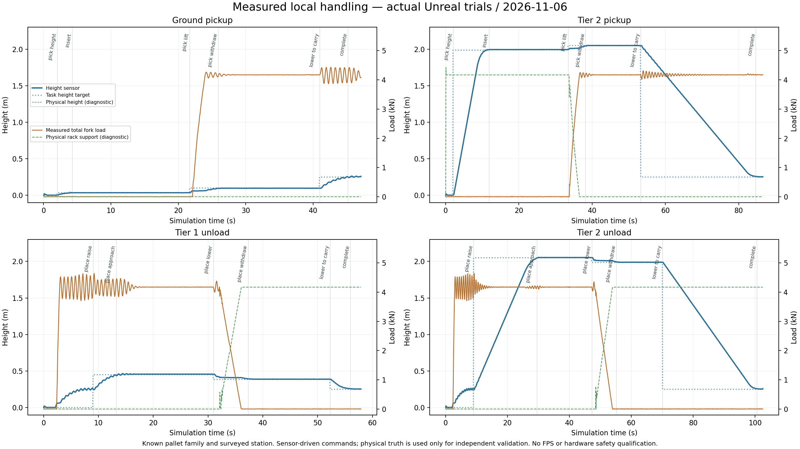

# 자동 정렬·삽입·인양·랙 하역 — 4번 묶음

2026-11-06. 기본 integrated 실행에 연결한다. 사용자 실행 파일은 루트 **Start.bat** 하나이며, Unreal Editor에서 Play를 누른다. 웹은 ForkliftSim 전용 4174 포트를 기본 사용한다.

## 조작

| 키 | 작업 |
|---|---|
| 5 | 앞에 있는 바닥 팔레트 자동 인양 |
| 6 / 7 | 등록된 랙의 1단 / 2단 팔레트 인양 |
| 8 / 9 | 등록된 랙의 1단 / 2단 하역 |
| 0 | 작업 취소 및 정지 |
| Space 또는 수동 이동·승강 입력 | 진행 중인 자동 작업 정지 |
| X | 기존 차량 비상정지 |
| Y | 건강한 센서·정지·중립 확인 후 정지 해제. 멈춘 작업은 재개하지 않음 |

자동 작업을 시작할 때는 이동·승강 입력에서 손을 떼고 정지 상태여야 한다. 랙 작업 전에는 수동으로 해당 랙 앞에 접근한다. 창고 전체 경로 계획과 임무 운반은 5번 묶음이다. 등록된 랙의 치수·위치는 `Config/RackHandling.json`에 있고, 자동 작업 속도·시간 한계는 `Config/HandlingControl.json`에 있다. 다른 곳에 세운 임의 랙을 자동으로 찾아가는 기능은 아니다.

랙 하역은 이미 든 팔레트의 좌우 하중, 네 존재 센서, 양쪽 뿌리 거리로 계산한 삽입 깊이를 다시 확인한다. 가까운 등록 작업대의 접근 구역에서만 시작한다. 센서 위치 추정의 알려진 출발 구역과 고정 지도 가정은 [SensorDrive.md](SensorDrive.md)를 따른다.

## 작업 제어

바닥/랙 인양은 삽입 높이 설정 → 인식 안정 확인 → 횡이동·회전 정렬 → 저속 전진 삽입 → 완전 삽입 증거 및 정지 확인 → 유압 인양 → 양쪽 하중 확인 → 후퇴 → 운반 높이 맞춤으로 진행한다. 포크가 들어간 뒤에는 횡이동·회전 보정을 하지 않는다.

가까운 거리에서 다른 판재를 통로로 다시 맞추는 문제를 줄이기 위해, 삽입 시작 시 센서에서 얻은 팔레트 기준 형상을 고정한다. 새 형상은 그 기준에 대한 위치·높이·각도 일치를 통과해야 갱신한다. 오도메트리·높이 이력과 실제 영상의 남은 표면 증거, 관련 뿌리 거리로 제한 추적한다. 현재 프로파일은 최대 20초·1.8m다. 시야가 가려진 모든 상황에서 팔레트 정지나 삽입 위치를 보장하는 방식은 아니다.

랙 하역은 정지 상태에서 작업단 위의 여유 높이로 상승 → 등록 랙 위치에 저속 접근 → 하강 → 좌우 포크 하중 해제 확인 → 후퇴 → 운반 높이 맞춤으로 진행한다. 현재 후퇴 목표는 1.5m이며 팔레트 뒤쪽이 랙에서 완전히 벗어나도록 여유를 둔다. 하강 중 한쪽 하중이 먼저 빠지는 것은 정상적인 지지 전달일 수 있으므로 운반 중의 편측 하중 이상과 구분한다. 높이에 도달했다는 이유만으로 포크를 빼지 않는다.

제어 입력은 측정 깊이와 인식/추적, 근거리·존재·하중·높이·압력 센서 상태, 엔코더·IMU 기반 자세/속도다. 팔레트 배우 위치·실제 질량·실제 접촉 깊이·실제 랙 지지력은 제어 입력이 아니다. 이 값은 기존 물리 계측과 시험의 독립 결과 대조에만 사용한다. 승강은 기존 센서 피드백 유압 제어, 구동은 기존 센서 피드백 바퀴 토크 제어를 사용한다.

## 정지와 제한

단일 광학 표본 누락은 즉시 이동 명령을 0으로 두고 제동한 뒤 짧게 재측정한다. 연속 누락·측정 상실·카메라 중단·센서 단절·제어기 고장·삽입 깊이 초과·정렬 재확인 실패·편측 운반 하중·하중 상실·시간 초과·수동 개입은 작업 정지를 잠근다. 정상 데이터가 돌아와도 멈춘 단계에서 자동 재개하지 않는다. 새 작업 요청은 처음부터 다시 검사한다. Y로 정지·중립·건강한 센서를 확인해 수동 대기로 돌리거나, 기존 R로 리셋할 수 있다.

자동 작업에서는 Shift 수동 접근 우회를 사용하지 않는다. 전후/측면 보호를 유지하면서 인식한 팔레트의 제한된 형상 영역과 등록 랙 기둥 주변만 공간적으로 구분한다. 대상 이름이나 배우 태그로 장애물을 지우지 않는다. 최소 거리 미만의 반사는 미해결 거리 구간의 양 끝이 모두 이미 허용된 대상 영역 안에 들어오는 경우에만 해당 영역 처리에 포함한다. 그러나 같은 허용 공간에 다른 물체가 들어오면 구분할 수 없고, 2D LiDAR 높이 밖 장애물도 검출하지 못할 수 있다. 비상정지는 같은 프레임의 확인 입력보다 우선하며, 자동 접근의 정지 해제 허용은 최초 무장에 한정한다. 이 가상 보호 기능은 인증된 산업용 안전장치가 아니다. 기존 제동 과도 운동·센서 지연·저마찰 토크 진동의 제한도 남아 있다.

## 웹과 기록

Unreal이 실제 보낸 `handling_control` 객체에서 단계·정지 사유·작업 높이·승강 목표·전진/횡이동/회전 명령·완전 삽입 및 하중 전달 확인 이력을 표시한다. 자동 작업 CSV는 수신한 값만 20열로 저장한다. 브라우저 버튼은 현재 실행 세션의 최근 30초·최대 600표본을 내보낸다. 전체 Native 상세 기록은 `Saved/Telemetry/Handling-*.csv`다. 브라우저가 물리나 작업 결과를 자체 계산하지 않는다.

## 검증

최종 DLL의 단위 **78/78**, Native **16/16**(자동 작업·고장 11, 기존 직진·운반·경사 제동 3, 기존 깊이 인식·수동 삽입 회귀 2), 전후 카메라의 실제 GPU 거리·결측·지연·RGB-D 동기 검증이 통과했다. 웹 모듈 9종과 합성 브리지 프로토콜 31항목도 통과했다. 합성 프로토콜 검사를 물리 검증으로 계산하지 않는다.

| 실제 GPU 자동 작업 조건 | 결과 |
|---|---|
| 바닥 팔레트 인양 | 삽입 증거 → 양쪽 하중 → 후퇴 → 운반 높이 완료 |
| 팔레트 횡편심 0.08m | 정렬 후 같은 인양 과정 완료 |
| 랙 1단 / 2단 인양 | 실제 랙 지지에서 포크 하중으로 전환 후 랙을 벗어나 운반 높이 완료 |
| 랙 1단 / 2단 하역 | 포크 하중 해제와 실제 랙 지지 전환 후 후퇴 완료 |
| 비상정지 / 취소 / 대상 외 측면 장애물 / 카메라 중단 / 근거리 센서 단절 | 각각 작업 정지 잠금·명령 0·제동 확인 |

인양 4조건에서 들어 올리기 직전 독립 물리 기록의 좌우 최소 삽입 깊이는 **1.0815~1.0850m**였다. 제어기가 참조한 값이 아니라 시험 후 실제 접촉 기하와 대조한 값이다. 팔레트 25kg·화물 400kg의 현재 시험 구성에 한정하며 실차 오차 보장이나 다른 팔레트의 성공률을 뜻하지 않는다.

실제 Unreal 웹 수신 **6,666프레임**에서 11개 작업의 종료 상태와 명령 제한을 확인했고 **20열·6,666행 CSV**를 검증했다. 이 전체 시험 CSV는 연속 수신 검증기가 저장한 기록이며 브라우저의 최근 표본 버퍼와 구분한다. 브라우저 DOM 클릭 자동화는 포함하지 않았다. 고장 주입은 삽입 단계 시작에 수행했으며, 고속·운반 중의 비상 제동 성능 검증을 뜻하지 않는다. 새 FPS 성능도 이번 검증 범위가 아니다.

랙 하역 시험은 먼저 정지 상태의 수동 승강으로 실제 팔레트를 든 뒤 하역 작업을 요청하며, 이 준비를 자동 인양 실적으로 계산하지 않는다. 창고를 돌아 인양·운반·하역을 잇는 임무 관리도 이번 시험으로 완료했다고 계산하지 않는다.

중간 실패 기록은 보존했다. 영상 갱신 주기보다 짧은 판정 기준, 가까운 가로판의 재인식, 단일 표본 누락과 실제 단절의 구분, 하역 중 좌우 순차 하중 해제, 랙 후퇴 여유, 비상정지와 확인의 동시 처리를 수정했다. 최종 결과는 같은 DLL·소스·설정 해시의 재시험만 계산한다.

근거: [Native 14조건](References/HandlingValidation-20261106.json), [실제 웹·CSV](References/HandlingWeb-20261106.json), [최종 빌드·소스·회귀·파일 해시](References/HandlingEvidence-20261106.json).
