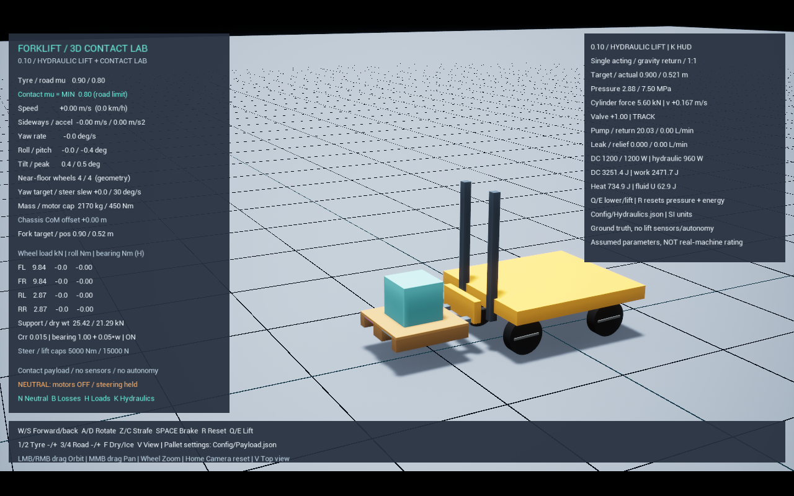

# 유압 승강 시험장 — C2

이 문서는 기존 직결 1:1 V1 시험 기록이다. 현재 통합 프로필의 이동 마스트·체인·배관·열 확장은 [공개 부품 참조 물리](RealComponentPhysics.md)에 정리했다.

전동 펌프 → 체크 밸브/승강 밸브 → 단동 실린더 → 포크 캐리지의 **직결 1:1 시험 모델**이다.
내릴 때 펌프로 아래로 밀지 않고 복귀 밸브를 열어 자중으로 내린다. 실제 지게차의 체인 배율·다단 마스트 구조를 복제한 모델은 아니다.
기존 포크–팔레트–비고정 화물 접촉과 바퀴 하중·타이어 탄성은 유지한다. 이전 정지식 LiftLab과는 별도의 주행 차체 모델이다.

## 실행과 조작

- `Start.bat -Mode hydraulic`: 에디터로 열고 Play. W로 삽입하고 멈춘 다음 E 상승, Q 하강.
- 시험장 창만 열려면 같은 명령에 `-Game`을 붙인다. 에디터에서는 Shift+F1로 마우스 해제, F8로 액터 검사.
- K: 유압 HUD 켜기/끄기. J 타이어, M 모터 HUD는 K를 끄고 확인한다.
- R: 강체·압력·누적 에너지·접촉 계측까지 초기화한다.
- JSON 수정은 실행 전 수행하고 다시 실행한다. 누설 비교 시 같은 적재·높이·시간을 사용한다.
- `Scripts/Run.ps1 -Stability -Payload -Hydraulics -LegacyLift`: 이전 위치 관절 구동과 비교한다.

## 설정 — Config/Hydraulics.json

모든 값은 **미보정 가정값**이다. 특정 제품의 정격·안전 한계로 사용하면 안 된다.

| 설정 | 기본값 | 의미 |
|---|---:|---|
| cylinder_area_m2 | 0.002 m² | 피스톤 유효 면적(직경 약 50.5 mm) |
| dead_volume_m3 | 0.002 m³ | 하단에서도 남는 실린더/배관 유효 유체 체적 |
| effective_bulk_modulus_pa | 200 MPa | 배관·혼입 공기 영향을 포함한 유효 압축 강성, 순수 오일 물성 아님 |
| relief_pressure_pa | 7.5 MPa | 이상적 릴리프 압력 제한 |
| pump_max_flow_m3_s | 0.0005 m³/s | 최대 30 L/min, 이상 무부하 속도 0.25 m/s |
| motor_input_limit_w | 1200 W | 전동 펌프 입력 전력 한계 |
| motor_pump_efficiency | 0.8 | 전동기+펌프 합산 효율 |
| return_orifice_m3_s_sqrt_pa | 2.5e-7 | 복귀 밸브 Q = 계수 × 개도 × √압력 |
| closed_valve_leak_m3_s_pa | 0 | 폐쇄 상태 누설 Q = 계수 × 압력. 비교 시험은 2e-12 |
| seal_friction_n / viscous_friction_ns_m | 80 N / 400 Ns/m | 저속 평활화한 씰 마찰과 점성 저항 |
| valve_response_s | 0.08 s | 밸브 1차 응답 시간 |
| valve_gain_per_m / position_deadband_m | 6 m⁻¹ / 0.003 m | 높이 오차→밸브 개도 변환 이득, 도착 허용 범위 |

`Vehicle3D.json`의 `fork_force_limit_n`도 별도 힘 상한으로 유지한다. 실효 최대 압력은 `min(릴리프 압력, 힘 상한/피스톤 면적)`이다.
`fork_speed_mps`는 수동 Q/E의 목표 높이 이동 속도이지 실제 상승 속도를 강제하는 값이 아니다.
`enabled=false` 또는 `-LegacyLift`는 비교용 과거 위치 관절 구동을 사용한다.

## 계산과 힘 전달

- 유체 체적 `V = Vdead + A × 높이`.
- 압력 변화 `dp/dt = β/V × (Qpump − Qreturn − Qleak − A × 속도)`.
- 펌프 유량은 최대 유량과 입력 전력 한계를 함께 따른다: `Q ≤ min(Qmax, Pinput × 효율 / 압력)`.
- 유체 압력은 탱크 기준 0 이상, 릴리프 이하로 제한한다. 초과 압력에 해당하는 유량은 릴리프로 방출한 것으로 기록한다.
- 캐리지에 `A × 압력 − 씰/점성 저항`을 가하고 같은 작용선으로 차체에 반력을 가한다. 반력 모멘트도 포함한다.
- 이 힘을 Chaos 내부 물리 간격마다 계산한다. 가이드 관절은 수평 이동·회전을 제한하고 승강 끝단을 제한할 뿐, 유압 모드에서 수직 위치/속도 서보를 중복 사용하지 않는다.
- 선언된 화물 질량으로 상승력을 보정하지 않는다. 실제 접촉을 통해 전달된 하중에 의해 압력과 속도가 달라진다.
- 목표에 도착하면 밸브를 닫고, 목표가 바뀌기 전에는 자동 높이 보정을 하지 않는다. 따라서 누설 처짐이 감춰지지 않는다.
- 초기 압력은 포크 자중 지지에 맞춘다. 초기 화물 무게는 보상하지 않으며 접촉 후 실제로 압력이 형성된다.

압력·유량의 기본식 참고: [MathWorks 단일 유압 실린더 예제](https://www.mathworks.com/help/simulink/slref/single-hydraulic-cylinder-simulation.html).

## 계측과 시험

기존 `Saved/Telemetry/Stability-*.csv`에 압력, 밸브, 유지 상태, 실제 속도, 펌프/복귀/누설/릴리프 유량, 실린더 힘, 입력·유압·기계·열 출력, 누적 에너지, 유체 저장 에너지를 덧붙인다. HUD는 센서가 아닌 **물리 정답**이다.

`Scripts/Test-Hydraulics.ps1 -Fps 60` 및 `-Fps 30`:

1. 무적재 / 425 kg 적재 / 펌프 600 W의 중간 스트로크 상승 속도 비교.
2. 릴리프를 2 MPa로 낮춘 과부하: 같은 425 kg을 못 올리고 방출 유량이 발생해야 한다. 전도와 승강력 부족을 분리하기 위한 시험이며 실차 과부하 정격이 아니다.
3. 밀폐 유지 / 누설 유지: 12~20초의 높이 변화를 비교한다.
4. 자중 하강 후 바닥에 팔레트를 내려놓기.
5. 이전 관절 서보와 비교. 단위 시험은 압력·출력·흐름 방향·무보정 유지·1자유도 하중 비교·240/480 Hz 속도 차이를 검사한다.

실행 결과는 아래 검증 기록에 추가한다. 아직 실측 데이터와의 오차 검증은 아니다.

## 한계

- 릴리프는 이상 압력 제한이며 실제 밸브의 유량 곡선·오버슈트가 없다. 탱크 압력, 공기 흡입/캐비테이션·압력파·열에 따른 점도 변화·펌프 맥동·호스 파손은 미구현이다.
- 정지 마찰은 속도 기반으로 평활화한 근사다. 실제 씰의 스틱슬립·마스트 롤러 마찰을 분리하지 않았다.
- 유체 체적·강성은 집중정수 근사다. 저장 에너지는 작은 압축률의 `V p²/(2β)` 진단이며 변화하는 체적·수치 적분까지 포함한 정확한 보존성 보장은 아니다.
- 입력 전력 계산은 `pQ/효율` 근사로, 모터 무부하 소비·전류·배터리·열 상태는 없다. 하강 에너지는 회생하지 않는다.
- 위치 명령은 실제 센서/자동 삽입 기능이 아니다. 센서 잡음·지연·고장과 안전 제어는 후속 묶음이다.

## 검증 기록

2026-10-25, UE 5.6.1, 기본 최대 내부 간격 1/480초, 60 FPS NullRHI 시험:

| 조건 | 중간 스트로크 속도 | 입력 전력 피크 | 결과 |
|---|---:|---:|---|
| 포크 150 kg, 무적재 | 0.249994 m/s | 521 W | 목표 0.9 m → 실제 0.89761 m |
| 팔레트+화물 425 kg | 0.166620 m/s | 1200 W | 실제 0.89739 m, 양중 입력 약 5938 J |
| 동일 적재, 펌프 600 W | 0.083874 m/s | 600 W | 실제 0.89719 m, 느리게 도착 |
| 동일 적재, 릴리프 2 MPa | 상승 불가 | 1200 W | 팔레트 높이 변화 2.49 mm, 릴리프 약 8.394 L |
| 밀폐 밸브 유지 | — | 유지 구간 0 W | 12~20초 처짐 약 0 mm |
| 누설 2e-12 m³/(s·Pa) | — | 유지 구간 0 W | 12~20초 처짐 22.03 mm |
| 자중 하강 | — | 하강 구간 0 W | 팔레트 지면 복귀, 캐리지 높이 7.87 mm |
| 이전 관절 서보 | — | 전력 모델 없음 | 동일 목표에서 캐리지 0.84387 m |

저출력 조건은 12초에도 상승 중이므로 해당 로그의 `hold_sag_m`(12초 높이−20초 높이)을 유지 처짐으로 해석하면 안 된다. 유지 비교는 `hold`/`leak` 조건만 사용한다.
기존 `swerve_fork` 회귀는 유압 모드에서 24초로 늘렸다. 무적재 자중 하강 속도가 약 0.10 m/s로 이전 양방향 서보 0.25 m/s보다 느리므로, 과거의 12초 종료 시점에는 아직 하강 중이다. 최대 양중 높이·최종 복귀 높이의 합격 기준은 그대로 유지한다.
과부하 때 캐리지는 구멍 안의 약 11 cm 여유 구간까지 움직이며, 팔레트를 실제로 양중하지 못하는 것이 판정 기준이다.
양중 입력−기계 일−열−유체 저장 에너지의 수치 잔차도 존재한다(기본 적재 예 약 −31 J, 입력의 약 0.5%). 완전한 에너지 보존 모델로 주장하지 않는다.

30/60 FPS 유압 각 8개/A-B, 60 FPS 타이어 9개/A-B, 비고정 화물 11개/마찰 A-B 통과. 기존 양중·선회·S자·초기화·삽입 회귀 5개도 통과했다.
30 FPS 적재 상승 속도 0.166647 m/s, 누설 처짐 22.031 mm로 60 FPS 결과와 근접했다.
60 FPS/1⁄240초에서도 적재·유지·누설·과부하 4개 통과: 적재 속도 0.166749 m/s, 누설 처짐 22.033 mm. 속도·처짐의 이 기본 시험 결과만 비교한 것이며 충격/압력 파형 전체의 수렴성이나 실차 정확도를 보증하지 않는다.

최종 빌드와 전체 `ForkliftSim` 단위 시험 15개 통과. 기존 제자리 회전·복합 이동·전환·제동·승강·전도 회귀 6개도 통과했다. 승강 회귀는 최대 높이 0.9756 m, 24초 최종 높이 0.0028 m다.
설정 키·HUD 최종 정리 후 적재 유압 시험을 다시 통과했으며, DX11 1280×800 실제 화면에서 압력·유량·출력 HUD와 화물 양중을 확인하고 위 이미지를 저장했다.
