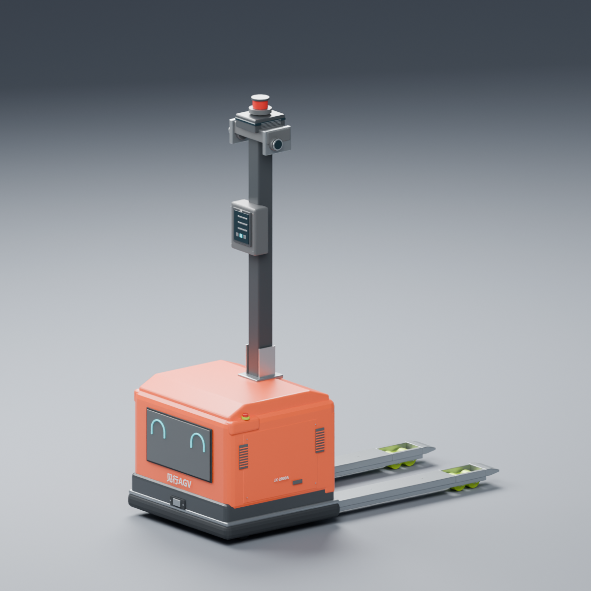
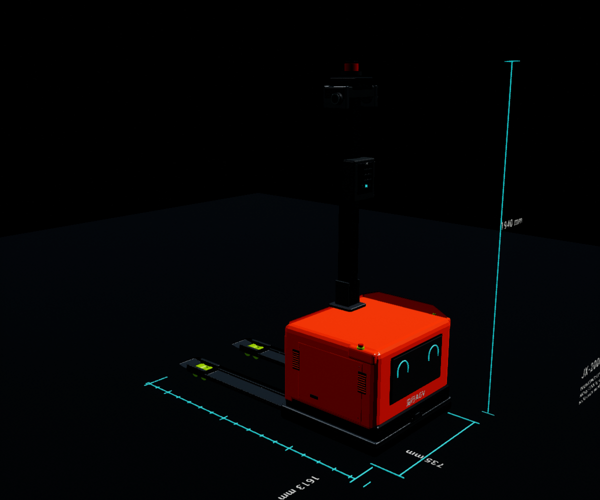
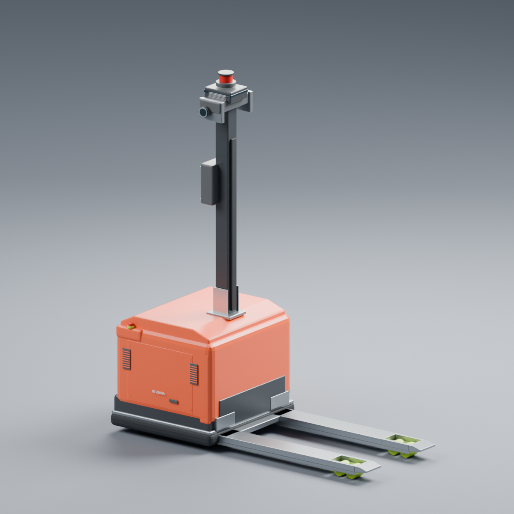
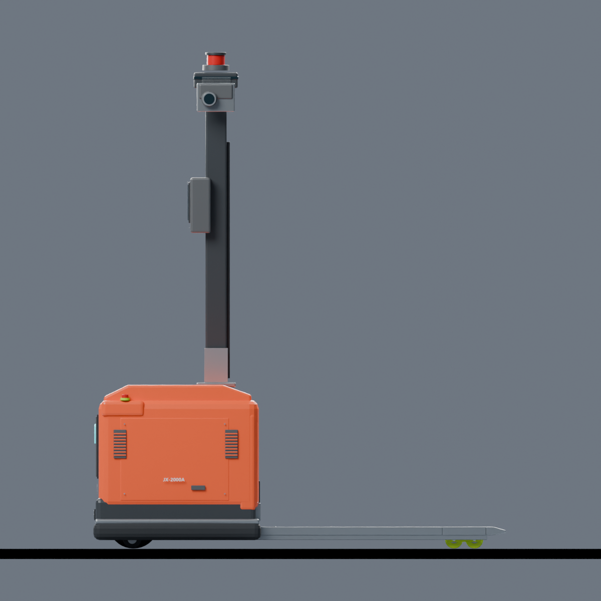

# JXAGV JX-2000A 중문 제품 외형

2026-11-18: 현재 기본 운용 모델은 [포크맨 참고 가상 AGV](AllturnForkman.md)로 변경합니다. 이 문서와 JX 자산·확인용 맵은 이전 검토 기록이며 기본 창고의 JX 전시는 제거합니다.

기준은 사용자가 선택한 [제조사 중문 제품 95](https://www.jxagv.com/products/detail/95.html)입니다. 영문 제품 90의 사양은 섞지 않습니다. 제조사 사진을 참고해 직접 만든 메시이며 OEM CAD를 가져온 것이 아닙니다.

## 확인 방법

기존 실행 파일 **Start.bat**를 계속 사용합니다.

- `Start.bat -Map jx2000a`: 언리얼의 **JX2000AReview**를 열어 외형·분리 부품·치수선을 확인합니다. Play에서는 일반 자유 비행 카메라를 사용하며 물리 운반 임무와 텔레메트리를 생성하지 않습니다. 에디터에서 우클릭+WASD로 자유롭게 살펴볼 수 있습니다.
- 기본 `Start.bat`: 기존 통합 창고·실제 웹을 엽니다. 주차장 옆 **JX-2000A CN / EXTERIOR EXHIBIT**가 같은 모델을 표시합니다. 작동 중인 3대는 기존 메카넘 장비입니다.
- 콘텐츠 브라우저 `/Game/JX2000A`: 10개 StaticMesh와 재질. Place Actors에서 **JX2000AExterior**를 배치하면 조립된 외형을 재사용할 수 있습니다.
- `ContentSource/JX2000A/JX2000A.blend`: 수정 가능한 원본. GLB와 부품별 FBX도 같은 폴더에 있습니다.

이 단계는 **새 외형의 제작·언리얼 자산 연결**입니다. 구동 가능한 기존 메카넘 지게차의 외장을 이 모델로 덮거나, 보이지 않는 고층 마스트를 남기는 교체는 하지 않았습니다. 모델을 확인한 뒤 실제 차량 교체 시에는 아래 구동·승강 차이를 반영해야 합니다.

## 공개 사양과 추정값

|항목|중문 제품의 공개 사양|이번 적용|
|---|---|---|
|전체 길이 × 폭|1613 × 735mm|조립 메시의 실측 경계 크기에 적용|
|높이 옵션|1940 / 2140 / 2340mm|1940mm형 제작|
|자중 / 정격 하중|460 / 2000kg|참조 데이터에 기록, 강체 질량 보정값으로 사용하지 않음|
|구동 방식|舵轮驱动, 조향 구동륜 방식|단일 모듈 외형을 가정해 배치. 실제 구동륜 개수와 하부 배치는 미확인|
|회전 반경 / 직각 적재 통로|1360 / 2350mm|참조 데이터에 기록, 주행 성능 검증값 아님|
|최대 주행속도|1.5m/s 이하|참조 데이터에 기록|
|배터리|48V 24Ah|참조 데이터에 기록|
|레이저 스캐너|2개|사진 기반 센서 헤드 외형, 실제 센서 입력과 미연결|
|포크 길이·간격·단면·롤러 축 치수|미공개|사진과 전체 크기 기반 추정|
|인양 스트로크·유압 부품·부품별 관성|미공개|확정하지 않음|

전체 경계 치수만 제조사 수치와 맞춘 것입니다. 판금 곡률, 내부 부품, 타이어 규격, 포크 지지 구조는 상세 도면·실측이 없으므로 동일 부품이라는 주장을 하지 않습니다. 높은 기둥은 **센서 타워**로 제작했고 기존 2단 랙용 승강 마스트로 해석하지 않았습니다. 영문 제품의 125±5mm 인양량과 840kg 자중은 이 모델에 적용하지 않습니다.

사진 기반 추정값은 [reference.json](../ContentSource/JX2000A/reference.json)의 `visual_estimates_not_manufacturer_dimensions`에서 구분합니다. 모델 축은 X=포크 방향, Z=위이며 원본은 m, Unreal은 cm입니다. 재질은 원본 로고의 메시 표현과 단색 PBR이고 제조사 사진을 텍스처로 배포하지 않습니다.

## 구성과 검증

10개 분리 부품: 차체, 포크 프레임, 센서 타워, 구동륜 모듈, 좌우 캐스터, 4개 하중 롤러입니다. 포크·센서 타워는 별도이므로 타워를 포크와 함께 올리지 않습니다. 구동륜·하중 롤러 회전 중심은 manifest에 기록했습니다. 외형 액터는 Tick·물리·충돌·내비게이션 영향이 없으며 센서·KPI·배터리 데이터를 만들어내지 않습니다.

Blender에서 조립 경계 1.613 × 0.735 × 1.940m를 검사합니다. Unreal 가져오기에서 부품별 크기와 조립 액터의 같은 크기를 각각 1mm 허용차로 검사하고, 10개 부품의 메시와 NoCollision을 확인합니다. 결과는 `Saved/Validation/JX2000A/NativeImport.json`, 재현 가능한 메시·재질·삼각형 정보는 [manifest.json](../ContentSource/JX2000A/manifest.json)에 있습니다.

실제 에디터에서 표시와 Play/정지를 확인했습니다. 모델 대신 위쪽을 가리키던 확인용 카메라의 회전축 오류를 수정했고, 카메라의 실제 pitch/yaw/roll도 검사합니다. 외형은 약 4.9만 삼각형입니다. 기본 창고의 전시는 물리 계산을 추가하지 않지만, 6대 운용 성능을 이 모델로 검증했다는 뜻은 아닙니다. [검증 기록](References/JX2000AModelEvidence-20261117.json).

`Scripts/create_jx2000a.py`가 원본·FBX·GLB·실제 3D 렌더를 생성하고, `Scripts/ImportJX2000A.py`가 네이티브 자산·확인용 맵·기본 창고의 외형 전시를 갱신합니다. 기존 캠퍼스 생성 스크립트가 맵을 재생성한 후에는 ImportJX2000A.py를 다시 실행해야 전시가 복원됩니다.

## 실제 운용 차량 교체 시 필요한 변경

중문 제품도 기존 4개 메카넘과 같은 구조라는 근거는 없습니다. 공개 사양은 조향 구동과 전후진·선회를 명시하고, 구동륜 개수는 밝히지 않습니다. 조향 구동륜·보조바퀴의 접촉과 하중 전달, 460kg 질량 분포, 저상 포크 인양 기구를 따로 구성해야 합니다. 옆으로 즉시 이동하는 기존 경로 추종을 회전·전후진이 필요한 경로 추종으로 바꾸고 정차·삽입·운반 시험을 다시 해야 합니다. 공개되지 않은 승강량으로 2단 랙 적재가 가능하다고 가정할 수 없으므로, 확인 전까지 이 제품은 바닥 팔레트 운반 대상으로 취급합니다.

