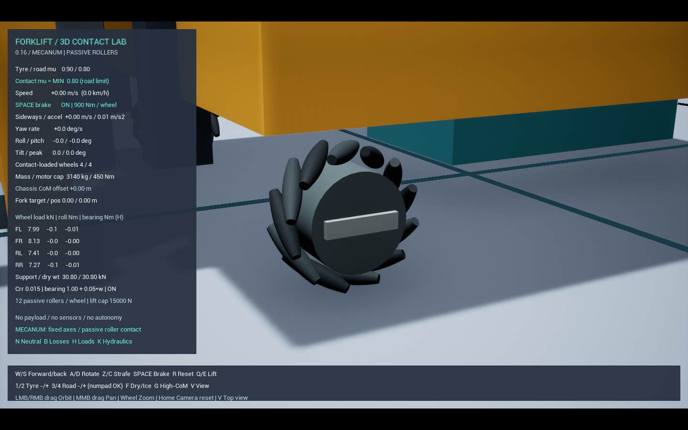
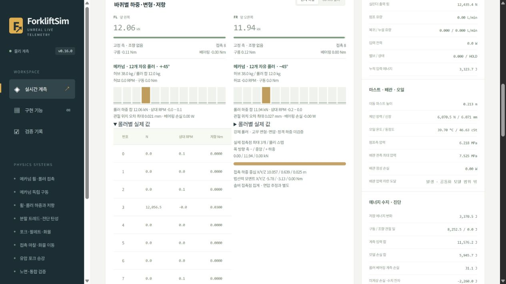
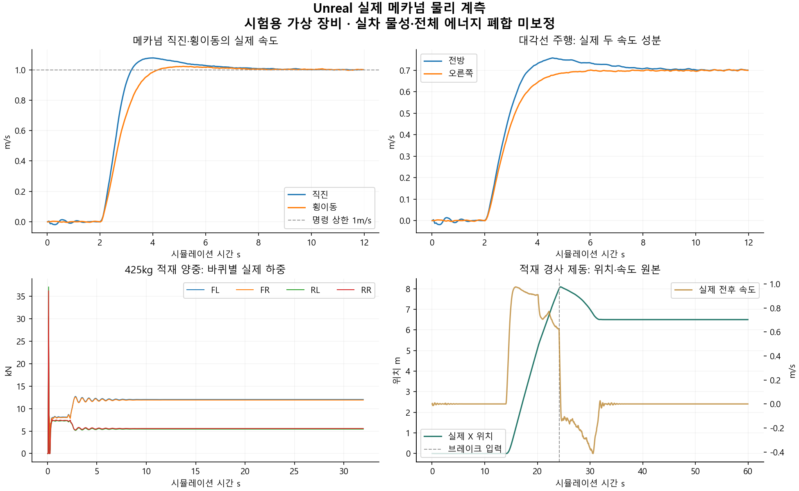

# 메카넘 휠 — 물리 롤러·구동·차체 반작용

> 이 문서는 이전 버전의 기록입니다. 관절 보존·중립 감속·브레이크 수정과 현재 기본 설정은 [0.18 검증](MecanumConservation.md)을 확인하세요.

**현재 기본은 0.17이며 [묶음 1–4 수정·검증](MecanumBatch1234.md)을 우선한다.** 아래 형상·제어·수치 결과는 0.16 도입 기록이다. 현재는 물리 스텝 구동, 정지 유지, 구면 조합 접촉을 사용하며 경사 제동은 통과했다. 자유 부유 관절 보존과 전체 에너지 폐합은 계속 미완료다.

기본 실행은 **`Start.bat` → Unreal Editor에서 Play**다. 메카넘은 평지 창고를 기본 시험장으로 사용하며 `Start.bat -Terrain ramp` 또는 T키로 경사 시험장을 선택할 수 있다. 기존 포크·팔레트·비고정 화물·유압·실시간 웹을 메카넘 구동과 함께 사용한다. 새 시작 배치 파일은 없다. 이전 독립 조향 비교는 `Start.bat -LegacySwerve`, 과거 링 시험은 `Start.bat -CoupledTread`로 유지한다. 이전 일반 타이어의 시험 통과를 메카넘 검증으로 재사용하지 않는다.

## 조작과 설계 범위

- W/S 전후, Z/C 좌우, A/D 차체 회전. 이동 입력을 함께 누르면 대각선과 곡선 주행이 가능하다.
- Space는 메인 휠 축 제동, Q/E는 포크 하강/상승, R은 리셋이다.
- 기본 병진 명령 상한은 **1m/s(3.6km/h)**다. 기존 모터 1800RPM/감속비 12/반지름 0.15m의 무부하 표면속도 한계는 약 2.36m/s다. 모든 방향에서 이 속도에 도달한다는 뜻은 아니다. 네 바퀴 명령은 모터 회전수 한계와 휠 속도 한계 중 작은 값으로 함께 제한한다.
- 기존 조향 모터·조향각 정렬 대기·조향 유격은 메카넘에서 사용하지 않는다. 고정 마운트 관절은 유지하며 이전 조향형 비교 모드에만 조향 모델을 남겼다.

## 실제 물리 구조

휠마다 **회전 허브 1개 + 수동 롤러 12개**, 총 48개 롤러를 별도 물리 바디로 생성한다. 롤러 중심의 병진과 두 회전축을 구속하고, 자기 축 회전 하나만 자유롭게 둔다. 롤러 표면과 바닥의 실제 접촉이 추진력을 만든다. 차체 위치·속도·회전을 명령값으로 직접 설정하지 않는다.

| 항목 | 현재 설계값과 의미 |
|---|---|
| 외측 반지름 / 장착 폭 | 0.15 / 0.16m |
| 허브 반지름 / 폭 | 0.105 / 0.14m |
| 휠 질량 분배 | 허브 38kg + 롤러 12×1kg = 50kg |
| 롤러 최대 반지름 / 길이 | 0.02 / 0.15m |
| 롤러 배치 | 45°, FL/FR/RL/RR의 부호 +/−/−/+ |
| 접지 재질 | 롤러 μ와 노면 μ의 Min 결합 |
| 롤러 베어링 저항 한도 | 0.03 + 0.002×상대 각속도 절댓값 N·m |
| 주행 피드백 | 비례·적분 차체 속도 보정 + 휠 속도 제어, 모터 토크/출력/회전수 제한 유지 |

질량·형상·저항·제어 이득은 **가상 장비의 설계 가정**이며 상용 메카넘 제품의 실측값이 아니다. 허브 38kg은 현재 원통 외형에서 약 7.84t/m³의 등가 밀도다. 실제 보어·볼트·베어링·PU/금속 재료 구분은 모델링하지 않았다. 관성은 현재 형상과 질량으로 계산하고 구동 모터 회전자 관성을 감속비 제곱으로 환산해 더한다.

롤러 형상은 회전축 둘레의 배럴이며 휠 원통 외곽 안에 들어가도록 반경 프로파일을 계산한다. 13개 축 방향 단면 × 32개 원주 정점으로 볼록 충돌체와 렌더 메쉬를 만든다. `Scripts/verify_mecanum_geometry.py`는 별도 계산으로 인접 롤러 간 비겹침·허브 간격·폭·외곽 지지 높이를 검사한다. 이 검사는 native 충돌체 쿠킹과 동적 접촉의 검증을 대신하지 않는다.

## 힘·토크 전달

`모터 → 허브 → 롤러 관절/노면 접촉 → 휠 마운트 → 차체`

허브에 +τ를 적용할 때 모터가 장착된 차체에 −τ를 적용한다. 지면 접촉력은 별도로 차체 이동과 회전 모멘트를 만든다. 화물과 포크의 무게중심 변화는 바퀴·롤러별 수직하중에 반영되고, 실제 회전수는 모터 가용 토크·출력에 다시 영향을 준다.

롤러 베어링은 속도를 강제로 지정하는 장치가 아니다. 실제 관절의 수동 저항이며 허브에 반작용한다. 물리 스텝 각충격량을 평균해 토크를 측정하고, 상대 회전 증분과 함께 소산 일을 적분한다. 수치적으로 양의 일이 생겨도 0으로 잘라 숨기지 않는다.

기존 전체 타이어의 수직/전단 스프링과 분할 탄성 링은 메카넘에서 끈다. 현재 롤러는 **강체 접촉**이므로 일반 타이어의 눌림·추정 패치·면압을 새 값처럼 표시하지 않는다. 휠 축의 등가 구름저항과 축 베어링 저항은 유지하며 롤러 베어링 저항과 구별한다. 전체 장비 에너지 폐합은 계속 미완료다.

## 주행 제어와 제동

Unreal의 X 전방, Y 오른쪽을 사용한다. 바퀴 위치 (xᵢ,yᵢ), 롤러 부호 sᵢ에 대해:

`Rωᵢ = vx + sᵢvy + Ω(−yᵢ + sᵢxᵢ)`

이상적 운동학은 바퀴 목표값을 만드는 데만 쓴다. 실제 차체의 움직임은 마찰과 동역학 결과다. 현재 속도·헤딩 피드백은 시뮬레이터의 실제 상태를 쓰며 센서 구현은 아니다. 토크 한계·출력 한계·회전수 한계·응답 지연은 기존 모터 모델을 거친다.

Space는 메인 휠 축에 유한 토크 탄성/소성 클러치를 적용한다. 작은 탄성 비틀림으로 정지 위치를 유지하고 900N·m 한계에서 미끄러질 수 있다. 롤러를 별도 잠그지 않는다. 경사·저마찰·바퀴 들림 조건의 정지를 항상 보장하는 주차 브레이크라는 뜻은 아니다.

## 시험과 미완료 범위

`Scripts/Test-Mecanum.ps1`는 정지·전후·좌우·대각선·제자리 회전·곡선·제동·무마찰, 적재 양중·운반·턱·경사 제동을 실제 Unreal에서 실행한다. 소스/설정/DLL 해시와 실제 내부 시간 간격을 보존한다. 1m/s 기준 직선/횡이동은 15% 속도 범위, 대각선은 각 성분 0.60~0.85m/s와 경로 차이 0.4m 이내를 검사한다. 경사 제동은 정지거리 0.5m 미만과 3초 이후 유지 구간의 밀림 0.03m 미만을 별도로 검사한다.

모터 반작용 시험은 유압 승강부를 가진 전체 장비를 무중력으로 바꾸는 초기 시험에서 분리했다. 별도 자유 부유 차체+휠 벤치에 50N·m를 1초 적용하고 차체 반대 회전과 전체 각운동량 오차(입력 각충격량의 2% 미만)를 검사한다. 이 벤치는 주행 장비의 에너지 예산 밖이므로 전체 장비 에너지 폐합 판정에 섞지 않는다. 초기 실패 기록도 보존한다.

최종 배포 물리 모델의 native 시험은 **15개 중 13개 통과, 2개 미통과**다. 단위 시험 29/29와 이전 독립 조향 직진 회귀도 통과했다.

| 시험 | 측정 / 결과 |
|---|---|
| 전진 / 후진 | +1.0007 / −1.0021m/s · 통과 |
| 오른쪽 / 왼쪽 횡이동 | +0.9989 / −1.0025m/s · 통과 |
| 대각선 | 전방 0.7007 / 오른쪽 0.6990m/s · 통과 |
| 제자리 회전 / 곡선 | 27.13 / 18.43°/s · 통과 |
| 평지 제동 / 무마찰 | 정지 / 추진 없이 공회전 · 통과 |
| 적재 양중 / 운반 | 포크 0.4383 / 0.4385m · 통과 |
| 적재 25mm 턱 | X 9.2614m, 최대 기울기 약 0.887° · 통과 |
| 적재 6° 경사 제동 | 정지거리 1.5093m, 유지 밀림 1.2287m · **미통과** |
| 자유 부유 모듈 각운동량 | 입력 50N·m·s 대비 오차 46.8482N·m·s · **미통과** |

실제 Unreal→웹 마지막 적재 세션 600프레임에서 롤러별 수직반력 합과 접촉점 반력 합이 약 3.64×10⁻¹²N 이내로 일치했다. 최대 롤러 관절 위치 오차는 0.256mm였다. 포크·유압·에너지 회계식 검증도 통과했다. 이 계측 경로 통과가 에너지 폐합이나 실제 재료 정확도의 통과를 뜻하지 않는다. 브라우저 CSV 440행/160열 내보내기도 실제 수신 기록으로 검증했다.

최종 [검증 기록·원본 해시](References/MecanumValidation-20261027.json)를 참고한다. 전체 물리 시험 뒤 롤러 끝면 삼각형 방향, 질량 없는 회전 마커와 HUD 문구만 수정했다. 충돌 형상·물성·힘·제어 코드의 동일성을 구간 해시로 확인했고, 최종 렌더링 실행도 확인했다. 물리 시험 DLL과 최종 표시 수정 DLL은 보고서에서 구별한다.

실제 고무/PU 변형·피로·베어링 발열·상용품 정격·재료 실측 보정은 남아 있다. 이전 5번 중 이번에 필요한 롤러 기하·질량·관성·수동 관절·베어링 저항을 함께 상세화했으며, 포크·마스트·유압의 기존 상세 모델은 유지한다. 이전 연결 링의 미소 토크/적재 턱 미통과가 해결됐다고 선언하지 않는다.

## 참고한 공개 자료

- [WPILib MecanumDriveKinematics](https://docs.wpilib.org/en/stable/docs/software/kinematics-and-odometry/mecanum-drive-kinematics.html): 차체 병진/회전을 네 휠 속도로 변환하는 운동학. 이 프로젝트는 Unreal 좌표 부호를 명시적으로 변환한다.
- [FOOT MASTER MP 카탈로그](https://www.gdok.co.kr/en/catalog/14_mecanum_catalog_en.pdf): 공개된 MP-152/176은 휠당 125/150kg, 세트 500/600kg 범위여서 현재 3t 이상 가상 장비의 정격 근거로 채택하지 않았다. 기존 Blickle 일반 휠의 사양도 메카넘 정격으로 재사용하지 않는다.

## 정밀 검증에서 발견한 문제

기본 이동·적재 구현과 별도로 **경사 유지와 자유 부유 모듈의 각운동량 보존 기준은 미통과**다. 물성을 바꾸거나 오차 기준을 늘려 통과시키지 않았다. 분리 벤치에서도 차체와 허브의 반대 회전은 확인됐지만 총 각운동량 오차가 입력 50N·m·s 대비 약 46.8N·m·s로 컸다. 이 관측을 실제 장비의 물리 정확도 통과로 해석하지 않는다.

엔진의 기본 62.83rad/s 각속도 제한은 새 메카넘 바디에서 2000rad/s의 수치 보호 상한으로 분리했고, 모터의 실제 회전수 한계는 유지한다. 롤러·허브·장착부의 자이로 항과 비선형 관절 해석을 활성화했다. 127회 속도 반복 실험도 경사 유지·보존 실패를 해소하지 못했으므로 기본 속도 반복은 기존 32회로 유지한다(위치 127회). 이 변경이 모든 수치 오차를 해결했다는 뜻은 아니다.

경사 시험은 6°에서 뒤로 밀렸으며, 127회 속도 반복 실험의 최대 이동은 1.524m, 유지 구간 밀림은 1.027m였다. 정지거리 0.5m·유지 밀림 0.03m 기준을 유지한다. 바퀴를 강제로 정지시키거나 롤러를 임의로 잠그지 않는다. 접촉/관절 수치 오차와 지지·마찰 전달을 더 분리해야 한다. 현재 기본 시험장이 평지인 이유도 이 미완료 상태를 명확히 하기 위해서다.
