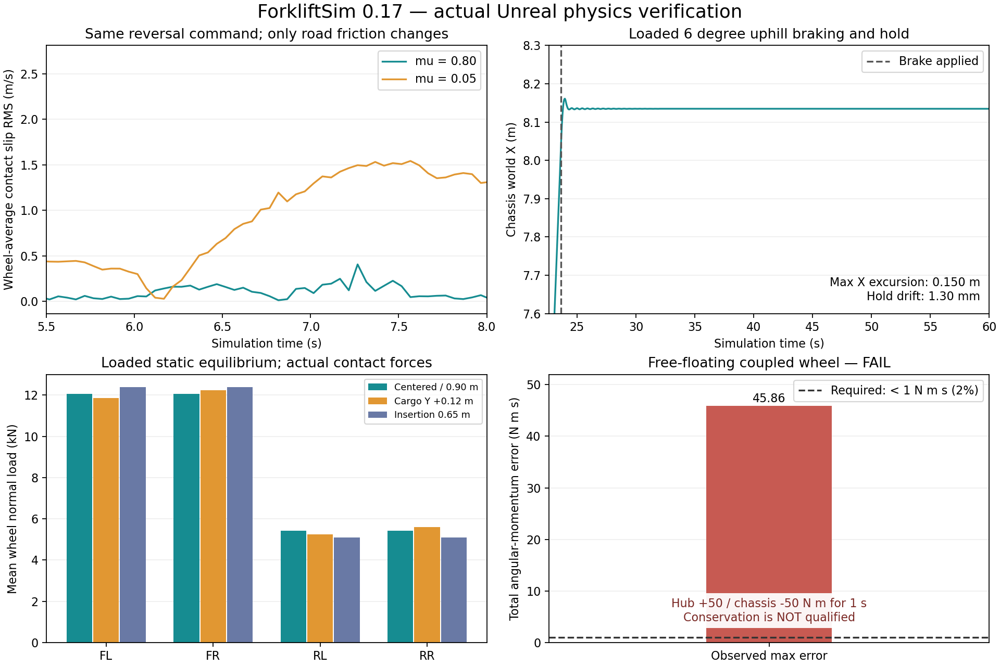
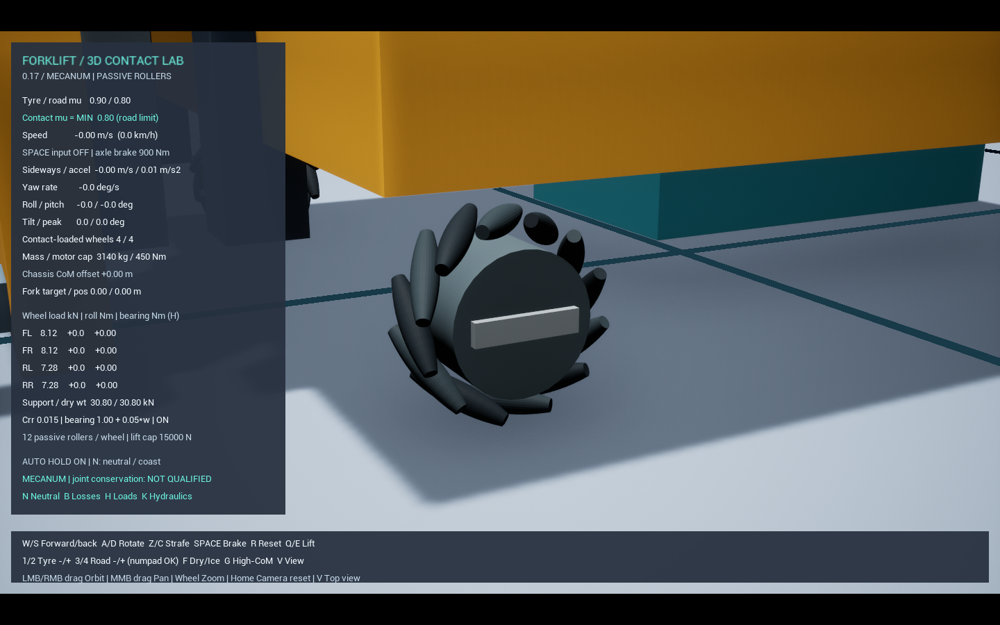
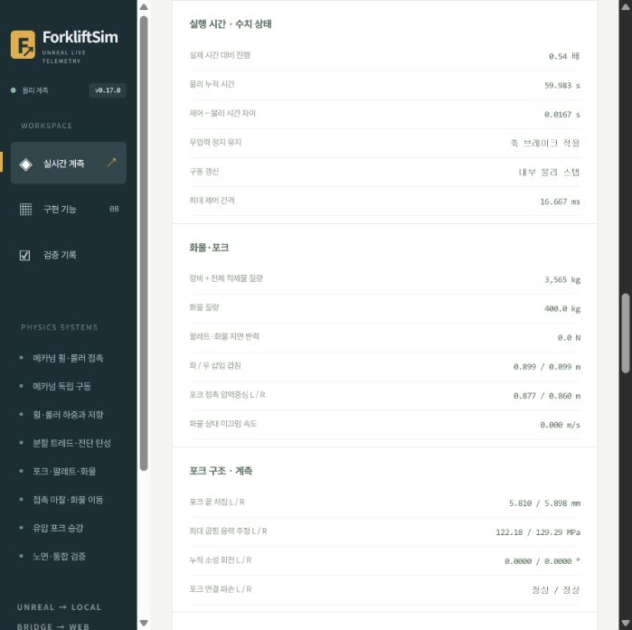

# 메카넘 물리 묶음 1–4 — 2026-10-28

> 이 문서는 이전 버전의 기록입니다. 관절 보존·중립 감속·브레이크 수정과 현재 기본 설정은 [0.18 검증](MecanumConservation.md)을 확인하세요.

**1·2·4의 구현과 행동 시험을 반영했다. 3의 관성·손실 관측은 수정했지만 관절 보존 오차는 미해결이다.** 고유 시험 조건 27개 중 26개 통과, 자유 부유 반작용 1개 미통과다. 전체 물리 정확도·에너지 폐합·실차 보정 완료를 뜻하지 않는다.

사용자 실행은 **루트 `Start.bat` → Unreal Editor에서 Play**다. 기본은 메카넘·평지·병진 명령 1 m/s다. 대시보드 포트가 다른 프로젝트에 사용 중이면 다음 포트를 자동 선택하고 Unreal 전송 주소도 함께 맞춘다. 현재 PC의 4173은 PortSim이 사용 중이므로 ForkliftSim은 4174를 선택한다. 명시적 `-WebPort`는 그대로 존중한다.

## 1. 헛돎과 실시간 실행

- 월드의 최대 제어 간격을 1/30초로 제한했다. 화면이 느리면 시뮬레이션도 느리게 진행하며, 제어 시간만 물리 시간보다 앞서 가지 않는다. 내부 최대 물리 간격은 1/480초다. 실제 진행 배율과 누적 시간 차이를 웹에 표시한다.
- 휠 속도 제어, 토크/출력/RPM 제한·모터 지연, 구름저항을 물리 내부 스텝에서 계산한다. 마찰계수는 기본 휠 0.9 / 노면 0.8 그대로다. 허브 토크와 차체 반작용도 같은 물리 스텝의 힘 쌍이다.
- 이전 프레임의 평균 접촉점을 현재 바퀴 자세에 대입하던 슬립 추정을 제거했다. 같은 물리 스텝의 접촉점·상대속도·법선 충격량으로 롤러 축/직각 방향의 슬립 RMS를 집계한다. 일반 바퀴의 `omega*R - 차체 속도`와 구별한다.
- 마찰 재질을 변경하면 UE가 관성을 재계산하므로, 마찰 키의 경로에서 기존 질량·관성·질량 좌표계를 유지한다. 1~4와 숫자패드/F 키 바인딩 시험에서 60개 바디의 질량 및 관성 변화가 0이었다.
- 무입력으로 충분히 감속하면 **AUTO HOLD**가 유한 토크의 축 브레이크를 적용한다. 이동/회전 입력에는 즉시 해제되고 N 중립에서는 꺼진다. 차체나 바퀴의 속도·위치를 강제로 고정하지 않는다. 정지 유지는 구동부 제어이며 현재 속도 입력은 시뮬레이터 정답값이다.

무입력 12초 시험은 통과했다. 2초 안정화 이후 차체 추가 변위는 약 0.4 mm였다(전체 원점 대비 마지막 X는 약 -1.7 mm). 4초 이후 최대 허브 표면속도는 0.000156 m/s였다. 기존 속도 제어만 사용하는 시험에서는 약 98 mm의 안정화 후 이동이 관측됐다.

실제로 `t.MaxFPS 6`을 적용한 일반 실행도 통과했다(benchmark 플래그 없음). 60 FPS 시험 대비 마지막 속도 차이 0.0003 m/s, X 변위 차이 0.0167 m, 최대 누적 월드–물리 시간 차이 0.033334초였다. 느린 PC에서 항상 실제 시간 1배속이라는 뜻은 아니다.

마찰 비교는 같은 전진→후진 명령을 사용했다. 6~7.5초 구간의 네 휠 평균 접촉 슬립 RMS는 노면 μ=0.8에서 0.162 m/s, μ=0.05에서 1.039 m/s였다. 접촉 마찰 한계가 실제 거동에 반영된다.

## 2. 접촉과 경사 제동

독립 롤러 48개와 회전 관절은 유지했다. 각 롤러의 접촉 형상을 **원본 배럴에 내접한 구면 9개 조합**으로 바꿨다. 중첩 구면을 별도 재료 질량으로 더하지 않으며 원본 볼록 배럴의 질량·무게중심·관성을 복사한다. 재질 지정 이후에 이 값을 적용하고, 이후 마찰 변경에도 유지한다. 기존 비회전 마운트 부품은 유지하면서 허브 축은 실제 차체에 직접 연결한다.

독립 기하 검사에서 지면 지지 높이 차이는 원본 배럴 대비 최대 약 0.152 mm, 외측 반지름 대비 지지 높이 감소는 약 0.196 mm다. **롤러 축 방향 끝면은 최대 약 9.84 mm 안쪽 근사**다. 끝면·측면의 정밀 충돌이나 PU 변형 모델은 아니다. 원본 볼록 접촉은 시험 스크립트의 `MecanumConvexContact` 비교 옵션으로 남겼다.

400 kg 화물 + 25 kg 팔레트를 실제 접촉으로 든 6° 오르막 제동에서 **X 방향 최대 제동 변위 0.149797 m, 3초 이후 유지 밀림 0.001300 m**였다. 기준 0.5 m / 0.03 m를 통과했다. 내리막·모든 경사/하중/마찰 조건까지 검증한 것으로 확대하지 않는다.

## 3. 관성·손실 관측과 미해결 보존 오차

`InertiaTensorScale.Z`는 관성 Izz의 직접 배율이 아니라 등가 형상 치수를 바꾸는 설정이다. 이 방식으로 구동축 관성이 늘어나지 않던 오류를 고쳤다. 현재 허브의 축 관성은 기하값 약 0.209454 + 회전자 환산 0.057600 = **0.267054 kg·m²**다. 질량 38 kg은 유지한다. 이는 `J_motor * 감속비²`의 등가 모델이며 실제 회전자 자유도를 별도로 시뮬레이션하지 않는다.

축 브레이크/베어링 관절의 내부 스텝 각충격량과 상대 회전으로 일을 기록하고, 이미 저장 에너지에 포함된 브레이크 탄성 에너지 변화를 중복 손실에서 제외한다. 부호를 잘라 숨기지 않는다. **음수 소산 잔차를 실제 음의 발열로 해석하지 않는다.**

자유 부유 벤치는 허브 +50 / 차체 -50 N·m를 1초 적용한다. 총 외부 토크는 0이며, 한쪽 토크 충격량 50 N·m·s를 기준 규모로 삼아 전체 각운동량 오차 <1 N·m·s를 요구한다. 최종 관측 오차는 **45.861075 N·m·s로 미통과**다. 물리 스레드의 합계도 같은 손실을 확인했다. 무동력 coast 에너지도 크게 감소해 보존 기준을 통과하지 못했다.

이전 분리 진단에서 롤러 관절을 끊으면 오차가 약 0.000764 N·m·s로 줄었다. 이 값은 관절 없는 진단 벤치의 통과이며 실제 메카넘 장비의 통과가 아니다. 관절 연결 상태에서의 위치·속도 갱신 및 일 수지를 더 분해해야 한다. 반복 횟수·해석기·자이로·시간 간격을 바꾼 비교도 남겼다. 구심력 half-kick 예측 후보는 큰 보존 오차를 해결하지 못해 **기본 실행에서 사용하지 않는다**(`MecanumBearingPredictor`는 실패 후보 재현용 시험 옵션).

실제 경사 세션의 웹 에너지 관측에는 축 관절 순일 +227.33 J, 소산 잔차 -236.83 J, 전체 미계상/수치 잔차 +6,665.35 J가 남았다. 관측식·전송 검증의 PASS는 물리 보존 PASS가 아니다. **전체 에너지 폐합 상태는 false**로 유지한다.

## 4. 적재 통합과 하중 이동

팔레트/화물을 고정하지 않은 실제 접촉으로 다음 12조건을 시험했다.

| 조건 | 내용 | 결과 |
|---|---|---|
| 양중·운반·하강 | 425 kg 적재, 전후/횡이동/회전, 바닥 복귀 | 통과 |
| 편심 양중 | 화물 Y +0.12 m | 통과 |
| 얕은 삽입 | 0.90 → 0.65 m | 통과 |
| 높은 승강 운반 | 목표 0.90 m | 통과 |
| 전체/한쪽 턱 | 25 mm | 통과 |
| 분할 마찰 운반 | 좌우 μ 0.08 / 0.8 | 통과 |
| 경사 제동·유지 | 적재, 6° 오르막 | 통과 |
| 화물 미끄럼·낙하 | 화물 마찰 감소, 실제 이탈/낙하 | 재현 통과 |

낙하 재현의 통과는 안전 운반 판정이 아니다. 정하중 10~13초 평균을 별도의 모멘트 평형식과 비교했다. 얕은 삽입에 따른 앞축 하중 증가는 예상 655.28 N / 측정 652.56 N(차이 0.415%), 오른쪽 편심의 오른쪽 바퀴 합 증가는 예상 363.46 N / 측정 352.90 N(차이 2.91%)였다.

## 검증 근거와 범위

- 고유 행동 조건 **27개 중 26개 통과**, 연결 롤러 자유 부유 보존 1개 미통과.
- 최종 DLL의 주행/무입력/키/마찰 15조건, 적재 운반·경사 대표 회귀를 실행했다. 적재 확장 12조건은 AUTO HOLD 직전 DLL의 기록이며, 힘·형상·물성 코드가 동일하고 모든 입력 구간에서 유효 브레이크가 같음을 확인했다. 실행별 DLL/소스 해시는 따로 보존한다.
- 물리 단위 시험 **29/29**, 이전 독립 조향 직진 회귀 통과.
- 마지막 실제 Unreal 경사 세션 600개 수신 프레임에서 롤러 하중–접촉점 하중 합, 관절 위치, 부품·유압, 회계식 전송 검증 통과. 이 600개는 마지막 유지 구간이다. 새로고침 후 같은 서버의 실제 이력을 복원하고 브라우저 CSV 599행/174열을 검증했다. 프레임 순서·이전 세션 차단·명시적 그래프 비우기와의 경합도 표시 모델에서 검사한다.
- 정량 시험 이후에는 HUD 버전·Space 입력과 유효 브레이크 한도·보존 미완료 문구만 수정했다. HUD 이전 물리 코드 구간의 해시가 같고 최종 네이티브 렌더를 확인했다. 시험 DLL과 표시 수정 DLL은 보고서에서 구별한다.
- 실측 물성·정격·고무 변형·전체 에너지 폐합은 검증 완료가 아니다.

[실행별 원본·해시와 미통과 값](References/MecanumBatch1234-20261028.json) · [독립 평형/마찰/시간 비교](References/MecanumBatch1234-Checks.json)

## 조작과 다음 제작 순서

W/S 전후, Z/C 횡이동, A/D 회전, Q/E 승강, Space 제동, N 중립/정지 유지 해제다. 1/2는 휠 표면 μ, 3/4는 노면 μ를 바꾼다. 접촉 μ는 두 값의 Min이므로 휠 0.9 / 노면 0.8에서 휠 값만 올려도 접촉 μ는 증가하지 않는다.

**남은 관절 보존/에너지 수지 수정 → 사용자의 Fab Warehouse 에셋 모델링·시험장 통합 → 센서 → 자동화** 순서다. 창고 적용 시에는 실제 크기, 바닥 충돌/물리 재질, 기존 바닥과의 중복, 통로/팔레트 치수, 장비 이동 간격과 바닥 접촉 계측 대상을 확인한다.
