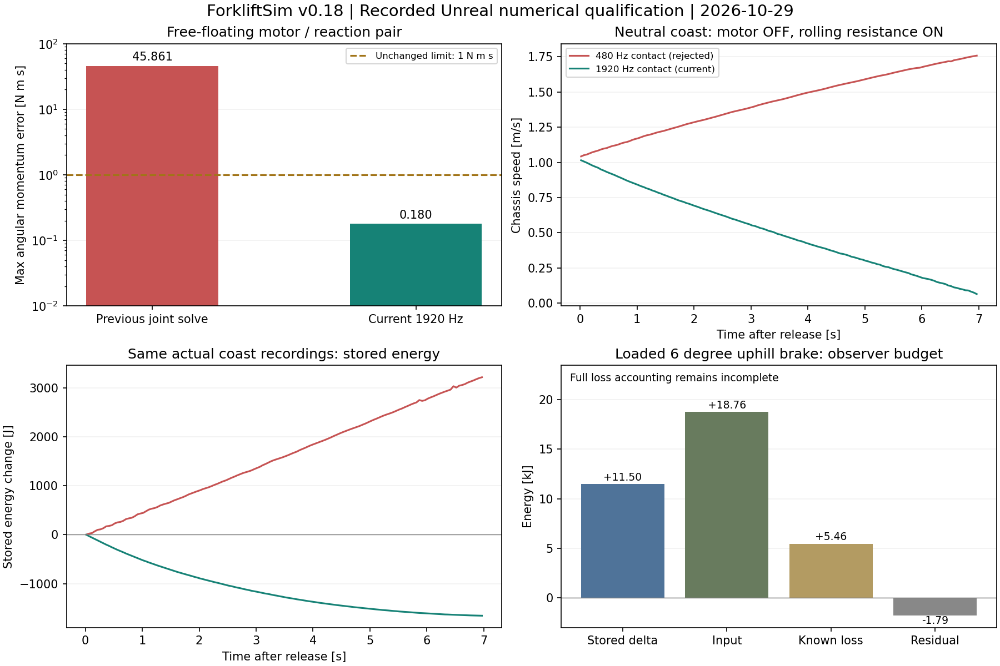
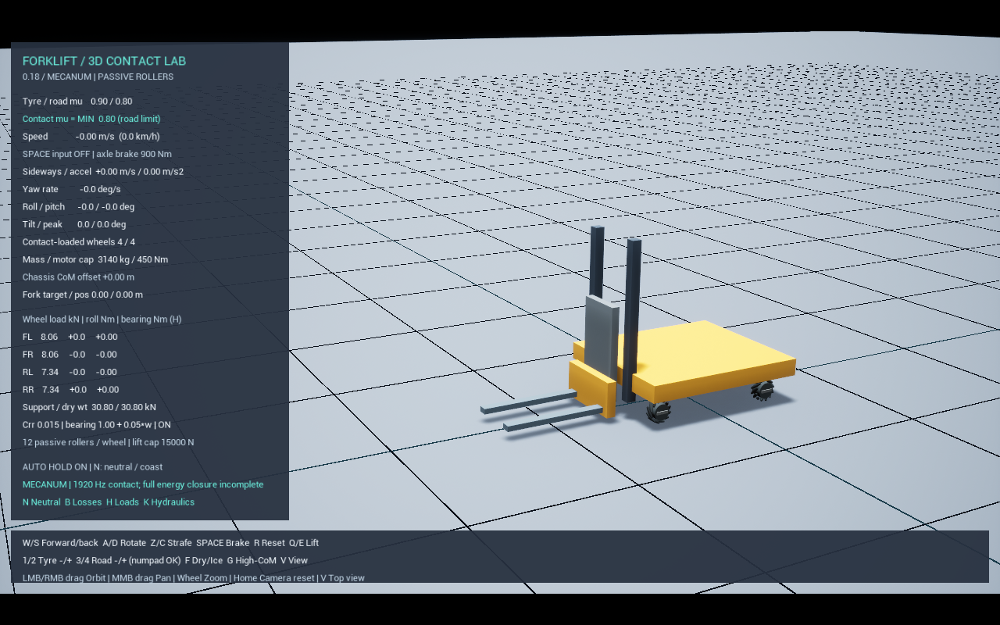

# 메카넘 수치 오차 수정 — 0.18 / 2026-10-29

**메카넘 행동 조건 28/28, 단위 시험 31/31 통과.** 이전에 실패했던 공중 반작용·각운동량 보존을 수정했고, 추가 시험에서 발견한 중립 가속과 브레이크 기준각 오류도 수정했다. 실제 장비의 실측 보정·정격 판정이나 전체 손실 수지의 완성을 뜻하지 않는다.

실행은 **루트 `Start.bat` → Unreal Editor에서 Play**다. 기본 통합 프리셋에 적용했으므로 사용자가 새 설정이나 실행 파일을 선택할 필요가 없다. 기본 물리 간격은 **1/1920초 ≈ 0.521ms**, 위치/속도 반복은 **32/32회**다. 계산량이 증가했으며, PC가 계산을 따라가지 못하면 시뮬레이션 시간이 느리게 진행된다. 웹의 실제 진행 배율·누적 물리 시간·선택 간격을 확인할 수 있다.

## 수정한 세 가지

### 1. 자유 롤러의 회전 적분과 베어링 반작용

기존 공중 시험에서 외부 토크 합이 0인데 전체 각운동량이 약 45.86 N·m·s 손실됐다. 내부 스텝을 나눠 계측하니 대부분이 관절 구속 해석에서, 빠른 롤러에서는 자유 회전 적분에서도 발생했다.

- 축대칭 롤러의 자유 회전은 주관성과 세계 좌표 각운동량으로 자세·각속도를 함께 진행하는 해석적 적분으로 바꿨다. 별도 시험으로 10초 보존, 축의 세차 운동, 시간 역전을 확인했다.
- 베어링 구심력과 회전축을 운반하는 자이로 반작용을 적분 전후 절반씩 적용한다. 롤러에 가하는 힘과 허브의 반력은 같은 작용점이며, 힘의 모멘트와 회전축 수송 토크도 허브에 반대로 적용한다.
- 관절은 계속 실제 Chaos 구속·접촉을 해석한다. 예측 베어링 일은 별도로 기록하며 외부 입력 에너지에 더해 수지를 맞추지 않는다.

구심력은 `m * Ω × (Ω × r)`이며, 축대칭 롤러의 수송 토크는 `[(I_parallel * ω_roller·a) - (I_perp * Ω·a)] * (Ω × a)`다. 허브 각속도 일정의 예측 성분이며, 나머지 가속·접촉·구속 반력은 관절 해석이 담당한다. 전체 다물체 운동의 해석적 정답이나 실제 회전자 자유도 모델은 아니다. 기존 회전자 환산 관성 모델을 유지한다.

### 2. 접촉 중 중립 가속

추가한 중립 시험에서 모터 토크가 0인데도 속도가 1.04 → 1.76m/s로 증가했다. 480Hz에서는 구름저항을 제거해도 증가했고, 베어링 저항을 제거해도 해결되지 않았다. 적용한 구름저항 토크의 방향과 잔류 각가속도도 확인했다. 해당 접촉 모델의 시간·반복 해상도가 부족한 수치 현상이다.

1920Hz에서 이 시험을 통과했다. 반복을 8/8, 16/16, 32/8로 줄인 후보는 감속량이 부족해 채택하지 않았다. 기본은 1920Hz·32/32회이며, 최대 서브스텝 예산 128회로 1/30초 제어 간격의 물리를 끝까지 처리한다. 마찰·질량·모터 사양은 변경하지 않았다.

### 3. 브레이크 기준각의 부호

UE의 `GetCurrentTwist()`로 읽은 쿼터니언 비틀림각을 `FRotator.Roll`로 그대로 전달하면 반대 부호의 쿼터니언이 된다. 기존 정지 유지 클러치는 이 경로로 기준각을 저장했다. 측정한 비틀림각과 같은 방향의 쿼터니언을 직접 전달하도록 수정했다.

기준 자세를 잡을 때 스프링 각도 오차가 0인지 단위 시험을 추가했다. 주행 제동·적재 경사 시험에서는 실제 축 관절 순일이 음수이며, 저장 탄성 에너지를 제외한 손실도 양수인지 검사한다. 경사 시험의 축 관절 일은 **−335.18J**, 관측 축 손실은 **+334.93J**였다.

## 정량 결과

| 시험 | 결과 | 기준·해석 |
|---|---|---|
| 공중 모터 +50 / 차체 −50N·m, 1초 | 최대 각운동량 오차 **0.179819 N·m·s** | 한쪽 충격량 50N·m·s의 2%인 1N·m·s 미만 |
| 이후 무동력 회전 | 에너지 변화 **+0.760%** | 절댓값 2% 미만; 정확히 0은 아님 |
| 평지 중립 7초 | **1.0179 → 0.0622m/s** | 최종 속도 0.1m/s 미만 |
| 같은 중립 구간 | 저장 에너지 **−1,667.52J**, 최대 증가 **0J** | 모터·자동 정지 유지 없이 감속 |
| 425kg 적재, 6° 오르막 제동 | X 방향 최대 변위 **0.088452m**, 유지 밀림은 로그 정밀도에서 **0m** | 0.5m / 0.03m 기준 통과; 내리막 전체 조건의 보증은 아님 |
| 얕은 삽입의 앞축 하중 변화 | 예상 653.56N / 측정 648.10N | 독립 모멘트 평형 대비 차이 **0.84%** |
| 오른쪽 편심의 오른쪽 바퀴 하중 합 변화 | 예상 362.98N / 측정 353.25N | 차이 **2.68%** |
| μ=0.8 / 0.05 전후진 반전 | 접촉 슬립 RMS **0.069 / 1.124m/s** | 실제 접촉 마찰 반응 |
| 실제 6FPS 일반 실행 | 60FPS 대비 속도 차이 **0.0006m/s**, 거리 차이 **0.0181m** | benchmark 플래그 없이 실행; 최대 시간 차이 0.033334초 |

28조건은 주행·후진·양방향 횡이동·대각선·회전·곡선·제동·무마찰·마찰 비교·정지·키 조작·반작용·중립, 양중·운반·편심·얕은 삽입·높은 운반·전체/한쪽 턱·분할 마찰·경사·화물 미끄럼/낙하·하강을 포함한다. 낙하 재현의 통과는 안전 운반 판정이 아니다.

## 에너지 관측의 남은 범위

적재 경사 시험의 최대 양의 잔차는 이전 약 7.95kJ에서 **19.18J**로 줄었다. 마지막 저장 에너지 변화는 +11.50kJ, 기록한 입력은 +18.76kJ, 기록한 손실은 +5.46kJ, 잔차는 **−1.795kJ**였다.

입력의 경계는 구동축 기계일과 승강 전기 입력이다. 음의 잔차에는 기록하지 않은 접촉 마찰열·충격·구조/체인 손실과 수치 소산이 함께 들어간다. 전부 실제 열로 확정할 수 없다. **`full_closure=false`를 유지하며 전체 에너지 수지가 닫혔다고 표시하지 않는다.** 실측 질량·마찰·모터·유압 보정과 강체 롤러의 고무 변형·실제 면압도 별도다.

## 웹·실행·기록

웹은 Unreal이 보낸 적분 방식, 선택한 물리 간격, 관측 최소 평균 간격, 내부 시간 합 오차와 베어링 수송 반작용 일을 표시한다. 실제 높은 적재 운반 세션 600프레임으로 접촉·부품·관측 수지를 검증했고, 실제 내보내기 함수의 **600행·179열 CSV**도 확인했다. 이는 브라우저 다운로드 자체를 자동 조작한 검사가 아닌 데이터 생성 함수 검사다. 웹용 운동 계산기로 값을 대체하지 않는다.

28조건과 단위 시험은 검증 DLL에서 실행했다. 이후에는 일반 타이어·분할 타이어가 새 대칭 롤러 적분에 들어가지 않도록 **불리언 조건 세 개만** 추가했다. 모든 메카넘 조건에서 이 조건들은 이미 true다. 변경 전후 전체 소스 차이를 확인하고 최종 DLL에서 반작용·중립을 다시 통과시켰다. 이전 일반 타이어 직진 회귀와 16조각 연결 링의 1.5초 시작 검사도 통과했다. 연결 링 전체 정확도 검증으로 확대하지 않는다. 실행별 DLL·소스·설정·CSV·로그 해시는 JSON에 구별해 보존했다.

[실행별 원본·해시·호환성 근거](References/MecanumConservation-20261029.json) · [독립 평형·마찰·시간 비교](References/MecanumConservation-Checks.json) · [그림의 실제 표본](References/MecanumConservation-PlotData.json)

다음은 사용자의 **Fab Warehouse 에셋 모델링·시험장 통합**이다. 바닥 크기·충돌·물리 재질·중복 바닥을 확인하고 같은 중립/제동 시험을 다시 실행한 뒤 센서를 진행한다.
