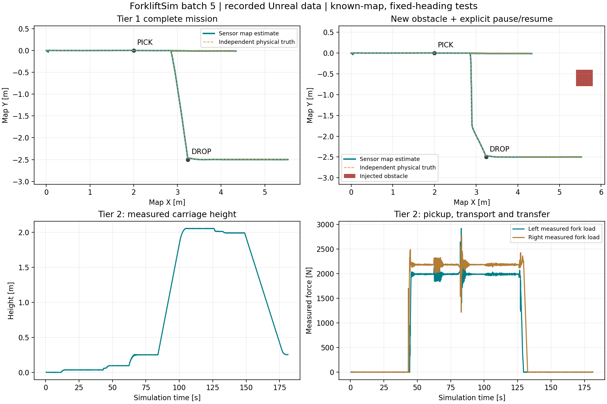

# 자동화 5묶음: 경로 주행과 운반 임무

사용자 실행은 루트 **Start.bat** 하나다. Unreal Editor와 실제 텔레메트리 대시보드가 열리면 **Play**를 누르고 게임 화면을 클릭한다. 이동 입력을 놓고 센서 초기화·정지 바이어스 추정과 위치 정합을 기다린다. 기본 창고의 바닥 팔레트를 인양해 등록된 랙으로 운반·하역하는 임무를 추가했다.

## 처음 실행해서 확인하기

기본 시작 위치는 팔레트 바로 앞이다. 수동 주행용 LiDAR 보호 여유 안에 팔레트가 있어 **obstacle_hold / 주행 차단**이 표시될 수 있다. 이때 W/S/A/D와 Z/C는 모두 차단되지만 Q/E 승강은 허용한다. 장애물이 남아 있으면 Y 확인만으로 주행을 해제하지 않는다. 수동으로 팔레트에 접근할 때는 **Shift를 유지하면서 이동 키**를 누른다. 이는 주변을 확인하며 사용하는 저속 접근 모드이며 장애물 주행 정지를 일시 해제한다. 고장·비상정지나 실행 중인 자동 작업은 우회하지 않는다.

자동 기능은 수동으로 위치를 맞추지 말고 다음 순서로 확인한다.

1. **R**로 기본 장면을 초기화하고 이동·승강 키를 놓는다. 카메라는 P로 켜진 상태여야 한다.
2. 센서 초기화를 기다린 뒤 **PageDown → Enter**를 누른다. 기본 위치가 이미 인양 구역이므로 팔레트 인식·정렬·삽입부터 시작한다.
3. HUD의 HANDLING이 acquire→align→insert→pick_lift로 바뀌며 포크가 삽입·인양하는지 확인한다. 자동 작업 중에는 W/A/S/D/Q/E/Space를 누르지 않는다. 수동 개입으로 임무가 정지할 수 있다.
4. MISSION이 to_dropoff로 바뀌면 낮게 든 채 등록 랙으로 이동한다. 이어 dropoff에서 하역하고 complete가 되면 종료다. 1단 전체 시연은 약 2분의 시뮬레이션 시간이 걸린다.
5. 새 2단 시연은 **R → 초기화 대기 → PageUp → Enter**로 시작한다. 가까운 바닥 팔레트의 인양만 확인하려면 임무 대기 중 **5**를 누른다. 5는 전체 운반 임무가 아니다.

웹의 **자율주행·물류 임무**에서 단계·경로·추정 위치·인양/하역 확인을, **자동 정렬·삽입·인양·하역**에서 로컬 작업 단계를 확인한다. 승강 높이·좌우 포크 하중·유압은 실제 움직임에 따라 변한다. **2D LiDAR·차량 정지 및 복구**의 주행/승강 차단 상태로 이동이 막힌 이유를 구분한다.

## 플레이 키

| 키 | 기본 integrated에서의 동작 |
|---|---|
| PageDown / PageUp | 임무 시작 전 랙 1단 / 2단 선택 |
| Enter | 선택된 층으로 바닥 인양→운반→하역 임무 시작 |
| Backspace | 임무 일시정지 |
| ] | 정상 센서·위치 정합·중립·정지 상태에서 명시적 재개 |
| 0 | 임무와 로컬 작업 취소 |
| X | 주행·승강 비상정지 |
| Y | 원인을 해소한 뒤 정상 수신·중립 상태에서 고장 확인. 취소 후 수동 복귀. 임무는 자동 재개하지 않음 |
| R | 장면과 팔레트 초기화. 새 임무를 처음부터 시연할 때 사용 |
| W / S | 수동 전진 / 후진 |
| Z / C | 수동 왼쪽 / 오른쪽 횡이동 |
| A / D | 수동 좌회전 / 우회전 |
| Q / E | 포크 하강 / 상승 목표 |
| Space 유지 | 제동. 자동 임무 중 수동 조작은 임무 일시정지로 전환 |
| Shift 유지 | 수동 저속 접근. 임무 중에는 이 장애물 보호 예외를 적용하지 않음 |
| 5 | 가까운 바닥 팔레트 로컬 자동 인양 |
| 6 / 7 | 등록 랙 1단 / 2단 로컬 자동 인출 |
| 8 / 9 | 등록 랙 1단 / 2단 로컬 자동 하역 |
| P / O | 카메라 센서·영상 켜기/끄기 / 후방 RGB·깊이 표시 전환. P로 끄면 인식 입력도 중단됨 |
| I / L | LiDAR / 근거리 센서 광선 표시 |
| U | 관절 센서 통신 고장 주입·해제. 복구 후 Y 확인 필요 |
| 마우스 왼쪽·오른쪽 드래그 / 가운데 드래그 | 시점 회전 / 이동 |
| 휠 / Home / V | 확대·축소 / 시점 초기화 / 상부 시점 |
| 1 / 2, 3 / 4, F | 타이어 마찰 감소·증가 / 노면 마찰 감소·증가 / 노면 프리셋 |
| N / B | 중립 / 저항 계산 전환 (물리 검사 용도) |
| H / M / J / K | 바퀴 하중 / 구동계 / 타이어 / 유압 HUD |
| T / G | 시험 노면 전환·리셋 / 고중심 시험 프리셋·리셋 |

처음 확인할 때는 **R → PageDown → Enter**로 1단 임무를, 다시 **R → PageUp → Enter**로 2단 임무를 시작한다. 자동 운반 중에는 W/A/S/D 등을 누르지 않는다. 센서 고장은 원인을 해제하고 **Y**, 위치 정합·정지를 확인한 뒤 **]**로 재개한다. 삽입·하중 전달 중 중단은 자동 재개를 거부한다. **0 → 원인 해소 → Y**로 수동 복구하거나 **R**로 시연을 초기화한다.

## 연결한 시스템

측정 엔코더·IMU와 기존 고정 지도 정합 위치 → 전체 외곽을 고려한 2D 격자 A* → 경로 추종 → 기존 바퀴 토크 제어를 연결했다. 로컬 인양과 하역은 기존 깊이 인식·근거리·존재·하중·높이·압력 센서 및 유압 제어를 사용한다. 제어기에 Actor의 실제 위치, 팔레트 태그, 실제 삽입 깊이를 넣지 않는다. 실제 위치와 접촉 하중 정답값은 독립 시험 판정·진단에만 사용한다.

임무는 인양 구역 주행→새 로컬 작업 요청→인양 완료 기록→낮은 높이의 운반→새 하역 요청→전달 완료 기록으로 이어진다. 작업 순번을 비교해 이전 작업의 완료를 새 작업으로 오인하지 않는다. 기본 장면은 이미 인양 접근 위치에 있으므로 처음부터 로컬 인양으로 넘긴다. 이동이 필요한 별도 시험에서는 인양 구역 주행도 검증한다.

Config/Mission.json의 등록 접근 위치는 기본 인양 (0,0)m, 하역 (3.24,-2.5)m다. 랙 실제 위치는 기존 등록 설정을 따른다. 임의 위치의 팔레트를 탐색하거나 임의 랙을 자동 등록하는 기능은 아니다.

기본 WarehouseLab에는 **고정 기준 기둥 3개**를 배치한다. 위치와 크기는 Config/NavigationLandmarks.json의 사전 설계값이며 해당 면을 기존 지도에 추가한다. 8m 스캐너로 창고의 평행한 먼 구조만 볼 때 위치의 한 방향을 구분하지 못하는 문제를 보완하기 위한 데모 환경 조건이다. 기둥은 실제 충돌 형상으로 스캔하고, 제어기가 실행 중 기둥 Actor 위치나 차량 정답 위치를 읽어 보정하지 않는다. 실제 시설을 자동으로 지도화한 결과나 실차 측량 검증이 아니다. Play와 R에서 자동 배치하며 별도 사용자 설정은 필요 없다. 시험장 지도는 이 기둥을 사용하지 않는다.

## 경로·장애물·복구의 범위

- 0.2m 격자, 앞 2.15m·뒤 0.80m·반폭 0.65m 외곽에 0.20m 여유를 둔다. 지도 선분의 사각형 교차 검사와 경로 구간 표본 검사를 사용한다.
- 메카넘의 횡이동으로 방향을 유지한다. 추정 방향이 초기 방향에서 0.06rad를 넘으면 정지한다. 회전 공간을 탐색하는 SE(2) 계획기는 아니다.
- 실제 LiDAR 표본을 취득 시각의 오도메트리와 지도 변환으로 투영한다. 0.15m 관측 셀을 2초 보존하고 1초마다 경로 유효성을 확인한다. 무효 경로만 다시 계획해 매초 불필요하게 멈추지 않는다.
- 무적재 0.25m/s, 적재 0.18m/s 이하. 운반 높이는 0.25m다. 주행 허가 중 보호 영역은 전체 외곽과 명령 방향 정지 여유를 포함한다. 웹 그림은 그 영역의 외접 사각형이다.
- 등록 하역 접근 위치에는 로컬 작업의 더 넓은 고정 보호 여유도 확보해야 한다. 경로가 통과 가능하더라도 하역 작업 공간에 다른 물체가 있으면 작업을 정지한다. 임의 하역 접근 위치를 새로 탐색하는 기능은 없다.
- 적재물 자기 반사는 새 인양 완료 기록·현재 양쪽 하중·측정 삽입 위치·낮은 운반 높이·짧은 형상 유효시간을 만족하는 공간만 제외한다. 그 공간과 겹치는 외부 물체를 완전히 분류할 수는 없다.
- 필수 센서 단절, 오래된 위치, 큰 위치 점프, 하중 소실, 진척 없음, 시간 초과, 150ms 임무 명령 만료는 정지한다. 공간이 생겼다는 이유만으로 임무를 재개하지 않는다.
- 자동 재시도는 빈 포크의 삽입 전 높이/인식 실패에 한 번만 허용한다. 부분 삽입과 하중 전달 실패는 수동 복구가 필요하다.

이는 알려진 2D 작업 구역·등록 출발 자세·알려진 팔레트 계열의 평지 저속 시뮬레이션이다. 3D SLAM, 전역 재위치 추정, 이동하는 사람의 안전 보장, 모든 적재 형상·노면에서의 정지거리 인증은 포함하지 않는다. LiDAR 높이에 걸리지 않는 물체와 가림은 기존 한계다.

## 웹과 검증 자료

4174의 실제 Unreal 스트림에 mission을 추가했다. 현재 단계·정지 사유·측정 위치·경로·명령·재계획 횟수를 표시하고 **실제 수신 임무 CSV 30열**을 내보낸다. Unreal 원본 임무 CSV는 Saved/Telemetry/Mission-*.csv의 36열이다. 웹의 현재 세계 최근 30초·최대 600프레임 기록과, 검증 전용으로 모든 시험을 수신하는 장기 기록기는 구분한다. 웹에서 물리를 계산하거나 제어 명령을 보내지 않는다. PortSim 4173은 변경하지 않았다.

검증은 Scripts/Test-Mission.ps1로 운반·복구 8조건, 로컬 인양 1조건, 엔코더 고장·경사 제동 2조건을 순차 실행한다. 완전 임무 시험과 특정 복구 지점만 확인하는 시험을 구분한다. Native 시험은 일정한 시뮬레이션 간격의 벤치마크로 실행하며 실시간 성능을 증명하지 않는다.

| 임무 시험 | 확인 범위 |
|---|---|
| mission_low / mission_high | 인양 구역 주행부터 랙 1·2단 하역·포크 후퇴까지 전체 임무. 독립 실제 삽입 깊이, 랙 하중 전달, 팔레트 위치, 화물 낙하·전도 검사 |
| mission_avoid_pause | 운반 도중 새 장애물 관측·경로 재계획·명시적 일시정지/재개와 전체 하역 완료. 별도 물리 위치·외곽 사각형 기준 여유 측정 |
| mission_blocked | 목적지 전체 외곽이 막힌 조건에서 주행·작업 시작을 막음 |
| mission_cancel | 실제 인양 이후 운반 중 취소와 정지 유지 |
| mission_watchdog | 실제 인양 이후 임무 갱신을 1초 중단해 150ms 명령 만료 정지 확인 |
| mission_sensor_recovery | 적재 운반 중 엔코더 2초 단절→정지→정지 지도 정합→Y 확인→명시적 재개 후 3초 주행까지. 전체 하역 완료 시험은 아님 |
| mission_retry | 카메라가 꺼진 인식 시간 초과→카메라 복구→단 한 번 새 작업→다시 삽입 시작까지. 전체 하역 완료 시험은 아님 |

이 8조건은 별도로 작성한 사각형 방의 고정 지도와 출발 오차를 사용하고 팔레트를 3m 옮겨 인양 구역 주행을 강제한다. 기본 창고의 임무와 시험장 가정을 혼동하지 않는다. `Scripts/Test-MissionRealtime.ps1 -FullMission`은 시험장 지도·팔레트 오프셋 없이 실제 기본 WarehouseLab의 1단 전체 임무를 추가 검증하는 별도 명령이다. 사용자용 시작 배치 파일을 추가하지 않는다.

별도 Scripts/Test-MissionRealtime.ps1는 실제 기본 WarehouseLab, 두 카메라, 경량 메카넘 960Hz, balanced 1280×800, 실제 웹을 켠 **비벤치마크** 20초 시뮬레이션 샘플이다. `-FullMission`은 같은 조건에서 1단 전체 임무를 완료할 때까지 측정한다. 최종 빌드의 전체 임무는 약 **120.26 시뮬레이션 초**에 완료됐고 평균 **41.79 FPS**, 프레임 p95 **38.13ms**, 실제 시간 대비 진행 **0.970배**를 기록했다. 별도 20초 샘플은 **43.21 FPS·0.992배속**이었다. 두 조건 모두 진행 ≥0.9배·평균 ≥25FPS·p95 ≤80ms 기준을 통과했다. 전체 임무 종료 시 기본 브리지의 최근 실제 **600프레임**을 보존했다. 이 600프레임은 전체 임무의 모든 웹 표본을 뜻하지 않는다. 다른 조건·움직이는 장애물·Editor PIE 성능의 보장은 아니다. 초기 시뮬레이션 1초 뒤의 1초 미만 게임 틱 간격을 집계하는 기존 프레임 계측이며 GPU 시간은 측정하지 않는다. 진행 비율은 전체 시작 이후 벽시계 시간으로 계산한다.

깊이 인식은 같은 프레임에서 반복 조회한 3×3 깊이 중간값·유효 분류를 캐시한다. 임계값·카메라 해상도·8Hz 카메라 주기·물리 간격은 바꾸지 않았다. 무적재 이동 중 전방 팔레트 탐색은 1Hz로 낮추고, 인식·삽입과 인양 직전에는 기존 카메라 프레임을 처리한다. 적재 지지 확인 후와 등록 랙 하역·후퇴에서는 전체 통로 탐색을 쉬며 근거리·존재·하중·높이 센서와 작업 완료 기록으로 제어한다. 새 시각 형상을 찾았다고 표시하지 않는다. 로컬 작업의 자기 반사 허용도 현재 근거리 삽입 측정에 맞춘 팔레트 외곽을 사용한다.

최종 동일 DLL 해시·독립 판정·실제 수신 기록은 Docs/References/MissionEvidence-20261107.json에 기록한다. 후보 빌드에서 실패한 시험은 최종 통과 숫자에 포함하지 않는다.

2026-11-07 최종 기능 검증은 단위 **89/89**, 임무·기존 기능 **11/11**과 기본 창고 전체 임무 **1/1**이다. 실제 웹은 임무·복구 8조건의 **10,808프레임·30열 CSV**를 확인했다. 웹 모듈 10개와 합성 브리지 프로토콜 32조건도 통과했다. 재시도 종료 순간의 임무 CSV는 같은 틱의 로컬 갱신 전 `align`을 담을 수 있으므로, 새 작업 순번·1회 재시도와 100ms 이내의 실제 `insert` 전환 로그를 함께 검증했다. 원본 로그와 CSV를 수정하지 않았다.

기존 카메라 실제 GPU 회귀도 통과했다. 미터 깊이 표적, 근·원거리 무효 처리, 설정 지연, 후방 RGB-D 동일 노출 동기를 검사했다. 별도 단독 실행의 검증이며 브라우저 DOM 클릭이나 Editor PIE 프레임 검증은 아니다.

