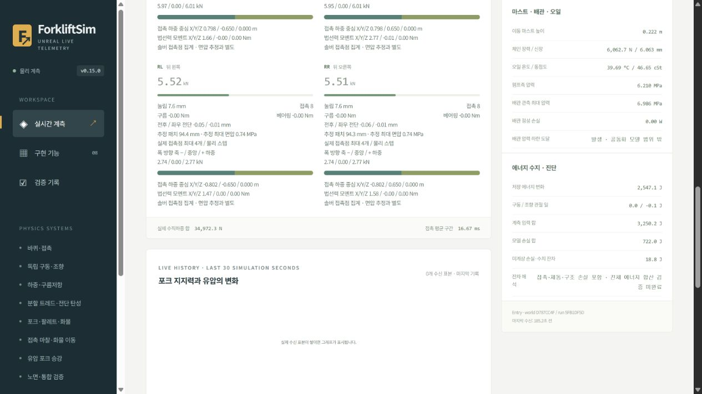

# 3+4 — 수치 오차 수정·에너지 관측·물성 보정 절차

이 문서는 3+4 당시 **일반 타이어·연결 링의 이력**이다. 현재 기본 실행의 [메카넘 모델·검증](Mecanum.md)과 구별한다.

**고정 허브 정적 반력 시험은 통과했다. 적재 턱, 미소 토크의 간격 민감도, 전체 에너지 폐합과 실차 보정은 남아 있다.** 실패를 통과로 바꾸기 위해 물성이나 허용 오차를 조정하지 않았다.

3+4 당시 기본은 강체 외피 타이어·480Hz였다. 현재 같은 `Start.bat -LegacySwerve`로 비교한다. 선택형 `Start.bat -CoupledTread`는 64조각·0.1배속·960Hz로 열린다. 현재 PC에서는 설정 배속보다 느릴 수 있다. Editor에서 Play를 누른다.

## 실제 수정

- **관절 기준축:** 연결 링의 코어 스프링 축이 변형 중인 조각을 따라 돌던 문제를 수정했다. Chaos 내부에서 컴포넌트 쌍 순서가 바뀌므로 연결 순서를 조정해 림의 축을 사용한다. 기존 독립 반경 조각 모드는 유지했다.
- **각강성·감쇠 단위:** 설치된 UE 5.6.1은 angular drive 강성·감쇠에 기본 1.5배를 적용한다. 실제 SI 물성 스프링은 이 변환을 역보정해 선언한 N·m/rad와 N·m·s/rad가 적용되도록 했다. 연결 링 코어·이웃 굽힘, 포크 휨, 탄성 브레이크 클러치에 적용했다. 경험적으로 조정한 조향 서보 이득에는 적용하지 않았다. 재료 설정값을 임의로 바꾼 것이 아니다.
- **실제 반복 상한:** 엔진의 `FIterationSettings`는 signed int8이며 최대 127이다. 과거 128/256/512 요청은 실제 127이었다. 수치 시험은 이제 범위 밖 요청과 실제 관측 불일치를 거절한다.
- **누락 에너지:** 포크의 실제 탄성각과 소성 기준각으로 휨 에너지 Kθ²/2를 추가했다. 파손 관절을 제외하고 남은 관절은 계속 집계한다.
- **감쇠 손실 관측:** 세계 좌표에서 연결점 상대 이동을 구한 뒤 현재 관절축에 투영한다. 서로 다른 시점의 회전 프레임에서 로컬 좌표를 각각 구해 뺀 초기 계산은 교체했다. 마지막 수정은 손실 관측만 바꾸며 힘은 바꾸지 않는다.

설치 엔진 버전·관련 원천 파일 해시는 `References/EngineConversions-UE5.6.json`에 기록했다.

## 고정 허브 정적 시험: 960Hz 4/4 통과

같은 질량·형상·강성·마찰과 기존 3% 반력 기준을 유지했다. 평평한 무마찰 바닥, 고정 허브, 64조각에서 독립 에너지 최소화 기준과 비교했다. 실제 최대 내부 간격은 1.041666721ms, 관측 반복 수는 위치 127 / 속도 32였다.

| 압입 / 조각 위상 | Unreal 반력 N | 독립 64조각 기준 N | 상대 오차 | 판정 |
|---|---:|---:|---:|---|
| 10mm / 0 | 9185.42330 | 9215.59933 | 0.3274% | 통과 |
| 10mm / 0.5 | 9145.65367 | 9191.75594 | 0.5016% | 통과 |
| 5mm / 0 | 3861.87489 | 3889.28729 | 0.7048% | 통과 |
| 5mm / 0.5 | 3848.67045 | 3903.13619 | 1.3954% | 통과 |

`Saved/Validation/CoupledTread-20261027-042626-496/`의 results/manifest/resolution에 원본·해시를 보존했다. 독립 64→128 반력 변화는 최대 4.14094%, Unreal 64 대 독립 128 차이는 최대 2.86411%로 이 비교 기준도 통과했다. 480Hz의 수정 후 시험은 일부 반력 기준을 통과하지 못했다. 따라서 연결 링 선택 옵션만 960Hz로 정했다.

**범위는 고정 허브·평지·5/10mm·두 위상이다.** 동적 접촉, 전체 공간 수렴, 실제 고무 정확도까지 인증하지 않는다. 웹의 전체 모델 `resolution_qualified=false`는 유지한다.

## 엄격한 단일 스프링 시험: 미소 토크 민감도 잔여

같은 코어 관절에서 이웃 연결·중력·접촉을 제거하고 물리 내부 단계에서 알려진 힘과 토크를 가했다. 선형 압축·전단 변위와 회전각을 K 역산값과 비교했다. 회전 토크는 0.02N·m이며 별도 1% 기준을 유지한다.

| 계산 간격 | 힘+토크 회전 오차 | 토크 단독 회전 오차 |
|---|---:|---:|
| 480Hz | 6.636% · 실패 | 0.054% · 통과 |
| 960Hz | 0.9125% · 통과 | 2.1750% · 실패 |
| 1920Hz | 2.076% · 실패 | 0.8226% · 통과 |

간격을 줄이면 모든 조건이 단조롭게 개선되는 상태가 아니다. `Scripts/Test-TreadConstitutive.ps1`의 엄격한 전체 판정은 미통과로 남겼다. 고정 허브의 3% 반력 통과와 이 1% 미소 토크 판정을 구별한다.

## 기본 모델·구조 회귀와 적재 턱

수정한 SI 변환 이후 기본 타이어의 양중·운반 60FPS/480Hz, 운반 60FPS/960Hz, 양중 30FPS/480Hz가 통과했다. 소성·파손 시험도 통과했다. 기준 양중의 포크 처짐은 좌우 약 3.660/3.668mm다. 이전 2.6mm대 처짐은 각강성이 1.5배 적용된 과거 결과이므로 현재 값과 혼합하지 않는다. 최종 관측 수정 후에도 양중 동작은 같고 단위 시험은 28/28 통과했다.

**425kg 적재·왼쪽 25mm 턱·연결 링 64조각·960Hz 시험은 미통과다.**

| 항목 | 측정 |
|---|---:|
| 이동 X / 최대 기울기 | 8.9917m / 1.159° |
| 최대 수직반력 | 21170.222N |
| 최대 반경 압축 | **25.476mm** |
| 기존 허용 기준 | **24.50mm** |

원본은 `Saved/Validation/Components-20261027-042626-200/`다. 이 시험 이후의 마지막 변경은 관측식뿐이므로 물리 변형 실패 결과는 유지한다. 허용치를 늘리거나 실측 없이 강성을 높여 통과시키지 않았다. 가상 장비의 설계 한계인지 재료 가정의 문제인지 판단하려면 실제 휠 자료가 필요하다.

## 에너지: 진단용 부분 수지

물리 내부 단계에서 실제 회전 증분과 토크로 구동 일을 계산하며 차체에 대한 모터 반작용도 포함한다. 조향은 실제 관절 각충격량과 상대 회전으로 계산한다. 저장 에너지는 전체 장비·팔레트·화물의 운동/중력, 타이어·브레이크·포크 스프링, 유압 압축·유체 관성·체인 탄성을 포함한다.

- 관측 입력 = **구동축 기계적 일 + 조향 관절 순 일 + 유압 DC 입력**. 전체 전기 입력이라는 뜻이 아니다.
- 모델 손실 = 유압 모델 열 + 타이어 구성식 감쇠 추정 − 구름저항 일.
- signed 잔차 = 저장 변화 − 관측 입력 + 모델 손실.
- 접촉·제동·베어링·구조/바디·소성 손실과 수치 오차는 아직 잔차에 함께 남는다. 외부 가압 벤치의 외력 일도 이 경계 밖이므로 소성/파손 시험을 에너지 합산 판정에서 제외한다.

**`full_closure=false`**이며 잔차를 0으로 보정하지 않는다. 양의 잔차가 입력 규모의 5%+20J를 넘는지 보는 단방향 탐지는 전체 정확도 판정이 아니다. 음의 잔차가 작거나 음수라는 이유로 수치 손실이 없다고 해석하지 않는다.

최종 손실 관측 수정 후 기본 양중의 종료 로그는 저장 변화 2547.057J, 관측 입력 3250.205J, 모델 손실 721.954J, 잔차 +18.807J, 양의 피크 19.022J였다. Unreal→웹 실제 392프레임에서 출처·유한값·포크 탄성 에너지·항목 간 회계식·종료 이벤트를 확인했다. `Saved/Validation/Calibration34-FinalWeb.txt`를 참고한다.

최종 관측식의 연결 링 무적재 직진은 7초 관측(행동 시험 완료 판정 아님)에서 회계식과 단방향 탐지를 통과했다. 양의 잔차 피크 615.339J / 기준 770.683J, 마지막 signed 잔차 −1237.859J다. 손실 미계상과 시간 정렬을 포함하므로 에너지 폐합으로 해석하지 않는다. 원본 CSV는 `Stability-swerve_straight-20261027-050541-D1FC10E8.csv`다.

이전 관측식으로 계산한 연결 링 턱 시험의 큰 양의 잔차는 **현재의 실제 에너지 생성량으로 해석하지 않는다.** 마지막 관측식으로 전체 32초 적재 턱의 에너지 판정을 다시 완료한 것은 아니다. 이전 자료는 이력으로 남기며 물리 변형 결과와 관측식 버전을 구별한다.

`EnergyAudit.png`는 SI 변환 수정 후, 마지막 감쇠 관측식 수정 전의 4조건 비교 이력이다. 현재 최종 양중 관측과 완전히 같은 빌드의 수렴 시험으로 인용하지 않는다.

## 실제 자료와 물성 보정

[EXSTO Vulkollan 92 TDS](https://webstore.exsto.com/upload/elfinder/fiches-matieres/FT-VULKOLLAN-V92.pdf)를 원문과 해시로 보존했다. ISO 37의 10% 인장 응력 4.9MPa는 시편 인장값이며 완성 바퀴의 압축 강성이나 현재 링의 등가 E와 같지 않다. 경도·정격 하중도 실제 하중–눌림 곡선으로 대체할 수 없다. 공개 부품 치수·재료 강도·오일 자료는 기존 참조를 유지하되 실측값과 가정값을 구별한다.

`Scripts/calibrate_tyre.py`는 실제 휠 시험의 출처·장비·형상·온도·SI 단위·불확도와 최소 학습 3점/별도 검증 2점을 요구한다. 수치 시험의 설정·원천·DLL 해시가 일치해야 한 개의 등가 기초 강성 후보만 계산한다. **Config는 자동 변경하지 않는다.** 후보 적용 전 새 물성의 native·적재 노면 재검증이 필요하다. 한 곡선으로 감쇠·마찰·Poisson까지 식별했다고 주장하지 않는다.

[실측 양식](References/TyreMeasurementTemplate.json)은 가짜 측정점 없이 비워 두었다. 현재 상태는 `awaiting_wheel_measurements`이며 활성 강성은 가정값이다. 원문 성공/실패와 SHA256은 `References/Calibration34Sources.json`에 기록했다. P+S PDF는 404였으며 채택하지 않았다.

## 남은 작업

1. 미소 토크의 시간 간격 민감도와 동적 접촉 오차 분리.
2. 적재 턱의 변형 한계 재설계/실측 보정 및 동일 조건 재검증.
3. 마지막 손실 관측식으로 전체 적재 운반·턱 재검증, 미계상 손실과 수치 오차 분리.
4. 실제 휠 하중–변형·장비 가감속/양중 자료 확보 후 보정.

3+4의 수정과 검증 절차를 구현한 상태이며 위 기준을 모두 완료한 상태는 아니다. 장치 상세화를 추가해 이 실패를 덮지 않는다.

최종 증거·빌드별 해시·미완료 기준은 [최종 검증 기록](References/NumericalCalibrationFinal-20261027.json)에 묶었다. 같은 폴더의 이전 `NumericalCalibrationValidation-20261027.json`은 축·SI 변환 수정 전의 이력이다.
