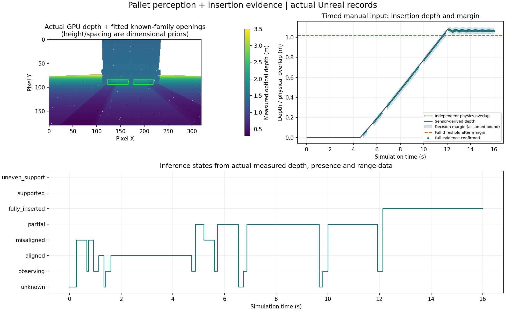

# 3번 묶음 — 팔레트 인식·삽입 판정

실행은 루트 `Start.bat` → Play다. 기본 integrated에서 전방 깊이 영상과 기존 센서 측정을 처리한다. 자동 정렬·삽입·운반 명령은 이 묶음에서 내리지 않는다. ForkliftSim 웹은 4174부터 사용하며 실제 Unreal의 인식·판정 결과와 별도 CSV를 제공한다.

## 인식 입력과 범위

현재 Warehouse Standard 팔레트 계열을 대상으로 하는 기하 템플릿 검사다. 범용 물체 검출기나 학습된 팔레트 분류기를 구현했다고 표시하지 않는다. `Config/PalletPerception.json`의 통로 간격·폭·높이와 지지대 배치는 알려진 형상 사전 정보다.

인식에 전달하는 카메라 표본은 **오차·양자화·누락·지연이 적용된 깊이 배열, 유효 상태, 보정된 내부 파라미터와 취득/전달 시각**이다. 렌더러 정답 깊이, 카메라 월드 자세, 팔레트 배우·태그·정답 위치는 입력에 포함하지 않는다.

1. 깊이 영상을 보정된 카메라 축의 점으로 역투영한다.
2. 대략 수직인 앞면 후보를 찾는다. 화물이 팔레트보다 몇 cm 앞에 나올 수 있으므로 두 앞면을 하나로 합치지 않는다.
3. 세 지지대·통로 위쪽 가로판, 두 통로의 더 먼 반사 증거와 양쪽 실재 경계를 검사한다. 단순한 상자나 벽의 표면은 두 통로 조건을 충족하지 않는다.
4. 측정된 지지대 표면으로 거리·접근 각도를 보정하고, 관측된 경계로 통로 좌우 위치·폭과 위쪽 경계를 추정한다. 통로 높이 자체는 알려진 계열의 치수이며 독립적으로 완전히 측정한 값으로 표시하지 않는다.
5. 일치 점수와 취득 시각을 함께 내보낸다. 점수는 학습·통계 보정된 확률이 아니다.

`NoReturn`·광학 누락을 빈 통로로 채우지 않는다. 이 가상 카메라에서 명시적으로 구분되는 `TooFar`는 측정 범위 밖이라는 약한 증거로만 사용하고, 각 통로에는 실제 유효한 더 먼 반사도 필요하다.

## 카메라 배치

카메라는 기존 두 개를 유지한다. 전방 카메라는 캐리지 기준 (5,-10,10)cm, 아래로 10°를 향하도록 옮겼다. 포크가 두 통로를 가리는 문제를 줄이기 위한 배치이며 포크와 함께 승강한다. 후방 RGB-D 배치는 유지한다. 전방 깊이 화면의 초록 테두리는 해당 프레임에서 인식한 통로 위치와 알려진 높이 모델을 표시한다.

새 위치는 운반 중 화물에 의해 가려질 수 있다. 이런 경우 현재 영상 인식을 주장하지 않는다. 카메라를 P로 끄면 현재 인식·기하 판정을 무효화한다. 카메라 배치 변경은 기존 관찰용 저위치 배치와 다른 선택이다.

## 삽입·지지 판정

| 상태 | 필요한 증거 |
|---|---|
| 판정 불가 | 필수 센서 결측·오래된 값, 인식/추적 상실 |
| 정렬됨 | 두 통로를 인식하고 좌우·높이·각도 여유를 만족하지만 아직 삽입 전 |
| 정렬 불량 | 통로의 여유나 각도를 만족하지 않음 |
| 부분 삽입 | 유효한 기하 추정에서 포크가 들어갔지만 완전 삽입 기준을 충족하지 않음 |
| 완전 삽입 증거 확인 | 좌우 깊이에서 오차 여유를 뺀 값이 기준 이상이고, 네 존재 센서가 모두 유효한 ON이며 정렬·지속 시간 조건을 충족 |
| 양쪽 지지 | 좌우 포크 접촉 하중 측정이 있음. 현재의 완전 삽입 깊이를 뜻하지 않음 |
| 편측 지지 | 한쪽에만 뚜렷한 접촉 하중이 있음 |

근거리 센서 4개·존재 센서 4개·좌우 하중·높이의 유효 상태를 사용한다. 포크 끝의 `TooClose`는 정상 가로판 통과 때도 발생하므로 그것만으로 불량 정렬을 확정하지 않는다. 좌우 뿌리 거리 측정이 이전 팔레트의 예측 앞면과 일치할 때만 깊이 보강에 사용한다. 임의의 거리 반사를 팔레트 정답 앞면이라고 취급하지 않는다.

통로가 시야에서 사라지는 구간은 마지막 인식과 **센서 기반 오도메트리·높이 이력**으로 제한적으로 추적한다. 보이는 구간에서는 예상 위치 근처에 실제 표면 증거가 남아 있어야 하며 가까운 가림 구간에서도 양의 근거리 반사 증거를 요구한다. 추적의 시간·거리 한계와 증가하는 깊이 오차 여유를 적용한다. 이미 든 팔레트가 월드에 고정돼 있다고 가정하지 않도록 하중이 잡히면 그 정적 추적을 폐기한다.

현재 프로파일의 추적 한계는 마지막 인식으로부터 20초·이동 1.8m다. 기본 깊이 여유는 25mm에 이동·시간에 따른 가정 여유를 더하며, 좌우 뿌리 거리와의 일치가 확인되면 약 30mm 여유의 거리 보강을 사용한다. 이 여유는 실측으로 보장된 오차 한계가 아니다. 영상 인식이 없는 추적과 최신 영상 인식을 웹에서 구분한다.

`지지 전 완전 삽입 이력`은 과거 증거이며 현재 삽입 깊이의 보증이 아니다. 하중이 보인다고 ‘완전 삽입’으로 바꾸지 않는다. 존재 센서 ON만으로도 완전 삽입을 확정하지 않는다. 현재 설계는 인증된 삽입 안전장치가 아니며, 장시간 시야 가림·팔레트 이동·다른 종류·심한 변형·큰 롤/피치·잡다한 환경에서는 미확정이나 오인식 가능성이 남는다.

## 검증 원칙

합성 단위 표본은 기하 검사와 결측·상자 거부, 깊이 오차 여유, 센서 지속 시간, 지원 하중과 삽입 상태의 분리를 검증한다. 실제 GPU 조건은 소유한 Fab 팔레트의 렌더링된 깊이 표본으로 확인한다. 인식 입력에 정답 위치를 주지 않으며 거리 오차·완전 삽입의 실제 물리 깊이는 별도의 시험 판정에서만 대조한다. GPU 시험의 일정한 수동 입력은 시험 조작이며 자율 삽입의 구현이 아니다.

초기 후보는 화물·팔레트 앞면을 합쳐 인식하지 못했고, 접근 중 구멍 일부가 가려지는 상황과 정상 가로판의 근접 반사를 충분히 구분하지 못했다. 이 실패 기록은 보존했다. 층별 앞면 후보·측정 경계 보정·표면 증거가 남는 제한된 추적과 뿌리 거리의 일치 검사를 추가했다. 초기 변형 시험의 팔레트 이동·회전 배치도 수정해, 판재·화물을 실제 초기 회전에 맞춰 생성한다. 2단 조건은 높은 팔레트와 올라간 포크, 최신 인식까지 함께 확인한다.

카메라의 거리 교정 회귀는 표준판만 렌더링하는 고립된 실제 GPU 구성이다. 아래로 기울어진 카메라에서 먼 교정판보다 바닥이 먼저 보이는 상황을 교정 오차로 오인하지 않도록 했다. 실제 팔레트 인식 시험과 일반 실행은 바닥·화물·포크를 포함한 전체 장면의 가림을 그대로 렌더링한다.

현재 20초·1.8m 한계와 삽입 중 기준 형상 고정은 4번 묶음의 저속 접근 시험에서 보강한 프로파일이다. 아래 결과는 3번 묶음 완료 당시(10초·1.2m)의 기록이며, 현재 제어 연결·회귀 결과는 [HandlingControl.md](HandlingControl.md)에 별도로 기록한다.

## 3번 묶음 검증 결과 — 2026-11-06

- 최종 빌드의 단위 **71/71**, Native **12/12**(실제 GPU 인식·삽입 9조건, 주행·기존 물리 3조건), 두 카메라의 실제 GPU 거리·결측·지연·RGB-D 동기 회귀와 웹 프로토콜 30항목이 통과했다.
- GPU 조건은 정렬, 실제 수동 입력 삽입, 10° 회전, 0.15m 편심, 상자만 있는 음성 조건, 카메라 중단, 랙 2단 높이, 근거리 센서 통신 단절, 실제 웹 전송을 포함한다. 상자는 인식하지 않았고, 회전·편심은 정렬 불량, 카메라 중단과 필요한 근거리 측정의 오래된 구간은 판정 불가가 됐다.
- 인식된 앞면의 정답 대조 거리 오차는 시험 조건 전체에서 최대 약 **37.5mm**였다. 현재 형상·센서·초기 조건의 관측값이며 모든 시야·팔레트의 정확도 보장이 아니다.
- 수동 삽입 시험에서 완전 삽입 증거가 확인된 **59개 Native 스냅샷**의 실제 좌우 최소 삽입 깊이는 **1.063m**, 그 구간의 깊이 추정과 실제 값 차이는 최대 약 **15.1mm**였다. 이것을 접근 전체의 최대 오차나 실차 성능으로 표시하지 않는다.
- 실제 웹 수신 **238프레임**에서 인식 100·부분 삽입 87·완전 삽입 증거 56프레임과 **29열·238행 CSV**를 확인했다. Native 기록과 웹은 기록 시점·전송률이 달라 개수가 다르다. 브라우저 DOM 클릭을 자동화한 검증은 아니다.
- 센서 주행 직진과 기존 운반·경사 제동은 이전 빌드와 위치·속도·포크 높이·하중·에너지 등 9개 CSV 항목의 최대 차이가 0이었다. 2번 묶음의 저마찰 토크 진동 등 기존 제한은 해결한 것으로 표시하지 않는다. 새 FPS 성능 인증도 이번 범위에 포함하지 않는다.

근거: [Native 검증](References/PalletPerceptionValidation-20261106.json), [실제 웹·CSV](References/PalletPerceptionWeb-20261106.json), [기존 동작 비교](References/PalletPerceptionPhysicsParity-20261106.json), [빌드·소스·검증 해시](References/PalletPerceptionEvidence-20261106.json).
