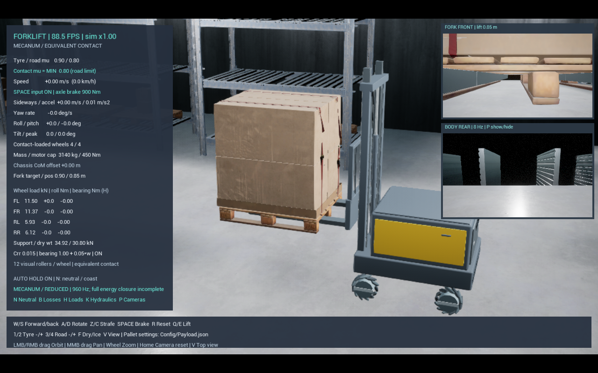

# 프레임 개선과 센서 적용 순서

이후 근거리 센서 묶음은 [ProximitySensors.md](ProximitySensors.md)를 따른다. 기본 integrated에 포크 전방 거리 4개·위쪽 물체 감지 4개를 추가했으며 아래 당시 미구현 설명·시험 수치는 이력이다.

2026-11-05 이후 묶음: [DynamicsSensors.md](DynamicsSensors.md). IMU·실린더 압력·좌우 포크 접촉 하중의 별도 측정 출력을 추가했다. 아래의 당시 미구현 설명과 검증 수치는 이력이며, 새 센서의 검증은 해당 문서를 따른다.

2026-10-29, Ryzen 5 5600H / RTX 3050 Laptop. 사용자가 선택한 **경량 모델 기본 + 기존 정밀 모델 유지**를 integrated에 적용했습니다. 아래는 RGB 관찰 화면 단계의 성능·계획 이력입니다. 이후 전방 깊이·후방 RGB-D 센서를 추가했으며 최신 구성과 검증은 [CameraSensors.md](CameraSensors.md)를 확인하세요. 자동화와 3D SLAM은 아직 포함하지 않습니다.

## 기본 실행과 모델 범위

- `Start.bat` → Unreal Editor와 실제 계측 대시보드 → Play. 현재 경량 메카넘 기본은 960Hz·32/32회이며, 단일 스레드 물리·balanced 렌더링·전후방 카메라를 유지합니다. 2026-10-31 접촉·랙·수치 검증은 [CurrentPhysicsQualification.md](CurrentPhysicsQualification.md)를 따릅니다. 아래 16/16회 성능 수치는 해당 시점의 이력입니다.
- `Start.bat -MecanumModel detailed`: 기존 롤러 48개 강체·1920Hz·32/32회 정밀 모델. 사용자 PC에서 느리므로 비교 시험용입니다.
- `Start.bat -NoCameraViews`: 카메라 렌더 비용 없이 실행. Play 중 P도 두 카메라 촬영과 표시를 함께 켜고 끕니다.
- `-Rendering original`, `-ParallelPhysics`는 각각 기존 그래픽·물리 스케줄링 비교 옵션입니다. 별도 시작 배치 파일은 없습니다.

경량 모델은 네 개의 실제 회전 강체 바퀴와 Chaos 법선 접촉을 사용합니다. 메카넘 방향의 접촉 슬립으로 마찰력을 계산하고 실제 법선 하중의 μN으로 제한합니다. 구동력은 바퀴에 가하며 축 관절을 통해 차체에 전달되고, 모터 반작용도 유지합니다. 제동·정지 유지는 접촉 탄성 상태와 쿨롱 한계로 계산합니다. 차체 위치나 속도를 직접 바꾸어 주행시키지 않습니다.

롤러는 시각 메시로 보존하지만 48개 개별 운동·베어링 상태는 경량 모드에서 계산하지 않습니다. 바퀴 총질량 50kg과 잠긴 조립체 기준 관성을 보존한 등가 모델입니다. 제거된 자유 롤러의 모든 동역학을 보존했다는 뜻은 아닙니다. 포크 휨·유압·팔레트·별도 화물·실제 접촉은 유지합니다.

웹에는 모델 종류를 표시하며, 개별 롤러 상태·횡축 슬립·분리 측정하지 않은 베어링 손실을 가짜 0으로 표시하지 않습니다. 접촉 손실은 추정값, 접촉 탄성 에너지는 별도 항목으로 표시합니다. 전체 다물체 에너지 폐합과 실차 보정은 여전히 미완료입니다.

## 확인한 병목

기존 정밀 모델은 4개 허브와 수동 롤러 48개, 부품 관절/접촉을 1920Hz·32/32회로 계산합니다. Unreal Insights의 짧은 1280×800 시작 측정에서 기존 게임 프레임 평균 약 254ms, EndPhysics 대기 약 230ms였습니다. 시작 구간에는 초기 셰이더 비용도 포함되므로 장시간 정상 FPS로 일반화하지 않습니다. 그래픽만 낮추어 해결될 규모가 아닌 물리 병목을 확인한 자료입니다.

단일 스레드 실행 후보는 같은 해상도/시간 간격에서 프레임 평균 약 162ms였지만, 추출 구간이 달라 최종 개선율로 사용하지 않습니다. 이후 같은 1920Hz·32/32회에서 중립·반작용·제동 3/3 검증을 통과하여 단일 스레드 실행을 기본 integrated에 채택했습니다. 원래 실행은 `Start.bat -ParallelPhysics`로 비교합니다. 선형 관절 후보는 반작용 검증 실패, 위치 반복 8회/속도 32회 후보는 중립 최종 속도 0.472m/s로 기존 0.1m/s 기준을 넘었습니다. 둘 다 기본 물리에 채택하지 않습니다. 정확도 기준을 완화하거나 마찰을 키워 실패를 감추지 않습니다.

원본 기록은 `Saved/Validation/Performance`에 있습니다. Trace는 한글 경로를 피하는 기존 ASCII 프로젝트 junction으로 기록했습니다. 추출은 [Epic의 Unreal Insights CLI 문서](https://dev.epicgames.com/documentation/en-us/unreal-engine/using-the-timers-and-counters-tabs-in-unreal-insights-for-unreal-engine?application_version=5.6)를 따릅니다.

## 독립적으로 적용한 그래픽 설정

기본 integrated의 `Start.bat`에 balanced 렌더링을 연결했습니다. TSR 대신 FXAA, 장면 렌더 해상도 75%, 낮춘 후처리/그림자와 1024 그림자 맵을 사용합니다. 렌더링 옵션 자체는 물리 모델이나 주기를 변경하지 않습니다. 원래 화면 설정 비교는 `Start.bat -Rendering original`입니다.

정밀 다물체 모델·물성·이전 검증 기록은 보존했습니다. 경량 모델의 별도 회귀를 수행하며, 이전 정밀 모델 시험 결과를 경량 모델 통과로 재사용하지 않습니다.

## 실제 장면의 전후방 화면

오른쪽 위는 포크 캐리지에 붙어 높이가 함께 변하는 전방 카메라, 아래는 차체에 고정된 후방 카메라입니다. 전방 렌즈는 현재 450mm 포크 간격에서 왼쪽 포크 옆의 팔레트 구멍 높이에 두었습니다. 캐리지 기준 위치는 (5,-10,-14)cm, 후방은 차체 기준 (-60,0,70)cm입니다. 화물을 숨기지 않고 실제 가림을 반영합니다. 포크 간격이나 팔레트 형상이 바뀌면 장착 위치를 다시 검증해야 합니다.

실제 장면을 SceneCapture2D로 촬영하고 Unreal HUD에 표시합니다. 브라우저 가상 이미지나 객체 위치로 그린 합성 화면이 아닙니다. 각 320×180, 시뮬레이션 시간 기준 최대 8Hz이며, 서로 다른 게임 틱에 촬영합니다. GPU 읽기나 웹 영상 전송은 하지 않습니다. 별도 영상 렌더링의 그림자·반사·볼륨 안개를 줄이고 장면 갱신을 프레임 끝으로 모아 비용을 줄입니다. 근접 물체를 잘못 통과해 보지 않도록 near clip은 1cm입니다.

이 카메라는 시야 확인용 RGB 화면입니다. 팔레트 검출·깊이 측정·잡음/지연 센서 모델은 아직 아닙니다. 카메라가 켜지면 오른쪽 기존 물리 HUD를 숨겨 화면 겹침을 피합니다. P로 카메라를 끄면 기존 물리 HUD가 다시 표시됩니다. 웹의 실제 물리 계측은 계속 갱신됩니다.

## 제안 센서 구성 (아직 미구현)

아래 주기와 해상도는 시뮬레이터의 초기 설계값이며 실제 제품 보장 사양이 아닙니다.

|순서|센서 / 위치|측정·용도|초기 주기|
|---|---|---|---:|
|1|구동축 엔코더 ×4 / 각 허브|회전량·회전속도, 메카넘 휠 오도메트리|100Hz|
|1|6축 IMU / 차체 중심 부근|각속도·비력, 회전과 기울기, 오도메트리 보완|100Hz|
|1|승강 위치 센서 + 상하단 리미트 / 마스트|캐리지 실제 높이·끝 위치|50Hz|
|1|유압 압력 센서 / 승강 실린더|압력, 양중 부하·과부하 추정|100Hz|
|2|2D LiDAR ×2 / 차체 반대편 모서리|전후좌우 장애물·지도와 위치 추정, 정지 영역|10Hz, 각 270 ray부터|
|3|깊이 카메라 / 캐리지의 팔레트 방향|팔레트 입구·구멍·접근 각도 정렬|10Hz, 저해상도부터|
|3|단거리 ToF/광전 센서 / 포크 주변|삽입 근접·팔레트 존재·끝 거리 확인|20Hz|
|4 선택|포크 변형/하중 센서|좌우 편하중 추정, 압력 기반 부하 추정과 비교|50Hz|

현재 메카넘 허브에는 조향 회전축이 없으므로 조향각 센서를 만들지 않습니다. 수동 롤러 48개에 엔코더를 각각 달지도 않습니다. 바퀴가 헛돌면 축 엔코더만으로 실제 이동을 알 수 없어 IMU·LiDAR와 비교해야 합니다.

LiDAR 기반 AGV 위치 추정은 [SICK LiDAR-LOC 설명](https://www.sick.com/sg/en/lidar-loc/s/digitalsolutions-resource-lidar)을 참고합니다. 깊이 센서의 팔레트 구멍 검출 용도는 [SICK의 Pallet Pocket Detection 사례](https://www.sick.com/be/fr/precise-detection-of-pallet-pockets-using-a-3d-snapshot-camera/w/blog-pallet-pocket-detection-transolt), 승강 센서는 [AGV fork height 적용 예](https://www.sick.com/it/en/catalog/applications/measurement-of-fork-lift-height-on-agvs/c/p613534)를 참고합니다. 현재 제안은 이 제품들의 인증·성능을 그대로 복제했다는 뜻이 아닙니다.

## 센서 모델의 구현 규칙

- 물리 정답값과 센서 측정값을 다른 데이터 경로로 둡니다. 기존 웹 물리 계측을 센서라고 이름만 바꾸지 않습니다.
- 측정 주기·양자화·잡음·바이어스·지연·누락·유효 범위, 실제 장착 위치와 가림을 표현합니다. 시뮬레이션 타임스탬프와 고정 난수 시드로 재현합니다.
- 엔코더는 회전량을 이산 카운트로, IMU는 센서 좌표계의 비력/각속도로 출력합니다. 압력으로 화물 질량을 추정할 때 체인 배율·씰 마찰·가속도를 고려합니다.
- 팔레트의 위치와 화물 질량을 장면 객체에서 직접 읽어 인식 결과로 보내지 않습니다. LiDAR와 깊이 자료로 검출한 결과를 물리 정답과 따로 비교합니다.
- 모든 센서를 렌더 프레임마다 실행하지 않습니다. LiDAR 두 개부터 개별 예산을 측정하고 카메라를 추가합니다. 메카넘은 옆으로도 이동하므로 전후방만 보는 충돌 회피로 끝내지 않습니다.

정밀 물리 단일 스레드 회귀: `Mecanum-20261029-163343-322`, 감속 최종 0.0349m/s, 반작용 각운동량 오차 0.05841N·m·s, 제동 최종 속도 0m/s. 원본 구조·질량·마찰·1920Hz·32/32회를 유지했습니다.

## 검증과 측정 한계

경량 480Hz 후보는 주행 9개 + 적재/중립/제동/반작용 6개, 총 15/15 조건을 통과했습니다. 팔레트를 든 6도 경사 제동 정지거리 약 7cm, 정지 후 이동 약 4mm였습니다. 같은 조건의 960Hz 후보는 운반 중 포크 높이가 목표 0.45m에 대해 약 0.454m로, 480Hz의 약 0.480m보다 가까웠습니다. 이를 고려해 960Hz를 기본으로 선택했습니다. 결과는 `Saved/Validation/Mecanum-20261029-172054-793`, `172053-065`, `172932-244`에 기록했습니다.

최종 960Hz·16/16회 회귀는 주행 9/9, 적재·중립·반작용·제동 6/6, 합계 **15/15**를 통과했습니다. 결과는 `Saved/Validation/Mecanum-20261029-180404-176`, `Mecanum-20261029-180417-313`입니다. 적재 6도 경사 제동 정지거리 0.0793m, 유지 이동 0.00342m, 독립 공중 반작용 시험 각운동량 오차 0.00151N·m·s입니다. 바퀴별 접촉 법선 합산의 차이는 0으로 기록됐습니다. 이는 해당 수치 시험의 통과이며 실차와 같다는 증명은 아닙니다.

물리 단위 시험 **33/33**, 웹 브리지·상태 회귀 **4/4**(프로토콜 23검사 포함)를 통과했습니다. 최초 실제 Unreal 504프레임 검증에 이어 최종 렌즈 위치 실행의 **537프레임**에서도 네 휠·경량 모델 표시·실제 FPS·미계산 롤러/횡축 슬립의 null 구분을 확인했습니다. `Saved/Validation/Performance/Final-Actual-Web.json`에 결과를 기록했습니다. 최종 모듈에서 기존 정밀 모델 반작용 1/1도 통과했습니다(`Mecanum-20261029-182125-497`).

카메라 없는 1280×800 오프스크린·실제 웹 전송·비 benchmark 짧은 실행에서 경량 480Hz 약 165 FPS, 960Hz 약 122 FPS를 기록했지만, 이후 같은 빌드의 10초 실행은 약 34~41 FPS였습니다. 이 초기 고수치를 안정적인 정상 성능으로 소개하지 않습니다. 카메라 두 개와 실제 웹 전송을 켠 30초 실행은 평균 **44.97 FPS**, 프레임 p95 **43.26ms**, 실제 시간 대비 진행 **0.904배**였습니다. 이 30초 기록의 전방 렌즈는 최초 중앙 위치였으며 이후 아래 팔레트 구멍 위치로 조정했습니다. 솔버 8/8회 후보는 짧은 실행 약 47 FPS에 그쳐, 별도 물리 검증 없이 기본값에 채택하지 않았습니다. 당시 기본은 검증된 16/16회였습니다.

**최종 위치의 단독 재측정:** 1280×800, 960Hz·16/16회, 두 카메라·실제 웹 전송, trace/benchmark 없음, 30초 실행에서 **평균 86.95 FPS**, **p95 30.39ms**, **진행 0.972배**, 마지막 120프레임 평균 **71.58 FPS**였습니다. 이 값은 `Runtime-reduced-960Hz-20261029-182500.json`, `Final-Cameras-30s.log`의 2684개 표본입니다. 이전 렌즈 위치·시작 구간·초기화 비용이 다른 기록에서 최종 개선 배수를 계산하지 않습니다. [검증 요약 JSON](References/RealtimeMecanumValidation.json)에 설정과 결과를 함께 보존했습니다.

FPS는 게임 틱 사이 실제 시간으로 측정한 값이며 모니터 표시 FPS나 장시간 에디터 PIE 성능 보장이 아닙니다. 첫 1초 이후 구간에도 초기화·셰이더 비용이 남을 수 있고, 끝부분의 스크린샷 저장도 프레임 시간을 포함합니다. 화면과 웹에 게임 FPS·진행 배율을 따로 표시합니다. 성능 시험은 다른 물리 시험 없이 단독 실행하며, 병행한 카메라 위치 확인 실행의 FPS는 성능 증거로 쓰지 않습니다.

승강 시각 확인에서는 포크 높이 약 0.866m에서 최종 전방 렌즈 높이 약 0.911m, 후방 렌즈 높이 약 1.190m로 기록했습니다. 두 장착점의 추종 위치 오차는 1e-10cm 미만이었습니다. 이는 수치상 부착 관계 확인이며 실제 센서 장착 공차를 뜻하지 않습니다. 아래 사진은 실제 적재 상태의 전후방 화면입니다.

초기 정밀 모델 Trace 약 4~7FPS 기록은 계측 오버헤드·웹 사용 여부·시작 구간 차이가 있어 위 수치와 나누어 개선 배수를 계산하지 않습니다. `Saved/Validation/Performance/Summary.json`에 당시 조건 차이를 남겼습니다.

사용자가 2층은 **랙의 두 번째 적재단**이라고 확인했습니다. 캐리지와 함께 움직이는 팔레트 깊이/근접 센서, 승강 위치·상하단 리미트, 선반 높이 확인을 센서 단계에 포함합니다. 현재 1.5m 승강 범위가 두 번째 선반의 팔레트와 안전 간격을 만족하는지 실제 선반 치수로 확인하고 필요한 스트로크를 검증해야 합니다.

2층 하역 전 확인할 추가 치수: 현재 약 1.22m 화물 높이와 팔레트 높이를 합친 값이 선반 사이 유효 높이보다 작아야 합니다. 기존 1.15m 단 간격은 해당 큰 화물에 부족할 수 있으므로 실제 맵의 보·플랫폼 충돌 상면을 측정하고 선반 배치 또는 시험 화물 높이를 조정해야 합니다. 승강 카메라 추가만으로 2단 적재가 완성된 것은 아닙니다.
