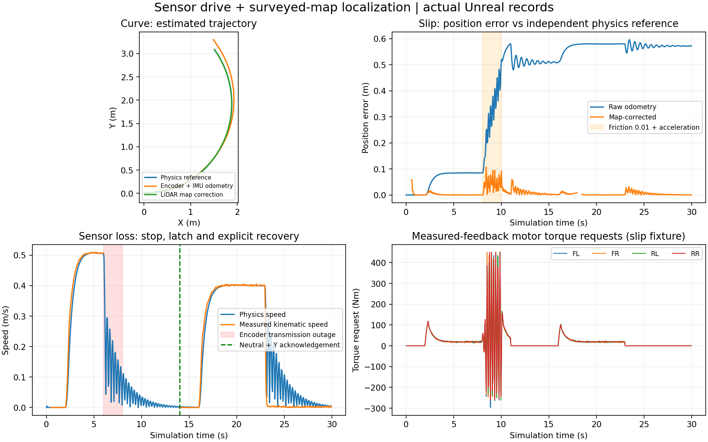

# 2번 묶음 — 센서 주행·2D 위치 추정

기본 실행은 루트 `Start.bat` → Editor에서 Play다. ForkliftSim 웹은 4174부터 시작한다. 첫 약 0.4초 이상은 이동 입력을 놓고 정지 상태로 IMU 바이어스를 추정한다. W/S·Z/C·A/D 조작은 유지한다. X 비상정지, U 센서 단절, 중립 상태의 Y 복구와 기존 팔레트 수동 접근용 Shift 저속 모드도 유지한다.

## 제어 입력과 물리 모델의 구분

기본 integrated의 주행 제어는 네 출력축 엔코더의 측정 회전 속도와 IMU의 측정 Z 각속도를 사용한다. 엔코더에는 기존 양자화·잡음·지연·누락이 적용돼 있다. 센서가 정상이고 서로의 취득 시각 차이가 60ms 이내일 때만 사용한다. 물리 정답 위치·속도·차체 방향·바퀴 회전수로 결측을 채우거나 외부 주행 오차를 보정하지 않는다.

샘플링된 바퀴 속도에 필터와 PI 제어를 적용해 각 바퀴의 토크를 요청한다. IMU의 정지 바이어스를 측정으로 추정한 뒤 각속도를 적분하고, 방향 유지·선회 오차를 바퀴 목표로 배분한다. 모터 토크·출력·응답 지연과 감속기 손실, 차체로 전달되는 반작용은 기존 물리 모델에서 계산한다. 모터 물리 모델이 실제 회전수로 역기전력·출력 한계·에너지를 계산하는 것은 측정 피드백을 대체하는 제어와 구분한다.

주행 엔코더 하나 또는 IMU가 오래되거나 사용할 수 없으면 주행 고장을 래치하고 기존 차량 전체 정지에 연결한다. 정상 신호가 돌아와도 자동 재출발하지 않는다. 중립 상태에서 Y를 누르면 주행·차량 정지 래치를 함께 복구한다. 명령은 100ms 유효기간을 갖고, 물리 스레드에서 만료하면 구동 요청을 차단한다. 만료를 받은 제어 측은 고장 정지·제동을 래치한다. 프로세스 전체 고장에 대한 독립 하드웨어 제동을 모델링한 것은 아니다.

## 위치 추정

1. 네 바퀴의 메카넘 전진 운동학으로 차체 기준 전진·횡 속도를 추정한다.
2. 바이어스를 보정한 IMU Z 각속도와 결합해 평면 오도메트리를 적분한다. 가속도를 이중 적분한 위치가 아니다.
3. 취득 시각별 오도메트리 이력을 보관한다. 지연된 LiDAR는 현재 자세 대신 **스캔 취득 시각의 자세**와 정합한다.
4. 측정점을 고정 지도의 선분과 point-to-line 방식으로 정합하고 map→odom 변환을 보정한다. 오도메트리 자체를 덮어쓰거나 물리 차체를 이동시키지 않는다.
5. 점이 부족하거나, 한 방향 벽만 보여 위치를 결정할 수 없거나, 잔차·교정량이 기준을 넘으면 정합을 거부한다. 0.75초 이상 보정이 없으면 지도 위치를 미확정으로 표시한다. 수동 주행은 유효한 엔코더·IMU로 계속할 수 있고, 이후 자율주행에서는 위치 확정을 별도로 요구해야 한다.

엔코더는 바퀴의 구름을 측정하므로 헛돌면 실제 이동량과 다르다. LiDAR의 고정 지도 보정이 이 누적 오차를 줄인다. 엔코더만으로 실제 지면 속도나 모든 방향의 슬립을 정확하게 알 수 있다고 표시하지 않는다. 관측을 놓친 시간도 별도로 기록한다.

## 지도와 설정

- `Config/SensorDrive.json`: 필터·초기 바이어스 추정 시간·제어 이득·토크 한계·명령 유효기간. 가상 설계값이다.
- `Config/NavigationMap.json`: 현재 창고의 고정 지도. `Scripts/ExportNavigationMap.py`로 **에디터에서 오프라인**으로 정적 충돌 프록시의 높이 0.22m 단면을 내보냈다. 현재 지도는 164선분이다. 지게차·동적 팔레트·화물의 현재 위치를 내보내지 않는다.
- 시작 위치·방향은 배치된 출발 구역에서 알고 있다고 가정한다. 창고 전체에서 위치를 잃은 상태로 시작하는 전역 재위치 추정, 큰 위치 오차 자동 복구, 미지 환경 지도 생성과 3D SLAM은 구현 범위에 포함하지 않는다.
- 창고 구조를 바꾸면 지도를 다시 내보내야 한다. 동적 화물·스캔 평면 밖 물체·경사·큰 롤/피치는 평면 정합의 한계다. 일부 잘못된 반사와 지도에 없는 물체는 제한된 대응 거리·강건 가중치로 배제하지만 모든 오정합을 보장해 거르는 모델은 아니다.

기존 물리·1번 묶음·승강 시험의 역사적 비교 경로는 기존 제어를 유지한다. 새 센서 주행 시험은 `drive_sensor_*`이고 기본 integrated가 새 제어를 사용한다. 비교용 `LegacyDriveControl` 스위치는 검증 전용이며 사용자 실행 파일은 추가하지 않았다.

## 웹·검증

웹에 추정 전진·횡 속도, 각속도·바이어스, 원시 오도메트리, 지도 보정 위치·방향, 정합 잔차·나이, 관측을 놓친 시간과 상태를 추가했다. `주행·위치 CSV`는 실제 Unreal 수신값만 26열로 저장하며 고장·미확정 위치를 물리 정답값으로 채우지 않는다. 기존 물리 상태 항목은 비교용 정답 계측으로 유지한다.

`Scripts/Test-SensorDrive.ps1`은 실제 직진·횡이동·곡선·낮은 마찰에서의 가속, 엔코더/IMU 단절, 명령 전달 보류·물리 watchdog, 30FPS, 실제 창고 지도와 기존 운반·경사 제동을 실행한다. 별도 직사각형 시험장에서는 초기 지도 위치에 0.15m·-0.12m·0.035rad 오차를 주며 독립적으로 작성한 지도와 실제 LiDAR 측정으로 보정한다. 실제 위치·속도는 제어 호출 이후 CSV와 시험 판정에만 쓴다.

정해진 가상 시험의 정확도는 실센서·실차 정확도, 모든 적재/노면의 보장값 또는 새 FPS 성능 인증을 뜻하지 않는다. 팔레트 인식·삽입 판정은 3번 묶음, 자동 작업은 4번, 경로 계획·자율주행과 임무 관리는 5번이다.

## 최종 빌드 결과

- 단위 **67/67**, 실제 Unreal **11/11**(새 센서 주행·위치 추정 9조건, 기존 물리 비교 2조건), 기존 카메라 GPU 회귀와 웹 프로토콜 29항목을 통과했다. CSV 함수·화면 자산 검사도 통과했다.
- 5~5.7초의 정해진 목표 속도 추종 구간에서 측정 속도 오차의 최댓값은 조건별 약 **0.0032~0.0131m/s**였다. 이는 과도 구간 전체나 실제 지면 속도 추정의 정확도가 아니다.
- 마지막 정지 구간(28초 이후)의 지도 보정 위치 오차 최댓값은 조건별 약 **0.88~3.49mm**였다. 실제 창고 조건은 약 **3.48mm**였다. 이상화된 가상 센서·정확한 고정 지도와 알려진 출발 구역에서의 수치이며 실제 장비 정확도 보장이 아니다.
- 마찰 0.01에서 가속한 시험의 마지막 구간에서 원시 오도메트리 오차는 최대 **0.5739m**, 지도 보정 후 **0.00235m**였다. 보정이 유효한 전체 구간의 위치 오차 최대는 약 **0.1069m**였다. 종료 오차를 주행 전체의 최대 오차로 표시하지 않는다.
- 같은 저마찰 가속 구간에서는 바퀴 제어 토크가 포화되고 진동했다. 새 센서 지연을 포함한 PI 제어의 모든 노면 강건 안정성이나 슬립 억제 제어를 완료한 상태가 아니다. 이 결과를 감추기 위해 마찰·물성·시뮬레이션 속도를 바꾸지 않았다. 자율주행의 운행 조건을 넓히기 전 추가 조정이 필요하다.
- 엔코더/IMU 단절·물리 명령 만료 시 고장 래치와 구동 토크 0을 확인했다. 정상 수신만으로는 복구하지 않았으며 중립·Y 확인 후 주행·승강 인터록을 함께 해제했다. 실제 속도는 유한 제동 응답을 따라 감속했다. 기존 제동 과도 운동 제한은 유지한다.
- 실제 웹 **384프레임**, 주행 허용 379·지도 위치 확정 374·초기 바이어스 추정 5프레임, **26열·384행 CSV**를 확인했다. 실제 수신과 공유 CSV 함수를 검증했으며 DOM 버튼 클릭은 자동화하지 않았다.
- 기존 물리 비교 조건의 운반·경사 제동은 이전 빌드와 위치·속도·포크·하중·에너지 등 9개 CSV 항목의 최대 차이가 0이었다. 새 센서 제어기와 과거 제어기가 같은 궤적이라는 주장은 아니다.

근거: [Native 검증](References/SensorDriveValidation-20261105.json), [실제 웹 수신](References/SensorDriveWeb-20261105.json), [기존 물리 비교](References/SensorDrivePhysicsParity-20261105.json), [빌드·소스·검증 해시](References/SensorDriveEvidence-20261105.json).
