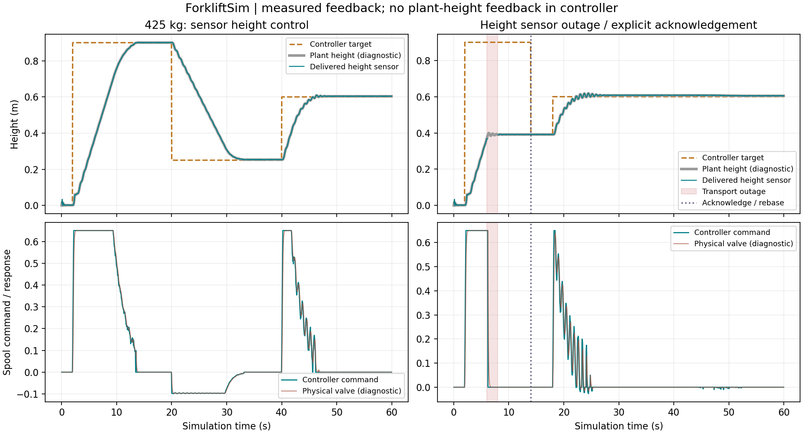

# 센서 기반 포크 높이 제어와 승강 인터록

2026-11-05. 이번 단계는 **높이 센서 피드백으로 유압 승강을 제어하는 범위**다. 팔레트 인식·완전 삽입 판정·자율주행·자동 삽입은 연결하지 않았다. 주행은 계속 사용자가 조작한다.

**Start.bat → Unreal Editor에서 Play**. 기본 integrated에 적용하며 별도 시작 파일은 없다. Q/E는 목표 높이 내림/올림, U는 기존 관절·IMU/압력/하중·근거리 센서의 통신 중단/복구, **Y는 승강 고장 복구 확인**, R은 장면과 제어기 전체 초기화다. L의 근거리 광선 검사와 기존 두 카메라도 유지한다.

## 어떤 값을 제어에 사용하는가

| 입력 | 사용 범위 |
|---|---|
| 캐리지 높이 센서 | 위치 오차와 취득 시각/카운터에 따른 속도 추정 |
| 상·하단 리미트 | 해당 방향의 승강 차단, 반대 방향의 복귀 허용 |
| 실린더 게이지 압력 센서 | 높은 압력에서 상승 차단, 하강 유량 상한 계산 |
| 액추에이터 명령 만료 응답 | 밸브 통신 경로 이상 시 승강 정지 유지 |

엔코더·IMU·포크 접촉 하중·카메라·근거리/존재 센서는 이번 승강 제어의 입력이 아니다. 각자의 측정·웹 기록은 계속 제공한다. 특히 근거리 센서 ON을 완전 삽입으로 바꾸거나 물리 객체의 이름/위치로 팔레트를 알아내는 코드는 넣지 않았다.

순수 제어기 `SensorLift::FModel`의 입력에는 actor·물리 높이/속도·질량·진짜 유압 상태·센서 truth 필드가 없다. 연결부는 이전 단계의 **전달된 측정 표본**만 복사한다. 높이와 압력의 취득 시각·유효성을 확인하고 오래된 값, 미래 시각, 모순된 리미트, 비정상 측정 높이 급변 등을 차단한다. 물리 정답은 제어 호출 후 진단 CSV에 별도로 기록한다.

## 유압 장치와의 연결

이전 유압 장치는 물리 높이 오차로 내부 밸브 명령을 만들었다. 새 경로에서는 그 위치 제어를 우회하고 센서 제어기의 spool 명령을 직접 전달한다. **물리 높이·속도는 실린더 체적/유량·압력·힘·체인·마스트 동역학 계산에 계속 필요**하다. 이를 읽는 유압 플랜트와, 물리 높이를 피드백으로 사용하는 제어기를 구분한다.

유압의 밸브 응답 지연·펌프 출력·압력 제한·누설·마찰·체인·강체 관절은 유지한다. 센서 고장 때 물체를 고정하거나 속도를 강제로 0으로 만들지 않는다. 펌프를 차단하고 밸브 중립을 명령하므로, 밸브가 닫히는 동안의 반환 유량·관성·탄성 변형에 따른 실제 이동이 남는다.

위치 PI에 측정 속도 감쇠, 출력 포화/적분 제한, 큰 목표 변경 때 적분 초기화, 방향별 제한과 목표 부근 안정 유지 시간을 적용한다. 목표에 접근하는 동안 반대 유로를 열어 억지로 제동하지 않고 현재 유로를 닫는 방향으로 접근한다. 기준 압력과 알려진 `체인 배율 × 반환 오리피스 계수 / 실린더 면적`으로 하강 spool 상한을 계산하고, 목표가 가까워질수록 이를 줄인다. 이 값은 공개/가상 설계의 **고정 부품 계수**이며 진짜 적재 질량·실제 승강 속도를 읽는 보상이 아니다.

기본 하강 속도 목표 상한은 **0.06m/s**다. 이는 유량 명령을 정하기 위한 값으로 순간 실제 속도의 엄격한 보장값은 아니다. 이번 단계는 정밀한 접근을 우선하며 상용 장비의 작업 속도를 재현했다고 주장하지 않는다.

## 고장·리미트·압력 제한

- 시작 때는 필요한 센서가 모두 정상이고 0.2초 동안 안정화될 때까지 승강 명령을 내지 않는다.
- 기본 최대 표본 나이는 250ms다. 필요한 센서가 사용할 수 없게 되면 `fault_latched`로 전환하고 spool 0·펌프 차단을 유지한다. 센서가 다시 들어와도 이전 목표로 자동 재출발하지 않는다.
- 정상 신호가 0.2초 이상 유지된 후 Y를 눌러야 복구한다. 너무 이른 확인은 거절한다. 복구 시 **현재 측정 높이를 새 목표**로 잡아 이전 목표로 갑자기 움직이지 않게 한다. Q/E를 계속 누르고 있으면 복구 후 그 입력은 새 목표 조작으로 적용된다.
- 상단 리미트는 상승, 하단 리미트는 하강을 막는다. 반대 방향은 허용한다. 기본 목표 상한은 설계 행정에서 40mm를 뺀 약 2.06m다.
- 기본 압력 상승 제한은 6.9MPa, 해제 기준은 6.5MPa다. 높은 압력은 상승을 제한하며, 자동으로 화물을 내리지 않는다. 사용자가 낮은 목표를 요청하면 하강은 허용한다. 압력 제한은 센서 통신 고장과 다른 상태다.
- 모든 직접 밸브 명령에는 기본 **100ms 시뮬레이션 시간 유효기간**이 있다. 물리 스레드가 이를 넘긴 명령을 사용하려 하면 spool 0·펌프 차단으로 바꾼다. 만료 응답은 제어기에 전달되어 고장 정지로 유지된다. 시뮬레이션이 일시정지되면 이 시간도 멈추며, 실제 장비의 독립 하드웨어 watchdog 인증과 구분한다.
- 제어기 설정이나 센서가 빠졌을 때 물리 정답 기반 위치 제어로 몰래 복귀하지 않는다. 센서 제어가 요청된 기본 실행에서는 승강을 중립으로 유지한다.

이 인터록은 **시뮬레이터 기능**이며 안전 등급·실차 정격·비상 정지 회로를 인증한 것이 아니다. 차량 전체를 정지시키는 기능도 아니다. 실제 장비에 적용하려면 독립 안전 회로와 실제 부품/제어 응답의 검증이 별도로 필요하다.

## 설정·웹·기록

[Config/SensorLiftControl.json](../Config/SensorLiftControl.json)에 PI/감쇠·출력·안정화·압력·취득 나이·명령 유효기간·하강 접근 계수를 둔다. 바꾸고 R 또는 Play 재시작으로 적용한다. 센서 자체의 잡음·지연·범위는 기존 JointSensors/DynamicsSensors 설정을 따른다. 이번 게인은 시뮬레이터의 기본 적재 조건을 위한 값이며 실차 보정 완료를 뜻하지 않는다.

웹 **센서 기반 포크 높이 제어**는 목표/센서 높이·압력·spool 명령·펌프 허용·고장 사유·복구 확인 상태를 표시한다. 관절 패널에는 높이/리미트, IMU/압력/하중 패널에는 압력이 승강 제어에 연결됐음을 구분해 표시한다. **승강 제어 CSV**는 실제 수신 제어 상태만 19열로 내보내며 결측 높이를 물리 정답으로 채우지 않는다.

`Saved/Telemetry/SensorLift-*.csv`는 최대 20Hz 진단 스냅샷 26열이다. `truth_height_m`·`truth_valve`는 실제 동작·정지 여유를 검증하는 별도 플랜트 진단이며 제어기에 입력하지 않는다. 센서 계측과 제어 명령 CSV는 서로 다른 목적의 기록이다.

기존 물리 시험의 GT 기반 시험 제어는 비교 경로로 보존한다. `mecanum_lift_sensor_*`는 새 제어 경로, 기존 carry/ramp/rack 등의 시험은 이전 위치 제어 경로다. 웹에서 비교 모드임을 표시하며 이 결과를 센서 기반 자율 작업으로 부르지 않는다.

## 검증 절차

`Scripts/Test-SensorLift.ps1`은 무적재/425kg 적재의 0.9→0.25→0.6m 목표 변경, 상승/하강 중 높이 센서 단절, 낮춘 제어 압력 한계의 상승 제한/의도적 하강, 명령 전달 보류에 의한 실제 물리 watchdog 만료, 30FPS 적재, 기존 운반·경사 제동을 실행한다. 압력 시험은 제어 제한을 5.5MPa로 낮추며 물리 릴리프·질량 등은 바꾸지 않는다.

초기 후보는 11초 하강 구간에서 최대 약 26.4mm의 목표 오차가 있었고, 감쇠만 높인 후보는 압력 제한과 반복 상호작용해 약 62.3mm가 됐다. 이 기록은 통과한 최종 성능으로 표시하지 않는다. 목표 접근의 역방향 유로 개방을 막고 압력에 따른 하강 유량 제한을 넣었다. 최종 시험은 하강 목표를 20초 유지하며 마지막 구간의 25mm 기준과 실제 고장 정지 이동량을 확인한다. 하강 물리 물성값을 바꿔 맞추지는 않았다.

## 최종 빌드 결과

- 단위 **57/57**, 센서 승강 **7조건**과 기존 물리 비교 **2조건**, 총 Native **9/9**가 통과했다. 센서 승강 조건은 적재/무적재, 상승/하강 고장, 압력 제한, 명령 watchdog, 30FPS 적재다.
- 목표 유지 구간(0.9m의 17~19초, 0.25m의 37~39.8초, 0.6m의 57~60초)의 최대 실제 높이 오차는 무적재 60FPS 약 **1.59 / 3.25 / 0.98mm**, 425kg 적재 60FPS **0.17 / 3.06 / 3.64mm**, 적재 30FPS **0.26 / 2.95 / 3.87mm**였다. 과도 구간 전체의 최대 오차나 실제 센서 정확도를 뜻하지 않는다.
- 상승 중 센서 전송 중단 이후 최대 추가 이동은 약 **27.6mm**, 하강 중 약 **16.2mm**였다. 고장 시점+0.4초 이후부터 복구 확인 전까지의 첫 위치 대비 최대 변위는 각각 약 **14.7 / 1.8mm**다. 명령 watchdog 조건은 추가 이동 약 **14.2mm**였다. 이는 정해진 부하·속도·단절 시점의 관측값이며 모든 조건의 정지거리 보장값이 아니다.
- 센서가 다시 정상 수신돼도 확인 전에는 모든 기록된 제어 명령이 0·펌프 차단을 유지했다. Y 확인 후 각각 측정 높이 약 **0.391 / 0.768 / 0.380m**로 목표를 재설정했다. 이 높이는 고장 시험의 실제 측정 결과이며 고정 복구 높이가 아니다.
- 제어 압력 한계를 5.5MPa로 낮춘 시험은 5~19초 구간의 상승 제한 **280스냅샷**, 높은 압력에서의 사용자 요청 하강과 최종 높이 약 **0.0234m**를 확인했다. 물리 릴리프 압력은 바꾸지 않았다.
- 기존 GT 물리 시험 경로의 운반·경사 제동 2조건은 이전 빌드와 위치·속도·포크 높이·하중·에너지 등 9개 CSV 항목의 최대 차이가 0이었다. 이 비교는 새 센서 제어기의 움직임과 과거 위치 제어기가 동일하다는 주장이 아니다.
- 실제 웹 **788프레임**, 고장 정지 **106프레임**, 정상 수신 후에도 정지가 유지된 **73프레임**, 확인 후 현재 높이 유지 **42프레임**, **19열·788행 CSV**를 검증했다. 실제 수신과 공유 CSV 함수를 확인했으며 브라우저 DOM 클릭은 자동화하지 않았다.
- 기존 두 카메라의 실제 GPU 거리·near/far 결측·지연·RGB-D 동기와 기존 JS 계측 회귀가 통과했다. 이번 빌드의 새 FPS 벤치마크나 실차 보정·안전 정격을 검증한 것은 아니다.

근거: [Native 제어 검증](References/SensorLiftValidation-20261105.json), [실제 웹·CSV](References/SensorLiftWeb-20261105.json), [기존 물리 비교 경로](References/SensorLiftPhysicsParity-20261105.json), [현재 DLL·소스·검증 해시](References/SensorLiftEvidence-20261105.json).
