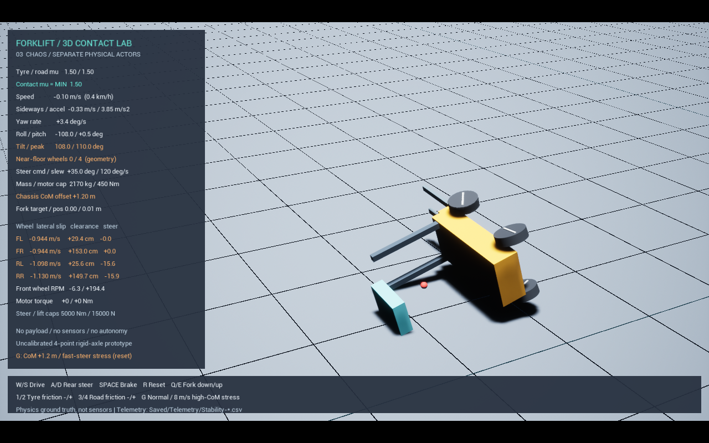

# 3D 물리 검증 기록 — 0.3.0

이 문서는 수정 전 0.3.0의 역사 기록입니다. 추진하면서 선회하는 시험이 누락돼
차체–타이어 내부 충돌 문제를 발견하지 못했습니다. 현재 0.3.1의 수치·검증 범위는
[DriveFixValidation.md](DriveFixValidation.md)를 기준으로 합니다.

2026-10-21, Unreal Engine 5.6.1 / Windows / Chaos.
최종 물리 설정은 `Config/Vehicle3D.json`, 서브스텝 설정은 `Config/DefaultEngine.ini`입니다.
접촉·구동·조향·전복은 3D 강체로 계산했습니다. 이것은 실차 대조 검증이 아니라 구현 검증입니다.

## 실행 결과

60 FPS에서 9개, 120 FPS에서 같은 9개, 30 FPS에서 직진·급조향·전복 3개,
총 **21개 3D 실행 시험 PASS**를 확인했습니다. 각 시험은 12초 시뮬레이션입니다.
기본 형상·질량에서 물리 몸체의 합계 질량은 매 시험 **2,170.0 kg**으로 확인했습니다.
시험 시작 시 2초 정지 후 입력을 가하며, 지면에서 출발시키기 위한 초기 낙하 구간은 최대값 집계에서 제외했습니다.

| 시험 | 확인 항목 | 60 FPS 결과 | 120 FPS 결과 |
|---|---|---:|---:|
| settle | 정지 후 최대 기울기 | 0.003° | 0.002° |
| straight | 5초 구동 중 최고 전진 속도 | 2.037 m/s | 2.000 m/s |
| zero_grip | 노면 μ=0, 최대 차체 전진 속도 | 0.003 m/s | 0.004 m/s |
| brake | 3 m/s 초기 조건에서 제동 후 최종 속도 절댓값 | 0.0002 m/s | 0.0000 m/s |
| fork | 1 m 목표의 실제 최대 상승량 | 0.9873 m | 0.9876 m |
| steering | 기본 마찰, 최대 회전 속도 절댓값 | 75.076°/s | 74.545°/s |
| low_grip | 노면 μ=0.08, 최대 회전 속도 절댓값 | 47.982°/s | 51.763°/s |
| low_tyre | 타이어 μ=0.08, 최대 회전 속도 절댓값 | 50.314°/s | 47.883°/s |
| rollover | 높은 무게중심·고마찰·급조향 시 최대 기울기 | 109.972° | 111.408° |

기본 직진 시험의 최대 기울기는 60 FPS에서 0.061°, 120 FPS에서 0.054°였습니다.
무마찰 시험은 차체가 거의 진행하지 않는 동안 구동 바퀴가 회전하는지도 별도로 검사했습니다.
120 FPS 무마찰 기록의 앞바퀴 최고 각속도는 약 8.91 rad/s, 둘레 속도는 약 2.67 m/s였습니다.
포크는 중력 아래 힘 제한 스프링/감쇠기로 움직이므로 목표에서 약 13 mm 처집니다.
기존 승강 시험장의 센서·PI 제어기를 적용한 결과가 아닙니다.

## 마찰과 급조향 비교

`steering`, `low_grip`, `low_tyre`는 동일한 6 m/s 초기 구름 상태에서 출발하고 2.5초부터
기준 30°까지 30°/s로 조향합니다. 조향 중 추가 구동 토크는 가하지 않습니다.
기본 접촉 μ는 min(0.9, 0.8)=0.8이며, 저마찰 두 시험은 각각 노면 또는 타이어를 0.08로 바꿉니다.

60 FPS의 바퀴별 접촉점 횡속도 근사값 중 최대 절댓값은 기본 2.231 m/s, 저마찰 노면
4.345 m/s, 저마찰 타이어 4.660 m/s였습니다. 낮은 마찰에서 옆으로 밀리면서 회전 반응도 줄었습니다.
이 값은 바닥 가까이에 있는 바퀴만 집계한 순간 최대값입니다. 접촉 해결기의 진동과
단순 충돌 형상에 민감하므로 실측 타이어 슬립 특성 곡선으로 해석하지 않습니다.

## 전복 조건

- 초기 속도 8 m/s, 추가 구동 없음
- 타이어 μ=1.5 / 노면 μ=1.5
- 차체 무게중심 높이 오프셋 +1.2 m
- 차체 질량의 60%인 1,080 kg 밸러스트를 기본 위치에서 2.0 m 높임
- 기준 조향각 35°, 명령 변화율 120°/s, 실제 안/바깥 바퀴는 Ackermann 목표각

무게중심 이동은 질량 있는 용접 형상의 위치 변경으로 구현했습니다. 관성도 그 배치에서
계산됩니다. 차체를 기울이는 명령·토크 주입·기울기 임계값에 따른 자세 변경은 사용하지 않습니다.
넘어진 뒤 마스트·차체·밸러스트·포크도 바닥과 충돌합니다.
30 FPS에서도 최대 109.004°를 기록했습니다. 화면 재생은 `Start-RolloverDemo.bat`를 사용합니다.

이 조건은 높은 밸러스트를 가진 시험체입니다. 기본 무인 지게차의 실차 한계 속도나,
화물을 실제 포크에 실었을 때의 전복 한계를 구한 것이 아닙니다.



## 시간 간격에 대한 확인과 남은 오차

| 지표 | 30 FPS | 60 FPS | 120 FPS |
|---|---:|---:|---:|
| 직진 최고 속도 (m/s) | 2.125 | 2.037 | 2.000 |
| 급조향 최대 회전 속도 (°/s) | 74.717 | 75.076 | 74.545 |
| 전복 최대 기울기 (°) | 109.004 | 109.972 | 111.408 |

세 주기에서 정성적인 상태와 각 시험의 허용 기준은 유지했습니다. 다만 직진 최고 속도는
30↔120 FPS 사이 약 6.3% 차이가 있습니다. 최대 회전 속도·슬립 같은 순간값도 접촉 해결기에 따라
차이가 납니다. 엄밀한 시간 간격 수렴이나 비트 단위 결정성을 달성했다고 판단하지 않았습니다.
정량 보정 전에는 액추에이터 갱신의 물리 서브스텝 동기화와 접촉 형상·솔버 수렴 검사가 더 필요합니다.

공통 검사는 정지 후 기울기 <3°, 속도 <0.2 m/s, 설정 대비 총질량 오차 <1 kg,
최고 전진 속도 절댓값 <8.5 m/s, 회전 속도 절댓값 <400°/s입니다.
이 상한은 수치 발산을 잡기 위한 시험 조건입니다. 실제 안전 운전 기준이 아닙니다.
직진은 최고 속도 1~3.3 m/s·최대 기울기 <5°·최대 회전 속도 <5°/s,
전복은 기울기 >65°와 바닥 가까운 바퀴 수 감소를 추가 확인합니다.
바퀴 수는 바닥과의 기하학적 간격으로 추정하며 접촉력 센서 계측이 아닙니다.

## 재현과 로그

```powershell
powershell -NoProfile -ExecutionPolicy Bypass -File .\Scripts\Build.ps1
powershell -NoProfile -ExecutionPolicy Bypass -File .\Scripts\Test-Stability.ps1 -Fps 60
powershell -NoProfile -ExecutionPolicy Bypass -File .\Scripts\Test-Stability.ps1 -Fps 120
# PowerShell 창 안에서 핵심 3개만 30 FPS로 실행:
.\Scripts\Test-Stability.ps1 -Fps 30 -Scenarios @('straight','steering','rollover')
```

`Saved/Logs/Stability-<scenario>-<fps>.log`의 `STABILITY_TEST ... PASS`가 각 판정입니다.
`Saved/Telemetry/Stability-<scenario>-*.csv`는 시간별 물리 상태입니다. 초기 속도 설정은
정지 후 한 번만 적용합니다. 그 후 위치·자세·속도를 덮어쓰지 않습니다.
같은 조건도 접촉 해결기의 실행 차이로 숫자가 조금 달라질 수 있습니다.

기존 승강 모델 3개와 기존 평면 바퀴 모델 6개의 자동 검사도 모두 PASS입니다.
`Saved/Logs/RegressionModels.log`에서 9개 결과를 확인할 수 있습니다.
기존 승강·평면 주행의 기본 실행 시험도 각각 PASS입니다.
`RegressionLift.log`는 팔레트 최대 상승 0.4528 m, `RegressionPlanar.log`는 최고 속도
5.6723 m/s와 직진 중 최종 y=0을 기록했습니다.

남은 범위: 실차·실측 마찰과의 보정, 후륜 요동 차축/안정 삼각형, 접촉력 계측,
타이어 탄성·구름저항, 실제 포크 적재 하중, 기존 센서/PI 제어기 연결입니다.
