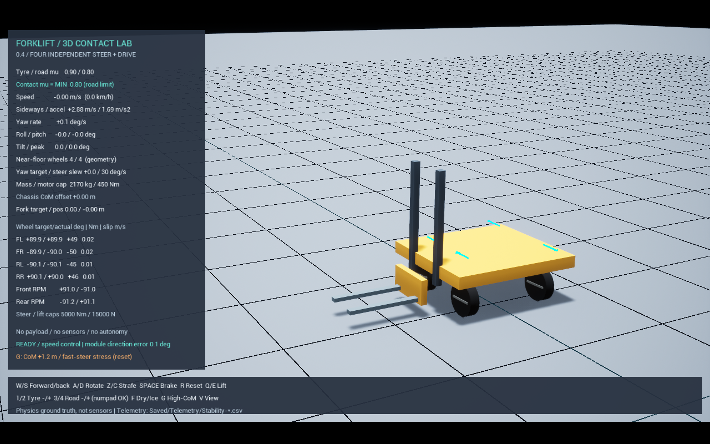
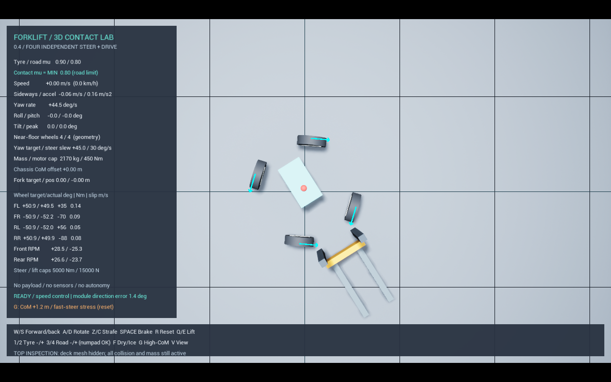

# 0.4 스워브 주행 검증 — 2026-10-22

환경: Unreal 5.6.1 / Chaos, Win64 Development, 실제 강체·접촉·관절 시뮬레이션.
구조와 설정은 [SwerveDrive.md](SwerveDrive.md)를 참고합니다. 실제 제조사 장비에 보정한 모델은 아닙니다.

## 실행 결과

- 60fps: 15개 시나리오 모두 PASS.
- 30fps / 120fps: 각각 횡이동, 제자리 회전, 연속 방향 전환 3개 PASS.
- 새 스워브 기구학 자동화 1개와 기존 승강/평면 바퀴 모델 9개: 10개 모두 Success.
- 기존 0.3 회귀 확인: W+D 동시 출발 `powered_turn_start`, 고중심 `rollover` 모두 PASS.
- 새 구조의 모든 실행 시험에서 차체–타이어 접촉 횟수 0/0/0/0.
- 질량 합계 2,170 kg, 바퀴별 모터 토크 상한 450 Nm 확인.

실행 시험 총 21건. 조향 목표의 변화율 제한, 실제 강체 관절의 각도 추종, 마찰 접촉과
토크 제한을 모두 사용합니다. 시험 중 차체 위치나 회전을 지정하여 결과를 만들지 않습니다.

| 시험 (60fps) | 결과 |
|---|---|
| 정지 | 최종 속도 약 0, 네 바퀴 접지 |
| 전진 / 후진 | 최종 +2.957 / -2.967 m/s |
| 오른쪽 / 왼쪽 횡이동 | 최종 +2.961 / -2.962 m/s |
| 오른쪽 / 왼쪽 제자리 회전 | 최종 +45.338 / -45.313 deg/s |
| 제자리 회전 중심 위치 변화 | 오른쪽 약 4 mm, 왼쪽 약 2 mm (시작→종료 순변위) |
| 이동+회전 | 전방 1.465 m/s, 측방 0.829 m/s, 회전 23.199 deg/s |
| 전진→횡이동→회전 | 18초 시험 완료, 최종 회전 44.543 deg/s |
| 무마찰 | 차체 최고 속도 약 0.001 m/s, 타이어는 회전 |
| 저마찰 | 가속이 느려지고 헛돎이 커짐, 최종 2.959 m/s |
| 제동 | 약 2.956 m/s에서 최종 약 0 |
| 포크 1m 상승·하강 | 최고 0.9875 m, 최종 약 0 (하중에 의한 제어 오차 포함) |
| 마찰 키 | 윗줄/숫자패드 1–4, F의 바인딩 호출 및 실제 재질 값 확인 |
| 고중심 급회전 | 최고 6.106 m/s, 최대 기울기 179.379도, 바퀴 들림 후 전복 |

마찰 비교는 시뮬레이션 4초, 즉 구동 시작 약 2초 뒤 동일 시점의 CSV 값입니다.

| 노면 | 전진 속도 | 앞왼쪽 바퀴 종방향 슬립 |
|---|---:|---:|
| μ=0.8 | 2.0533 m/s | 0.08598 m/s |
| μ=0.08 | 1.3988 m/s | 1.17284 m/s |

속도 제어기는 모터 토크를 조절하여 목표 속도에 접근합니다. 따라서 마찰이 달라도 충분한 시간이
지나면 최고속도가 비슷할 수 있습니다. 마찰 검증은 가속 구간·헛돎·제동을 함께 비교해야 합니다.
현재 μ 결합 규칙은 Min이며 실측 타이어-노면 쌍의 마찰 곡선은 아닙니다.

## 관찰과 한계

- 기본 조향 목표 변화율 30 deg/s에서 90도 정렬은 약 3초가 걸립니다. 연속 전환은 감속·목표 속도 변화까지 포함해 더 걸릴 수 있습니다.
- 정렬 중에는 구동 목표를 0으로 두고, 도달할 수 없는 회전 목표가 누적되지 않게 방향 기준을 갱신합니다.
- 초기 횡이동 시험에서 바퀴가 정렬되기 전에 구동하면 차체가 틀어졌습니다. 정렬 대기와 바퀴 구동을 통한 방향 유지 피드백을 추가했습니다.
- 약 19m 횡이동에서 전후 방향 순변위는 최대 약 0.46m였습니다. 정밀 경로 추종이 아닌 수동 속도 제어 단계입니다.
- 제자리 회전의 순변위는 순간 이동 오차의 최대값이 아닙니다. 계기판 속도는 질량중심 속도이므로, 질량중심과 회전 중심이 다르면 회전 중 작은 측방 속도가 표시됩니다.
- 접지는 평평한 바닥과 바퀴 형상 간 거리로 추정합니다. 수직 접촉력 센서가 아닙니다.
- 마찰 키 시험은 입력 바인딩 함수를 호출합니다. OS 키보드 이벤트나 실제 키보드 동시 입력을 자동으로 검증한 것은 아닙니다.
- 전복은 인위적으로 높인 밸러스트를 사용하는 스트레스 시험입니다. 실제 적재 지게차의 전복 한계 자료로 사용할 수 없습니다.

## 재현

```powershell
.\Scripts\Test-Swerve.ps1
.\Scripts\Test-Swerve.ps1 -Fps 30 -Scenarios swerve_strafe,swerve_spin,swerve_transition
.\Scripts\Test-Swerve.ps1 -Fps 120 -Scenarios swerve_strafe,swerve_spin,swerve_transition
```

결과 로그: `Saved/Logs/Stability-swerve_<이름>-<fps>.log`.
물리 상태: `Saved/Telemetry/Stability-swerve_<이름>-<시각>-<GUID>.csv`.
기구학/기존 모델 자동화 결과: `Saved/Logs/SwerveModelTests.log`.
최종 표시 보완은 조명·계기판·검사용 데크 가시성에만 적용되며 물리 파라미터와 제어는 동일합니다.

## 실제 렌더링 확인

최종 빌드의 1280×800 DX11 화면을 직접 캡처하고 검토했습니다. 캡처 실행은 7초에 화면을 저장하고
8초에 종료하므로 전체 12초 물리 시험 결과로 집계하지 않습니다.




