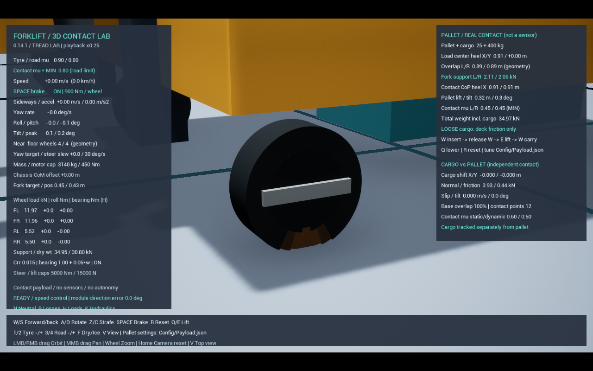
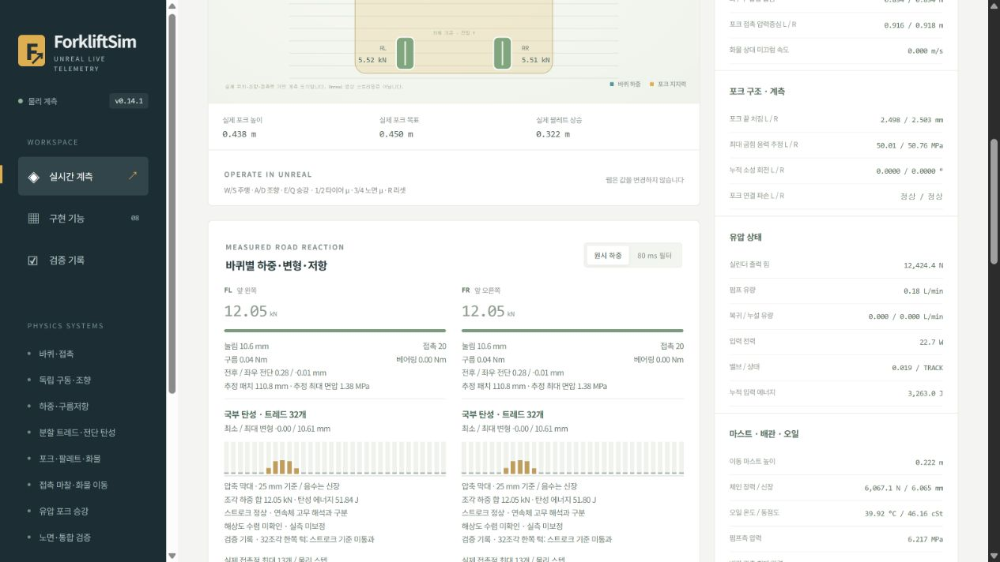

# 분할 타이어의 해상도 검증 — 0.14.1

기본 실행은 기존 타이어, 분할 타이어는 시험 옵션으로 유지한다. 이번 작업은 분할 수·시작 회전각·압입 깊이를 바꿔 **솔버 오차와 모델 이산화 오차를 구분**하고, 같은 물성값으로 32조각을 비교할 수 있게 한 것이다. 실차 물성 보정이나 고무 FEM 완성 단계가 아니다.

## 실행

```powershell
# 기존 기본 실행: Editor + 실제 Unreal 계측 웹, 에디터에서 Play
.\Start.bat
# 기존 16조각 시험, 0.5배속 설정
.\Start.bat -DeformableTread
# 같은 물성값의 32조각 비교, 0.25배속 설정
.\Start.bat -DeformableTread -TreadSegments 32 -PlaybackRate .25
```

32조각도 4륜 독립 구동·조향, 휠당 50 kg·트레드 합계 6 kg, 장비 질량 3,140 kg, 같은 면적당 강성·감쇠와 480 Hz·128/32회 솔버를 사용한다. **32조각은 적재 한쪽 턱의 스트로크 한계 이력 기준을 통과하지 못해 기본 시험값으로 승격하지 않았다.** 조각별 질량·스프링 계수는 분할 면적으로 나뉜다. 재생 배속 설정·조각 수는 HUD/웹에서 확인한다. 실제 진행 속도는 PC 부하에 따라 더 느려질 수 있으며, 누적 물리 시간과 월드 시간의 차이도 함께 확인한다. 64조각은 고정 코어 단일 바퀴의 기준 시험 전용이다. 일반 설정 파일과 런처에서 허용하는 최대 조각 수는 32다.

## 두 가지 오차

기존 기준식은 **동일한 유한 폭 강체 조각**의 평형식이다. 바퀴 중심 높이를 H, 반지름을 R, 조각의 아래 방향 각도를 θ, 조각 반각을 a=π/n, q=cosθ라 하면:

```text
접촉 높이 = R cos(max(|θ|−a, 0))
겹침 e = 접촉 높이 − H
조각 압축 δ = e/q
조각 반력 N = k δ/q + 조각 무게  (e>0, q>0)
```

가장자리만 먼저 닿아도 조각 전체의 반경 스프링이 눌리는 구조다. 조각 수가 줄어 폭이 넓어지면, 실제 접촉에 참여할 수 있는 조각의 범위가 함께 커진다. 이 모델의 식과 Chaos가 1~2%로 맞더라도 분할 폭의 영향은 남는다. 회전각을 반 조각만 바꿔도 접촉하는 가장자리의 배치가 달라진다.

새 비교 기준은 같은 독립 반경 스프링층의 **각도 방향 폭을 0으로 보낸 수학적 극한**이다. 재료를 새로 보정한 식이 아니며 실제 고무의 검증값도 아니다. Θ=acos(H/R), K는 면적당 강성, W는 폭, M은 전체 트레드 질량이다.

```text
N∞ = 2 K R W [R ln(secΘ+tanΘ) − H tanΘ] + M g Θ/π
```

이 식은 접촉 호 전체의 미소 반경 스프링 평형을 적분한 것이다. 별도 중점 수치 적분과 비교하는 단위 시험을 추가했다. 각도·면적 계산에는 double 정밀도의 π를 일관되게 사용해, float π로 계산한 각도와 double 각도 정규화의 차이에서 발생하던 미세한 주기성 오차도 수정했다.

## 시험과 판정

```powershell
# 실제 Chaos: 두 압입 깊이 × 16/32/64조각 × 시작 회전각 0/반 조각
.\Scripts\Test-TreadReference.ps1 -Fps 60 -Counts 16,32,64 -Heights .14,.145 -PhaseFractions 0,.5
# 위 실행에서 출력한 results.json의 절대 경로 사용
.\Scripts\Measure-TreadResolution.ps1 -ReferenceReport 'C:\...\results.json'
# 수렴을 필수 품질 기준으로 사용할 때
.\Scripts\Measure-TreadResolution.ps1 -ReferenceReport 'C:\...\results.json' -RequireConvergence
```

- 각 실제 솔버 시험: 유한 폭 조각의 독립 평형식과 반력 오차 3% 미만, 알려진 공중 조각 충격 입력 이후 추가 에너지 증가·최종 잔류량 각각 0.02 J 미만, 스트로크 한계 미도달.
- 해상도 판정: 16→32→64처럼 두 배씩 늘린 자료와 회전각 0/반 조각이 모두 있어야 한다. 같은 FPS·높이에서 최종 두 해상도의 반력 변화, 가장 촘촘한 해상도의 회전각 편차, 연속 극한에 대한 최대 상대 오차가 모두 5% 이하여야 통과한다.
- 반력 변화·회전각 편차는 비교 값 중 최댓값으로 나눈다. 극한 상대 오차는 극한 반력으로 나눈다. 서로 다른 분모를 결과에 구분해서 기록한다.
- `resolution.json`은 `solver_reference_pass`와 `convergence_pass`를 별도로 기록한다. `-RequireConvergence`는 수렴하지 않으면 실패한다. 진단 모드는 실패 판정을 출력하면서 측정 보고서를 남긴다.
- 분할 수를 늘리면 볼록 외피의 곡면 분할 수도 256개 수준에서 512개 수준으로 달라질 수 있다. 이 근사의 최대 호 간격은 2π/256 이하이며, 솔버–유한 조각 기준 오차에 함께 포함된다.

웹은 조각별 실제 눌림·접촉 반력을 계속 표시하며, 새 모델에 **해상도 수렴 미확인·실측 미보정** 상태를 명시한다. 웹에서 가상의 보정 하중을 계산해 실제 하중을 대체하지 않는다. CSV의 조각별 열 수도 실행한 조각 수에 맞춰 증가한다.

## 남은 물리 작업

유한 폭 강체 조각의 접촉 구조가 만든 편향은 시간 간격을 줄이는 것만으로 없어지지 않는다. 부드러운 접촉 표면, 조각 간 변형 전달, 일관된 변형 에너지·힘 전달을 갖춘 접촉 모델이 필요하다. 그 구조를 바꾼 뒤 동일 시험으로 분할 수렴·회전각 편차·무동력 에너지·적재 제동을 다시 확인해야 한다. 현재 계수를 실제 타이어 강성으로 해석하지 않는다.

## 실제 측정 — 2026-10-26

`Saved/Validation/TreadReference-20261026-230540-107`의 60 FPS, 16/32/64분할 × 중심 높이 0.14/0.145 m × 회전각 0/반 조각 12건 모두 솔버 기준 시험을 통과했다. `resolution.json`의 수렴 판정은 두 높이 모두 **실패**다. 각 자료의 DLL·설정 해시는 같은 폴더의 `manifest.json`에 고정했다.

| 조각 수 | 10 mm 압입의 최대 극한 상대 오차 | 5 mm 압입의 최대 극한 상대 오차 | 10 mm 압입의 회전각 편차 |
|---:|---:|---:|---:|
| 16 | 106.2% | 129.8% | 22.30% |
| 32 | 45.8% | 64.7% | 4.71% |
| 64 | 20.8% | 30.1% | 0.08% |

위 상대 오차는 실차 대비 오차가 아니라 이 문서의 독립 반경 스프링층 극한 대비 오차다. 10 mm 압입에서 연속 두 해상도의 최대 반력 변화는 16→32의 29.3%에서 32→64의 17.1%로 줄었다. 5 mm에서는 30.3%→21.0%다. 32조각은 편향을 줄이지만, 요구한 5% 기준을 충족하지 않는다.

`Saved/Validation/TreadReference-20261026-231004-729`에서 30 FPS의 16/32조각·반 조각 위상·10 mm 압입 2건도 통과했다. 60 FPS와 반력 차이는 출력 정밀도 수준이다. 이 사실 역시 분할 오차를 없애는 근거가 아니다. 이후 수정한 double 주기 정규화는 별도 단위·위상 기준 시험으로 확인한다.

최종 DLL SHA-256은 `1F8BE4B158F1F8C38776A8025622C7EC22677C69BB9271AF4D766AE4760B7B46`이다. `Tread-ResolutionVerifiedUnits.log`의 단위 시험 26/26이 성공했다. 주기 검사 반력 차이의 최댓값은 약 1.82×10⁻¹² N이며 검사 허용값 10⁻⁷ N을 유지했다. `TreadReference-20261026-231235-353`의 16/32조각 × 두 위상 4건도 통과했다. 마지막 수정은 기준식의 double 주기 정규화이며 접촉 형상·재료 계수는 변경하지 않았다.

32조각 적재 한쪽 턱 시험(`Components-20261026-231259-241`)은 X=9.0366 m까지 진행했지만 실패했다. 실제 CSV에서 24.5167초에 FL 조각 최대 압축 24.9316 mm가 기록됐다. 물리 이동 한계는 25 mm, 기존 한계 접근 판정은 그 98%인 24.5 mm다. 초기 안착만의 문제가 아니라 시험 주행 중 한계 접근 이력이 발생했다. 이 기준과 물성·이동 한계를 유지하고 32조각을 비교 옵션으로 남겼다. 해당 실행의 CSV는 766열이며 모든 조각의 변형·속도·반력을 기록한다.

같은 32조각 실행의 적재 선회 운반·무동력·경사 제동은 3/3 통과했다. 무동력 구간 시작 속도 0.417973 m/s, 에너지 변화 -306.520120 J, 최대 추가 증가 0 J였다. 경사 제동은 28.800초 유지 중 최대 4.073 mm 밀렸다. 따라서 전체 회귀 묶음은 **3/4 통과·1건 실패**로 기록한다.

기존 기본 타이어의 운반(`Components-20261026-231947-734`) 1/1, 유지할 16조각의 동일 한쪽 턱(`Components-20261026-232015-551`) 1/1도 통과했다. 16조각의 주행 중 최대 눌림은 19.734 mm였다. 더 거친 분할이 만든 추가 강성이 통과 여부까지 바꿀 수 있으므로, 16조각의 통과 역시 실제 타이어 성능 인증으로 해석하지 않는다.

`Tread-32VisualWeb.log`의 실제 렌더·0.25배속 설정 실행에서 웹 원본 600개 프레임을 검증했다. 포크 0.43793 m, 실린더 6.217 MPa, 조각별 반력 합·변형과 실제 위치·해상도 미검증 메타데이터의 일치를 확인했다. 최종 월드 시간 10.99591초, 누적 물리 시간 10.95632초, 차이 0.03959초, 최대 내부 간격 약 1/480초였다. 이는 해당 실행 결과이며 실시간 성능 보장은 아니다.




