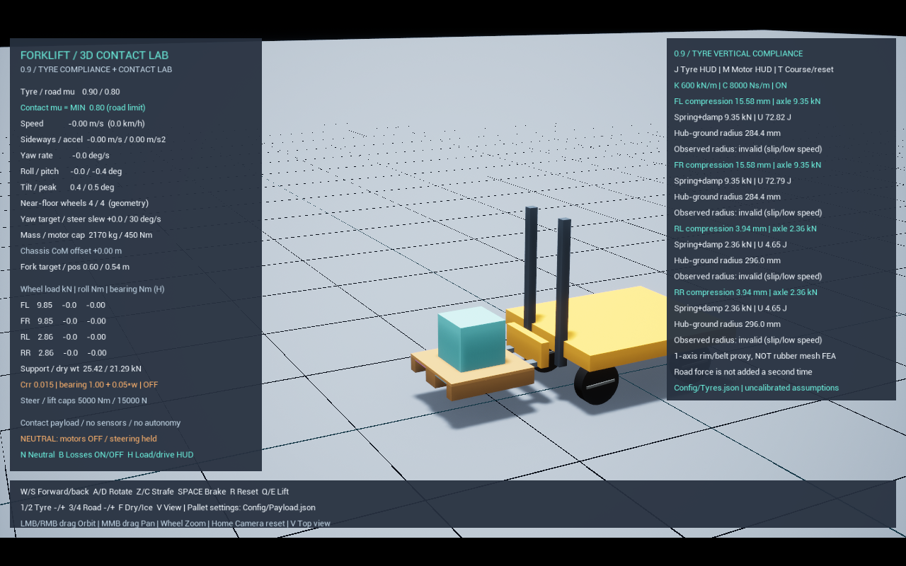

# 0.9 / 타이어 수직 탄성·감쇠

이 문서는 0.9의 V1 비교 모델 기록이다. 현재 통합 프로필의 3축·비선형 확장은 [공개 부품 참조 물리](RealComponentPhysics.md)를 참고한다.

수직 1자유도 **림–접촉 링 집중정수 근사**를 추가했다. 고무 전체를 변형시키는 유한요소해석이나 실제 타이어 접촉 패치 모델이 아니다. 강체 타이어에 하중으로 계산한 눌림 숫자만 붙이는 것도 아니다. 휠 중심과 접촉 링 사이의 상대 변위가 실제 차체 높이·하중 전달·진동에 영향을 준다.

## 구조와 중복 힘 방지

힘 전달 순서는 `노면 ↔ 강체 접촉 링 ↔ 회전축 ↔ 비회전 지지부 ↔ 수직 스프링·댐퍼 ↔ 휠 중심/너클 ↔ 차체`다. 기존 Chaos의 접촉·마찰·바퀴 회전은 유지한다. 차체나 타이어에 별도의 지지력 `k*x`를 AddForce로 다시 넣지 않는다. 회전축과 별도의 비회전 수직 가이드를 사용해 타이어가 돌아도 탄성 축이 함께 돌아가지 않게 한다. 수평 위치와 축 방향, 기존 회전축은 유지한다.

실제 장비에 새로운 현가장치를 장착했다는 의미는 아니다. 현가장치와 유사한 집중정수 자유도를 타이어의 수직 변형에 배정한 근사다. 접촉 링 중심은 차축 중심과 조금 어긋나며, 바퀴 외형은 여전히 원형이다. 고무가 바닥에서 납작해지는 형상·면압·카커스 세부 운동은 구현하지 않았다.

기계식 브레이크의 회전 속도 구동은 접촉 링–휠 중심 사이의 별도 토크 전용 관절에 둔다. 이 관절의 병진·각도 제한은 전부 자유이므로 수직 지지력이나 스프링을 추가하지 않는다. 1 kg 중간 지지부를 거쳐 제동 토크를 반복 해법으로 전달하면서 제동이 약해지는 것을 피하기 위한 경로 분리다. 기존 제동 토크 상한과 속도 구동 감쇠값은 유지한다.

베어링 마찰은 접촉 링–너클 회전 관절 내부의 속도 0 구동으로 해결한다. Coulomb+점성 모델의 요구 토크 크기를 이 구동의 한계로 사용하고, Chaos가 동일·반대 반력을 계산한다. 기존 명시적 외부 토크 쌍은 추가 관절 연쇄에서 실제 감속량이 과소 계산되어 사용하지 않는다. 기계식 브레이크와 베어링 한계는 독립 항으로 합산한다. 화면/CSV의 베어링 토크·손실 일률은 모델 요구값이며, 특히 거의 정지한 구간에서 실제 관절 전달 토크와 정확히 같다고 주장하지 않는다. 구름저항은 여전히 정적 노면에 대한 외부 저항 토크다. 내부 베어링 토크를 다시 AddTorque로 가하지 않는다.

`F = k*delta + c*delta_dot`, `U = 0.5*k*delta²`, `P_loss = c*delta_dot²`를 진단한다. 실제 전달력은 물리 스레드의 axle 관절 충격량을 시간으로 나누어 별도 측정한다. 계산식의 힘과 측정 힘을 혼동하지 않는다. 내부 스프링은 양쪽 강체에 작용하므로 힘을 한 번만 전달한다.

접촉 링에 기존 바퀴 질량 50 kg을 유지했다. 기존 너클 5 kg을 너클 4 kg + 비회전 지지부 1 kg으로 나눠 총질량을 유지했다. 따라서 평지 정지 상태에서 `노면 하중 ≈ 가이드 지지력 + 접촉 링·지지부 무게`이며, `k*delta`를 노면 하중 전체와 바로 같다고 놓으면 약 500.3 N 오차가 난다. 차체 질량을 늘리거나 기존 하중을 삭제하지 않았다. 이동 한계에 닿으면 별도의 하드 스톱 반력이 생기므로 선형 스프링 식만으로 해석할 수 없다. CSV의 axle_support_n은 이 직렬 가이드의 전달력이다.

## 설정·조작

`Start.bat -Mode tyre` → Play. 시험장 창만 실행하려면 `-Game`을 붙인다. 기존 평지 적재/노면 시험장에서도 타이어 모델이 적용된다.

- J: 타이어 계측 표 전환. M: 모터 계측 표. H: 왼쪽 하중/구동 표.
- W/S·A/D·Z/C·Space·Q/E는 기존과 동일하다.
- T는 기존 노면 전환과 초기화. 적재 시험장에서는 무적재 전용 노면 시험장 안내를 표시한다.
- 비교용 강체 바퀴: `Scripts/Run.ps1 -Stability -Tyres -RigidTyres`.

`Config/Tyres.json`을 수정하고 프로그램을 다시 실행한다. R/T는 설정 파일 재로딩이 아니다.

| 설정 | 기본값 | 의미 |
|---|---:|---|
| enabled | true | 수직 탄성 근사 사용. false는 이전의 강체 axle 잠금 |
| vertical_stiffness_n_per_m | 600000 N/m | 같은 하중에서 더 클수록 덜 눌림 |
| vertical_damping_ns_per_m | 8000 N·s/m | 상대 운동의 진동 에너지 소산. 정지 눌림 자체를 정하지 않음 |
| max_relative_travel_m | 0.05 m | ± 상대 이동 하드 한계. 타이어의 실제 안전 정격이 아님 |

값은 바퀴 한 개 기준이며 실물 고무/타이어 데이터로 보정하지 않은 가정이다. 낮은 강성이나 큰 적재물로 이동 한계에 닿으면 HUD/CSV에 표시한다. 한계에 도달한 결과를 정상 선형 타이어 거동으로 해석하면 안 된다.

## 반경 구분

- Compression: 접촉 링 중심이 휠 중심보다 위로 이동한 수직 변위. 음수는 복원 중의 인장 방향이다.
- Hub-ground radius: 휠 중심에서 조회된 노면 평면까지의 법선 거리. 평지 정지에서는 대략 `R0-delta`이며 실제 차체 높이에 반영된다.
- Observed rolling radius: 접촉 링의 전진 속도를 상대 회전 속도로 나눈 `v/omega`. 접촉이 있고 충분히 회전하며 접촉 미끄럼이 0.05 m/s 미만일 때만 유효로 기록한다.

하중 반경과 구름반경은 같은 값이 아니다. 현재 접촉 링은 원형 강체이므로 무미끄럼 구름반경은 대체로 기존 0.30 m에 가깝다. 눌림량을 빼서 모터 속도 제어기·구름저항의 반경을 임의로 줄이지 않았다. 실제 타이어의 하중별 유효 구름반경 변화·히스테리시스를 재현하려면 추가 모델과 실측이 필요하다. 접촉 패치의 유효 반경을 완전히 구현했다는 뜻이 아니다.

잠금 관절의 유한 반복 해법 오차, 접촉 침투, 기울기도 기하 측정에 포함된다. 따라서 hub-ground 거리가 정확히 R0-delta라고 가정하거나 그 차이까지 고무 변형으로 해석하지 않는다. 기존 CSV의 `RL_joint_error_m` / `RR_joint_error_m`는 휠 중심–접촉 링 중심 거리이므로 0.9부터는 의도한 탄성 변위도 포함하며, 잠금 관절만의 오차 지표로 사용하면 안 된다.

가벼운 지지부가 추가된 관절 연쇄를 해결하기 위해 스워브 시험장 솔버는 위치 반복 128회·속도 반복 32회를 사용한다. 질량 조건화·관성 가짜 배율·추가 지지력으로 수치를 맞추지 않는다. 강체 타이어 비교에도 같은 반복 수를 적용한다. 기본 최대 물리 간격은 1/480초, 최대 서브스텝은 32개로 세분화했다. 화면 480 FPS라는 뜻은 아니며 CPU 연산량이 증가한다. 초기 낮은 반복 수에서는 수 mm의 기하 오차와 횡이동→회전 전환 중 약 29도 조향 오차가 발생했다. 반복 수만 높인 독립 비교에서는 전환 오차가 약 2.7도로 감소했다. 이 오류를 정상 타이어 슬립으로 분류하지 않았다.

## 검증

`Scripts/Test-Tyres.ps1 -Fps 60` 또는 `-Fps 30`. 단일 사례는 PowerShell에서 `-Cases settle,soft,stiff`처럼 실행한다. 실제 Chaos 최대 내부 계산 간격 비교는 `-PhysicsHz 240 -Cases settle,drop,drop_low`로 수행한다. 기본값은 480이며 프로젝트 설정 파일을 덮어쓰지 않고 프로세스별 ini 오버라이드를 사용한다. 로그 이름에 FPS와 내부 계산 주파수를 함께 기록한다.

| 사례 | 확인 |
|---|---|
| settle / soft / stiff | 강성 600 / 300 / 1200 kN/m의 정하중 눌림, k*delta와 관절 반력, 전체 무게 평형 |
| drop / drop_low | 초기 노면 간격 60 mm에서 수동 낙하. 감쇠 8000 / 1500 N·s/m의 눌림 피크와 0.2~1.2초 수직 진동 비교 |
| step / step_rigid | 같은 25 mm 턱, 같은 구동 명령. 탄성 타이어와 이전 강체 타이어의 차체 수직 가속도 비교 |
| roll | 안정 주행의 유효 v/omega 표본과 하중 반경의 구분 |
| payload | 비고정 화물 400 kg + 팔레트 25 kg 양중 후 전륜 눌림과 하중 전달 증가 |

정하중 시험은 마찰뿐 아니라 관절 측정 반력과 중량 합도 확인해 지지력의 중복 적용을 검사한다. 낙하/정지 시험은 기계식 브레이크를 걸고 중립·구름/베어링 손실 해제·조향 서보 해제로 수직 거동을 분리한다. 브레이크는 에너지를 소산할 수 있지만 구동 에너지를 넣지 않는다. 구동 주행은 기존 모터·마찰·저항을 유지한다.

기계 에너지는 전체 비적재 강체의 병진·회전 운동 에너지, 중력 위치 에너지, 타이어 스프링과 기존 승강 가이드의 위치 스프링 에너지를 합산한다. 타이어 감쇠 손실은 내부 물리 스텝에서 상대 속도 제곱으로 적분한다. 접촉·기존 승강 감쇠 등의 추가 손실을 포함하지 않으므로 `기계 에너지 변화 + 타이어 감쇠 손실`은 0과 정확히 일치할 필요가 없다. 수동 시험의 에너지 증가 한계와 시간 간격별 결과를 따로 검증하며, 적재 승강/주행에는 모터 일이 들어가므로 같은 무입력 에너지 판정을 적용하지 않는다.

Chaos의 PostSolve에서는 새 위치 P가 이전 위치 X에 아직 반영되지 않는다. 따라서 감쇠 일은 그 내부 스텝의 상대 변위 변화량/시간으로 적분한다. GT의 순간 속도로 표시하는 `spring+damp` 값은 진단 추정치이며, 동적 상태에서 관절 충격량으로 측정한 평균 전달력과 정확히 같다고 주장하지 않는다. `rig_mechanical_delta_j`는 팔레트·화물 에너지를 포함하지 않는 비적재 장비 진단값이다. 적재 시험에서 전체 시스템 에너지로 해석하면 안 된다.

## 0.9 측정 결과 (2026-10-25)

최종 기본 1/480초에서 타이어 사례 9개와 강성·감쇠·턱 A/B가 30/60 FPS 모두 통과했다. 1/240초 비교 실험도 별도로 수행했다. 두 FPS 자체는 프레임률 비교이고 서로 다른 내부 물리 간격 비교가 아니다. 아래 수치는 기본 1/480초 조건이다.

| 항목 | 60 FPS 결과 |
|---|---:|
| 강성 300 / 600 / 1200 kN/m의 평균 정지 눌림 | 16.072 / 8.036 / 4.018 mm |
| 기본 정지 노면 하중 합 / 중량 | 21.288 / 21.288 kN |
| 기본 정지 직렬 가이드 전달력 합 | 19.287 kN |
| 60 mm 낙하, 감쇠 8000 / 1500의 최대 눌림 | 28.981 / 37.172 mm |
| 같은 낙하의 0.2~1.2초 차체 수직 속도 RMS | 0.105 / 0.301 m/s |
| 25 mm 턱, 탄성 / 강체 차체 수직 가속도 피크 | 5.162 / 15.409 m/s² |
| 안정 주행에서 유효 표본의 관측 구름반경 | 0.30009 m |
| 비고정 화물 400 + 팔레트 25 kg 양중 전/후 평균 전륜 눌림 | 약 8.78 / 15.58 mm |

기본 정지의 바퀴별 `k*delta` 대 측정 전달력 오차 최대는 0.001% 미만이었다. 적재 정지 하중 합은 약 25.420 kN으로 이론 25.457 kN보다 약 0.14% 낮았다. 후속 정량 보정 대상이며 값을 이론값으로 덮어쓰지 않았다. 30 FPS 턱 피크는 탄성 3.583 / 강체 5.824 m/s²였다. 이 피크는 프레임 속도 차분으로 측정하므로 30/60 FPS 간 값이 같을 것으로 기대하면 안 된다.

60 FPS에서 실제 최대 물리 간격을 1/240 → 1/480초로 줄인 정지·낙하·저감쇠 낙하 비교도 통과했다. 평균 정지 눌림은 8.036 mm로 유지되었으나 낙하 피크는 27.765/35.218 → 28.981/37.172 mm로 달라졌다. 기본 감쇠 낙하의 감쇠 일 적분도 891.949 → 1029.423 J로 바뀌었다. 충격과 소산량에는 계산 간격 민감도가 남아 있으므로 에너지 보존이 완벽하거나 수렴 검증이 끝났다고 주장하지 않는다. 두 내부 간격 모두 비적재 수직 수동 시험에서 측정한 양의 에너지 증가 최댓값은 0 J였다. 추가로 독립 1자유도 암시적 계산 단위 시험에서 1/120·1/240·1/480초의 수동성을 확인한다.

해상도 변경은 작은 베어링 손실을 분해하기 위해서도 필요했다. 2 m/s로 시작한 베어링 단독 시험은 1/240초에서 2.0205 m/s로 거의 감속하지 못해 실패했지만, 1/480초에서 1.8215 m/s로 감속해 기준을 통과했다. 무저항 비교는 2.0473 m/s였다. 여전히 무저항 수평 중립 주행에는 약 4.8%의 병진 운동 에너지 증가 오차가 있으므로, 수직 수동 시험의 통과를 모든 주행에서의 완전한 에너지 보존으로 확대 해석하지 않는다. 마찰·손실 계수의 실차 정량 보정도 완료하지 않았다.

베어링 단독 비교는 기존과 같은 증폭 계수 8 Nm + 0.2 N·m·s/rad를 사용한다. 기본의 작은 1 Nm + 0.05 N·m·s/rad 손실까지 실물 수준으로 정밀 검교정했다는 뜻이 아니다. 적재 화면의 전륜 hub-ground 거리는 약 284.4 mm이며, 초기 낮은 반복 수에서 보였던 수 mm 기하 오차도 크게 감소했다.

회귀 중 선회 입력을 모두 해제할 때 전진·회전 명령을 서로 다른 비율로 줄여 거의 정지한 바퀴에 큰 조향 변경을 요구하는 문제가 드러났다. 전진과 회전을 같은 비율로 줄여 마지막 선회 곡률을 유지하도록 수정했다. 차체 위치·속도 강제 설정, 마찰 축소, 토크 한계 증대, 기존 8도 조향 오차 판정 완화는 하지 않았다. W를 유지한 채 D/A만 바꾸는 주행은 공통 회전 할당을 사용한다.

적재 전륜의 조향 지연에 대해서는 공통 회전 명령이 실제 모듈 각도보다 5도 이상 앞서가지 않도록 할당 단계를 확장했다. 모든 바퀴의 구동을 끄는 전역 정지 게이트는 넣지 않았다. 스워브 조향의 위치 서보 이득은 5000 → 20000 N·m/rad, 속도 감쇠 이득은 200 → 400 N·m·s/rad로 조정했다. 이는 실제 조향축 강성을 새로 측정한 값이 아니라 하중에서의 제어 응답 튜닝이다. 명목 조향 속도 한계와 물리 모터 토크·출력 한계는 유지하며, 이전 뒷바퀴 조향 비교 모델의 이득은 바꾸지 않았다.

조향이 노면에 의해 정격 회전수 이상으로 밀릴 때 구동 토크 차단과 회생 제동까지 동시에 차단되던 경우도 분리했다. 과속에서는 위치 구동을 잠시 해제하고 속도 0의 제동 구동만 유지한다. 정격의 90% 아래로 내려오면 위치 구동으로 복귀하며 회전 속도를 강제로 덮어쓰지 않는다. 제동도 기존 토크·출력 한계 안에서 계산한다.

## 최종 회귀 확인

기본 1/480초, 60 FPS에서 모터·노면 9개와 A/B, 바퀴 하중·저항 7개와 A/B, 비고정 화물 11개와 고/저마찰 비교, 적재 좌·우 선회/동시 출발/고양중/S자/초기화/삽입 7개가 통과했다. 제자리 회전·횡이동·복합 이동·주행 전환·제동·고중심 전복 6개도 통과했다. 전복 사례는 과거와 같이 이상 액추에이터 스트레스 조건이며 실제 모터가 그 속도를 낼 수 있다는 검증은 아니다.

적재 S자 구간의 최저/평균 전진 속도는 0.762 / 0.878 m/s로 선회 정지 문제가 재발하지 않았다. 분할/균일 노면의 4~8초 왼쪽 평균 절대 슬립은 0.04630 / 0.00546 m/s였다. 저마찰 완만 제동의 화물 이동은 약 0.205 m, 전륜 하중 비율은 0.7747 → 0.7943으로 증가했다. 이 제동 A/B 입력은 12%이며 전도·낙하 스트레스는 100%로 별도다.

전체 단위 시험 14개, Unreal Development 빌드, DX11 실제 HUD 렌더, PowerShell 구문·JSON·diff 검사, 무적재 CSV 217열/적재 CSV 276열 행 정합성을 확인했다. 값은 지정된 시험 조건의 내부 검증이며 실물 지게차 데이터와의 일치 검증은 아니다. 다음 묶음은 C2 승강 액추에이터이며 유압/전동 구조를 선택한 뒤 진행한다.

## 참고·남은 한계

- [MathWorks Tire (Magic Formula)](https://www.mathworks.com/help/sdl/ref/tiremagicformula.html): 수직 강성·감쇠와 하중 반경·유효 구름반경의 구분 참고. 이 프로젝트에 Magic Formula를 이식한 것은 아니다.
- [Epic Physics Constraint Reference](https://dev.epicgames.com/documentation/en-us/unreal-engine/physics-constraint-reference-in-unreal-engine?application_version=5.6): 선형 구동, 강성·감쇠, 제한 관절.

카커스 굽힘·횡방향 탄성·열·고무 히스테리시스·실제 접촉 면적·단차를 감싸는 효과는 없다. 경사면에서는 휠 중심의 수직 축과 접촉 법선이 다를 수 있으므로 본 1축 모델의 적용 오차가 생긴다. 특히 실제 타이어/지게차의 안전 한계나 승차감·정격은 보증하지 않는다.
