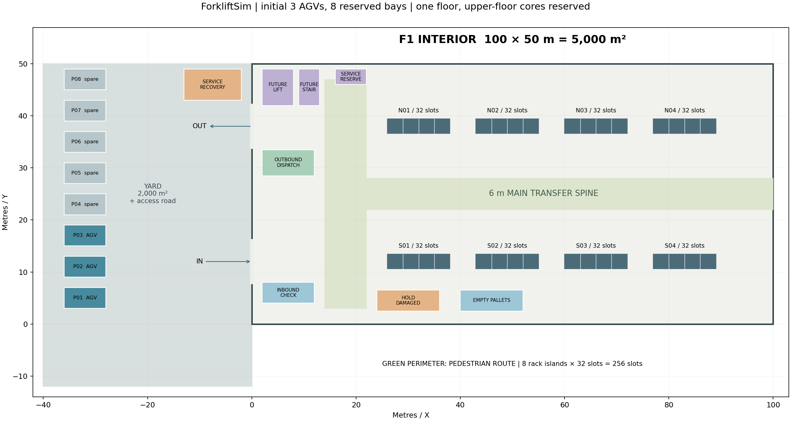

# 1층 창고 맵 — 2026-11-12

현재 실행·관제 조작과 5~6 묶음 상태는 [CampusFleet](CampusFleet.md)을 확인하세요. 아래 내용은 맵·기반 작업의 시험 이력입니다.

이 문서는 1층 맵의 배치와 제작 이력을 설명합니다. **현재 기본 실행에는 실제 물리 차량 3대·작업 팔레트·재고·센서 기반이 연결됐습니다.** 최신 조작과 검증은 [1~4 묶음](CampusFoundation.md)을 확인하세요. 자동 배차와 창고 전체 경로 계획은 다음 단계입니다.

## 실행과 조작

루트 **Start.bat**를 더블클릭하면 `/Game/Maps/WarehouseCampus`와 기존 실시간 대시보드가 열립니다. 에디터에서 **Play → 화면 클릭** 후 지게차를 운전합니다. **1~4**는 아래 자유 카메라 시점, **End**는 차량 운전 복귀, **Tab**은 차량 선택입니다. 아래 표의 WASD/Q/E 자유 이동은 자유 카메라 모드에 해당합니다.

| 키 | 맵 미리보기 동작 |
|---|---|
| WASD / 마우스 | 자유 이동 / 시선 회전 |
| Q / E | 아래 / 위 |
| Shift | 빠른 이동 |
| 1 또는 Home | 전체 조망 |
| 2 / 3 / 4 | 외부 주차장 / 실내 / 상층 확장 예약 구역 |
| H | 지붕 표시 전환 |
| Shift+F1 / Esc | PIE 마우스 해제 / PIE 종료 |

최신 차량 운전 키는 [1~4 묶음 안내](CampusFoundation.md)를 따릅니다. 기존 단일 장비의 물리·센서·자동 인양을 시험하려면 같은 실행 파일에 **`Start.bat -Map lab`**를 사용합니다. `-Game`은 독립 실행, `Website.bat`는 웹만 실행합니다. 새 창고의 다중 차량 웹은 후속 묶음이므로 웹은 대기하거나 마지막 수신값을 오래된 데이터로 표시합니다. 가상 차량 값을 보내지 않습니다.

## 실제 배치

| 항목 | 배치 |
|---|---|
| 실내 | 벽 안쪽 기준 100×50m, 5,000㎡, 1개 층 |
| 외부 주차·충전 구역 | 40×50m, 2,000㎡ |
| 남측 진입 도로 | 40×12m, 480㎡, 실내 면적에 포함하지 않음 |
| 주차·충전 예약 | 8면, 현재 물리 차량 3대·5면 여유 |
| 차량 출입구 | 서측 입구·출구 각각 폭 8m, 높이 4.2m |
| 랙 | 백투백 8열 묶음, 각 4베이·양면·2단·베이당 팔레트 2개 |
| 슬롯 | 고유 ID 256개, 받침 높이 0.35m / 1.95m |
| 주요 통로 | 중앙 6m, 랙 사이 교차 통로 명목 5m·구조물 끝 기준 4.88m |
| 높이 | 벽 6m, 상부 보 아래 최소 5.79m |
| 상층 계획 | 화물 승강기·계단/로비·설비 예약 구역, 향후 층간 높이 계획값 7m |

입고·검수, 출고 대기, 파손/보류 화물, 빈 팔레트, 외부 정비/복구, 보행자 둘레길과 횡단 표시를 배치했습니다. 상층 예약 구역은 표시와 보호 프레임만 있으며 승강기·계단·2층 구조는 아직 없습니다. 충전기 외형과 예약면에는 현재 [배터리 에너지·충전 배차](FleetOperations.md)를 연결했습니다. 셀/BMS·충전기 통신·실제 접점 전기 모델은 포함하지 않습니다. 장식용 주변 지면은 시설 면적에 포함하지 않습니다.

## 팔레트와 충돌

사용자 이미지의 전체 치수 **1100×1100×120mm**로 자체 제작한 4방향 진입 팔레트를 추가했습니다. 9개 받침과 상판 격자로 구성하며 임시 통로는 폭 280mm·높이 90mm입니다. 이 세부 구조는 이미지에 기반한 설계 가정이며 제조사 CAD·정격 자료가 아닙니다. 폭 120mm·높이 50mm 포크가 네 방향의 가정 통로를 통과하는 형상 검사를 수행했습니다.

맵에 저장한 재고 팔레트·상자는 인스턴스 외형으로 시작합니다. 랙 기둥·보와 벽에는 별도 충돌 부재, 선반에는 받침 충돌이 있습니다. 장식용 재고에는 전체 적재 외곽을 감싸는 정적 장애물 충돌을 사용합니다. 현재 기반 모드에서는 작업 대상으로 선택한 팔레트의 **기존 정적 외형/충돌을 제거하고 개별 접촉 강체로 교체**합니다. 현재는 [1~4 묶음](CampusFoundation.md)에서 작업 대상으로 선택한 재고를 실제 접촉 강체로 교체하고 새 형상의 인식·삽입 판정·하중 측정에 연결했습니다. 자동 접근·삽입 임무의 새 맵 연결은 후속 범위입니다.

## 확장 때 연결할 내용

`Config/WarehouseCampus.json`은 미터 단위 배치와 슬롯·접근 위치·통로 연결 예약 정보를 공유합니다. 경로 노드의 연결성 검사는 배치 수준입니다. 차량 회전 궤적·대향 교행·교착 방지·처리량 검증은 이후 차량 작업에서 수행합니다. 현재 단일 차량의 0.2m 격자/20,000셀 제한으로 5,000㎡ 전체를 직접 탐색할 수 없으므로 상위 통로 그래프와 국소 경로 계획을 나누어야 합니다. 인스턴스 장애물의 센서 읽기와 차량별 수동 제어·카메라·ID는 1~4 묶음에 연결했습니다. 다중 차량 웹과 임무 제어는 후속 범위입니다.

현재 장비의 4개 메카넘 휠은 유지합니다. 새 팔레트의 네 방향 수동 작업·인식·삽입 판정과 3대의 개별 소유권을 연결했습니다. 주차장 출발→픽업→랙 하역의 자동 임무 연결은 다음 단계입니다. 주차 8면은 향후 6대 이상을 위한 여유 공간이며 해당 대수의 운용 성능을 검증한 결과는 아닙니다.

## 재생성과 검증

1. `Scripts/campus_layout.py`: 공유 배치 JSON 생성.
2. `Scripts/create_campus_pallet.py`: Blender에서 자체 팔레트 FBX/원본 생성.
3. C++ 빌드 후 Unreal Python으로 `Scripts/CreateWarehouseCampus.py`: 맵·인스턴스·충돌·표지 생성. `CampusOwned` 태그의 생성물만 교체합니다.
4. `Scripts/validate_campus.py`: 배치·면적·슬롯·통로·팔레트 형상 10조건 검사.
5. Native 실행의 `-CampusCapture=Overview|Yard|Interior|Rack`으로 실제 렌더와 바닥 5곳·차량 문 2곳·벽 충돌을 검사합니다.

Fab Warehouse 원본은 로컬 소유 에셋을 사용하며 저장소에 재배포하지 않습니다. 다른 PC에서는 해당 에셋을 자신의 권한으로 추가해야 합니다. 맵 제작 당시 기존 단위 시험은 89/89 통과했으며, 이는 3대 통합 운행의 증거가 아닙니다. 프레임 기록은 **맵만 실행한 오프스크린 측정**으로 실제 Editor PIE·차량 물리·센서 부하가 포함되지 않습니다. 초기 맵 제작 시점의 파일 해시와 조건은 [검증 기록](References/WarehouseCampusEvidence-20261112.json)에 기록합니다.
