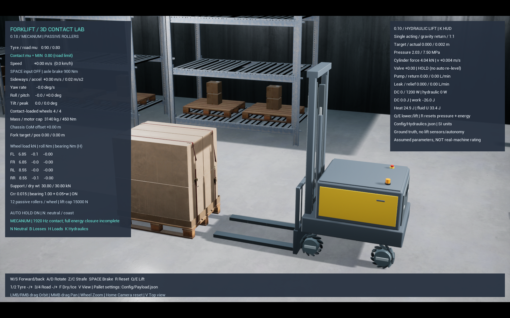

# Warehouse와 무인 지게차 모델링

실행은 루트 `Start.bat` 하나를 사용합니다. 기본 integrated가 Unreal Editor의 `/Game/Maps/WarehouseLab`과 실제 텔레메트리 웹을 엽니다. 에디터에서 Play를 누르세요. 센서와 자동 인식은 이번 작업에 포함하지 않습니다.

## 채택한 실제 규격과 가상 설계

[Jungheinrich EKS 215a의 01/2019 사양서](https://www.logisnextamericas.com/-/media/logisnext/sites/portal/files/forklifts/jungheinrich/class-iii/eks_215a/eks_215a_spec_sheet-english.pdf)의 표와 치수 도면을 참고했습니다. 최신 전 모델 공통 치수나 OEM CAD 복제가 아닙니다.

|항목|적용값|구분|
|---|---:|---|
|포크 전면까지 차체 길이|1.405m|사양서 headlength|
|외폭|0.985m|사양서|
|축간거리|0.938m|사양서|
|포크 길이 × 폭 × 두께|1.2 × 0.12 × 0.05m|사양서|
|캐리지 폭|0.88m|사양서|
|마스트 최저 높이|2.475m|사양서의 3.5m duplex, laser 제외 옵션|
|무적재 총질량|3140kg|기존 사양 참조 목표 유지|
|바퀴|300mm 메카넘 4개|사용자가 선택한 가상 구조|
|윤거|0.70m|외폭과 바퀴 간격에 맞춘 가정|
|작동 포크 스트로크|1.5m|현재 유압 시험 범위 유지|

EKS의 실제 구동 구조를 메카넘으로 재현한 장비가 아닙니다. 실제 치수 일부를 채택한 가상 설계이며, 부품 질량 분배·마찰·재료·액추에이터와 메카넘 정격은 실측 보정 전입니다. 마스트 높이 규격을 사용했다는 사실이 실제 장비의 최대 양중 높이 재현을 뜻하지 않습니다.

## 모델과 물리 연결

Blender에서 만든 차체, 고정 마스트, 이동 마스트, 캐리지, 포크 구간을 각각 UE StaticMesh로 가져왔습니다. 외형은 각 물리 부품의 실제 자세를 따라가며 별도의 질량과 충돌을 추가하지 않습니다. 차체의 전방 덱 간격, 캐리지 두께, 이동 마스트 하단은 바퀴 및 포크와 간섭하지 않도록 수정했습니다. 포크 분할 부품은 기존 휨·소성·파손 관절을 따릅니다.

4개 메카넘은 기존 실제 구동 허브·수동 롤러·축 관절을 유지합니다. 휠베이스/윤거 변경은 외형만 축소하는 방식이 아니라 실제 물리 축과 차체 질량 형상의 변경입니다. 기존 큰 차체 시험 결과를 새 모델 검증으로 사용하지 않습니다.

## Fab Warehouse 적용

사용자 소유 [ScansMatter Warehouse Environment](https://www.fab.com/listings/ef0311b7-fd62-414a-b2c3-66ba95d8a21d)를 로컬 `Content/Warehouse`에 추가했습니다. 무거운 전체 데모 대신 22 × 16m의 작은 취급 구역에 랙 6개, 보관 팔레트와 상자, 벽, 지붕 일부를 배치했습니다. 원본 Fab 파일은 gitignore로 공개 소스에서 제외합니다. 다른 PC에서는 같은 에셋을 본인 권한으로 프로젝트에 추가해야 합니다.

보관 랙/정적 적재물은 간단한 박스 충돌 근사입니다. 선반의 모든 미세한 빈틈을 재현한 정밀 충돌 모델은 아닙니다. 편집용 차량 미리보기는 `NoCollision` 프로필과 Actor 충돌 비활성화를 저장합니다. 렌더 메시(QueryOnly)와 정적 물리 프록시(PhysicsOnly)는 별도 영구 프로필을 사용합니다.

실제로 들어 올리는 팔레트는 `SM_WM00217-Pallet_Standard`입니다. 모델을 로컬에서 검사한 크기 약 1.216 × 1.011 × 0.172m를 사용합니다. 연결된 판재 21개의 바운딩 박스를 용접한 강체 접촉 형상으로 만들어, 포크 진입 구멍·아래 판재·블록을 남깁니다. 판재 미세 변형과 못 체결은 모델링하지 않습니다. 판재 부피에 비례하여 가정한 25kg을 배분합니다.

화물은 Warehouse의 포장 상자 묶음 메시를 쓰며 약 1.264 × 1.015 × 1.220m의 별도 400kg 강체입니다. 팔레트와 고정하지 않습니다. 질량 400kg과 마찰은 시각 에셋에서 얻은 실측값이 아니라 기존 시험값입니다. 팔레트-화물은 실제 접촉·마찰로, 포크-팔레트는 판재 접촉으로 반력을 전달합니다. 화물의 충돌은 외접 박스 근사입니다.

`Config/Modeling.json`은 차체 규격, `Config/WarehousePayload.json`은 판재 치수와 시각 메시 연결, `Config/Payload.json`은 사용자가 조절하는 질량·마찰·삽입 깊이의 출처입니다. Warehouse 형상에서는 팔레트/상자 치수가 메시에서 측정한 값으로 교체됩니다. 기본 포크 간격 0.6m는 실제 입구 폭 안에 들어갑니다.

## 조작과 검사

- W/S: 전후, Z/C: 좌우, A/D: 회전, Space: 제동, Q/E: 승강.
- 처음에는 W로 팔레트 입구까지 전진해 삽입한 다음 E로 낮게 들어 올립니다. R은 초기화합니다.
- 왼쪽/오른쪽 포크 반력, 바퀴별 하중, 마찰, 화물 미끄러짐, 유압 값은 기존 Unreal 계측과 웹/CSV를 계속 사용합니다. 센서값이 아닙니다.
- 한 개체의 모든 시각 부품을 붙여서 움직이는 방식이 아닙니다. 차체, 실제 롤러, 포크 각 구간, 이동 마스트, 팔레트, 화물의 물리 연결을 유지합니다.

## 생성 및 검증 기록

`Scripts/create_forklift_model.py` → Blender 생성, `Scripts/ImportForkliftModel.py` → cm/축/재질 검증을 포함한 가져오기, `Scripts/CreateWarehouseLab.py` → 작은 창고 장면 배치입니다. `Scripts/BuildModelingScene.py`는 가져오기와 장면 생성을 함께 실행합니다. 에셋 생성은 실행 중인 편집기에서 하지 말고 프로젝트 저장 후 닫고 수행하세요.

새 프로필 시험은 `Scripts/Test-Mecanum.ps1 -ReferenceModel -Cases ...`, 실제 창고 레벨 적재 시험은 `-WarehouseMap -Cases carry`를 사용합니다. 자동 시험 스크립트는 사용자용 시작 파일과 별도입니다. 수치 기준은 물리 동작 회귀 조건이며 실차 보정이나 정격 인증이 아닙니다. 실제 결과는 `Saved/Validation/Modeling` 및 각 Mecanum 시험 디렉터리의 로그/manifest/results와 연결된 CSV에 남습니다.

## 2026-10-29 검증 결과

- 물리 검증 빌드: 성공(`ReferenceModel-Build12.txt`). 최종 `Build13`은 카메라 시점만 추가 조정했으며 물리 계산은 동일합니다.
- 새 차체/팔레트 승강: PASS, 포크 약 0.438m, 화물 낙하 없음.
- 최종 차체 횡이동·선회·제동: 3/3 PASS. 횡이동 약 9.61m 동안 전후 오차 -0.036m. 초기 후보의 +0.508m 오차는 합격 기준 0.3m를 초과했고, 기준을 완화하지 않고 방향 유지 제어를 조정했습니다. 무적재 캐리지의 바닥 간섭도 제거했습니다.
- 실제 Warehouse 맵에서 양중→전진·횡이동→제동: 1/1 PASS. 이동량 약 X=6.56m/Y=2.72m, 최종 포크 0.437m, 화물 낙하 없음. `Mecanum-20261029-120537-596` 기록입니다.
- 실제 Unreal 웹 기록 600표본에서 WarehouseLab·mecanum_carry 출처, 팔레트 25kg/화물 400kg, 포크 상승 및 유한한 바퀴 하중을 확인했습니다. 이 부분 표본은 4.67~14.65초 구간이고 전체 운반 통과는 위 네이티브 시험이 판정합니다.

기록: `Saved/Validation/Mecanum-20261029-120525-220`, `Saved/Validation/Modeling/Warehouse-LiveSummary.json`. 초기 실패 기록도 보존했습니다. 이전 큰 차체의 전체 노면 28조건을 새 좁은 차체로 모두 재인증한 것은 아닙니다. 본 작업 범위의 승강·기본 이동·창고 운반 검증이며 경사/턱 정격이나 실차 보정 완료를 주장하지 않습니다.

최종 장면 가져오기/저장 성공: `WarehouseFinalSave.log`, 초기 편집 시점 저장: `WarehouseCameraSave.log`. 저장본 재로드 검사에서 편집 미리보기 64개의 NoCollision 유지를 확인했습니다.

