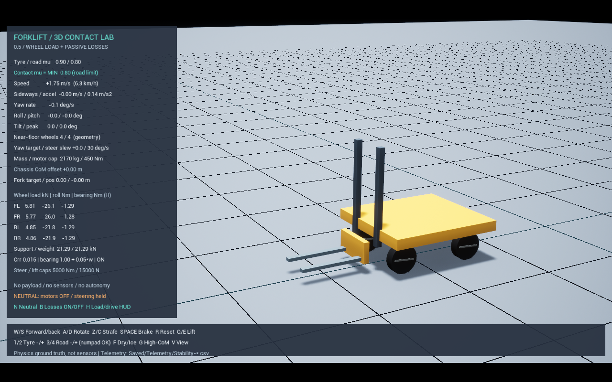

# 0.5 — 바퀴별 하중과 구름·베어링 저항

현재 0.11의 엄격 검증에서는 무저항 관성 주행의 에너지 증가 오차가 확인되었다. 이 문서의 상대 비교 통과가 작은 베어링 손실의 정량 정확도를 보장하지 않는다. [최신 오차/보정 판정](PhysicsCalibration.md)을 우선 참고한다.

이 문서는 0.5 당시 평지 모델의 기록이다. 0.8에서는 고정 경사면·턱·여러 노면 재질을 추가했다. 0.9는 타이어 수직 탄성 근사와 회전 관절 내부 구동을 통한 베어링 마찰을 추가했다. 현재 모델·회귀는 [TyreCompliance.md](TyreCompliance.md), 모터·노면은 [DrivetrainAndTerrain.md](DrivetrainAndTerrain.md)를 참고한다. 아래 0.5 수치를 현재 빌드의 결과로 해석하지 않는다.

이 단계까지 주행 물리의 기준을 검증한 뒤 센서·자동화로 넘어갑니다. 실제 기계의 모든 특성을
먼저 구현하려는 단계는 아닙니다. 아래 계수는 실측 지게차 데이터가 없는 **가정값**입니다.



## 실행과 비교

`Start.bat -Mode stability` → Play로 실행합니다. 아래 화면과 수치는 0.5 당시 기록이며 현재 실행기는 최신 빌드를 엽니다.

| 조작 | 기능 |
|---|---|
| W로 가속 후 N | 중립 전환. 모터 토크·속도 제어 제동을 끄고 현재 조향각 유지 |
| 중립에서 B | 구름·베어링 저항을 함께 끄거나 켜서 감속 비교 |
| N 재입력 | 일반 속도 제어 복귀. W/S, A/D, Z/C 입력이 다시 적용됨 |
| Space | 중립에서도 브레이크 작동 |
| H | 바퀴별 하중·저항 토크 표 / 기존 조향·구동 표 전환 |
| R | 현재 마찰값으로 초기화. 중립 해제, 저항 활성화 |

일반 모드에서 W를 놓으면 속도 제어기가 모터로 감속합니다. 이것은 구름저항만으로 멈추는
시험이 아닙니다. 또한 일정 목표 속도에서는 제어기가 저항을 보상하므로 **최종 속도보다는
필요 모터 토크, 가속 과정, 중립 감속**을 비교해야 합니다.

HUD의 하중은 N 대신 kN으로 표시합니다. 1 kN = 1,000 N이며 kg과 다른 단위입니다.
`Support / weight`는 네 바퀴의 평활화된 접촉 하중 합과 중량 `mass × 9.81`입니다.
정지 평지에서는 두 값이 가까워야 하지만, 충격·수직 가속·전복 중에는 같을 필요가 없습니다.

## 설정

`Config/Vehicle3D.json`을 수정하고 프로그램을 다시 실행합니다.

| 항목 | 기본값 | 의미 |
|---|---:|---|
| rolling_resistance_coefficient | 0.015 | 구름저항 계수 Crr, 무차원. 허용 0~0.1 |
| bearing_coulomb_nm | 1.0 | 바퀴마다 일정 베어링 저항 토크, Nm. 허용 0~20 |
| bearing_viscous_nm_per_rad_s | 0.05 | 회전 속도에 비례하는 베어링 저항, Nm/(rad/s). 허용 0~5 |

예: 구름저항만 비교하려면 두 bearing 항목을 0으로 설정합니다. 베어링만 비교하려면 Crr를
0으로 설정합니다. 1~4/F 키는 기존 **접지 마찰 μ**를 변경할 뿐 Crr나 베어링 계수를 바꾸지 않습니다.

## 모델과 단위

- 구름저항 모멘트 크기: `Crr × 바퀴 접촉 하중[N] × 반지름[m]`.
- 베어링 모멘트 크기: `일정 토크 + 점성 계수 × 바퀴와 너클의 상대 각속도`.
- 회전 방향 반대로 토크를 가합니다. 0.5 rad/s 이하에서는 방향 함수를 선형으로 완화하여
  정지 부근의 부호 전환 떨림을 줄입니다. 정지 마찰의 정확한 고착/이탈 모델은 아닙니다.
- 구름저항은 바퀴–고정 바닥 사이의 외부 접촉 모멘트입니다. 베어링 저항은 타이어와
  너클에 크기가 같고 방향이 반대인 내부 토크를 가합니다.
- 공중에서는 구름저항을 0으로, 베어링 저항은 회전 중 계속 적용합니다.
- 엔진 토크 단위 변환은 `1 Nm = 10,000 kg·cm²/s²`, 충격량은 `엔진 값 / 100 = N·s`입니다.
- 새 4륜 장비의 임의 선형·각 감쇠는 0으로 바꿨습니다. 이전 뒷바퀴 조향 장비는 유지합니다.
  그렇더라도 접촉 솔버·256각 충돌 형상·관절 때문에 수치적 에너지 손실/증가 오차는 남습니다.

예를 들어 한 바퀴 하중이 5,000 N이면 반지름 0.3 m, Crr 0.015에서 구름저항은 22.5 Nm입니다.
이는 접지 마찰의 한계 `μN`과 다릅니다. μ는 미끄러지지 않고 전달할 수 있는 접선력의 한계이고,
Crr는 굴러갈 때 소모되는 에너지를 근사합니다.

## 하중 계측

`ContactLoadSampler`는 Chaos 물리 스레드의 PostSolve에서 **해당 바퀴와 시험장 바닥 사이**의
정상 방향 접촉 충격량을 누적합니다. 같은 물리 스텝 안의 내부 서브스텝 충격량도 모두 더합니다.
출력 큐를 통해 게임 스레드로 전달하고, 그 출력에 대응하는 물리 시간으로 나눠 평균 하중 N을 구합니다.
게임 스레드에서는 물리 스레드의 UObject를 직접 읽지 않습니다. 식별자는 물리 입자 ID입니다.

일반 OnComponentHit 이벤트는 프레임/서브스텝에 따라 일부 접촉 표본만 전달되므로 하중 적분에
사용하지 않습니다. 충돌 이벤트는 기존 차체–바퀴 내부 충돌 진단에만 남겨둡니다.
계측 중 바퀴 재질의 수면 임계값을 0으로 설정하고 수면 카운터를 크게 설정해,
내부 서브스텝 사이의 수면 최적화 때문에 정지 반력이 사라지는 문제를 방지합니다.

원시 평균과 시간상수 0.08초의 평활값을 모두 기록합니다. HUD·저항 계산에는 평활값을 쓰고,
접촉이 사라지면 0으로 지웁니다. 따라서 저항은 직전 물리 결과를 사용하며 약간의 지연이 있습니다.
현재 모델은 **수평의 고정 시험장 바닥 전용**입니다. 경사·움직이는 바닥·여러 지면 재질,
타이어 변형, 완전한 정지 마찰, 실제 센서 오차는 이번 범위에 포함하지 않습니다.
네 점을 단단한 강체로 지지하므로 개별 좌우 하중 분배는 접촉 형상과 솔버에 민감합니다.
하중의 합과 앞뒤 축 합은 검증했지만 실제 타이어 변형을 포함한 좌우 하중까지 실측 검증한 것은 아닙니다.

기본 물리 계산 간격 상한은 1/240초, 프레임당 최대 16개 서브스텝입니다. 이는 화면을
240 FPS로 그린다는 뜻이 아닙니다. 순간 프레임 지연이 약 66.7 ms를 넘으면 물리 시간이
일부 제한될 수 있습니다. 계측은 화면 시간이 아닌 물리 출력의 시간 구간으로 정규화합니다.
256각/240 Hz는 중립 시험으로 선정했습니다. 단순히 각 수나 계산 주파수를 늘린다고
Chaos의 접촉 오차가 항상 줄어드는 것은 아닙니다.

## 기록과 자동 시험

`Saved/Telemetry/Stability-*.csv`에 기존 주행 기록 외 다음 열이 추가됩니다.

- `FL/FR/RL/RR_normal_n`, `normal_filtered_n`: 바퀴별 원시/평활 접촉 하중.
- `floor_events`: 물리 계측의 유효 접촉 표본 수. HUD의 기하학적 near-floor 판정과 구분.
- `rolling_nm`, `bearing_nm`, `loss_w`: 두 저항 토크와 계산 순간의 소모 전력.
- `normal_sum_n`, `load_interval_s`: 하중 합과 해당 평균의 물리 시간 구간.
- `neutral`, `resistance_enabled`, `crr`, `bearing_coulomb_nm`, `bearing_viscous_nms`: 재현 설정.

```powershell
powershell -NoProfile -ExecutionPolicy Bypass -File .\Scripts\Test-WheelResistance.ps1
powershell -NoProfile -ExecutionPolicy Bypass -File .\Scripts\Test-WheelResistance.ps1 -Fps 30
powershell -NoProfile -ExecutionPolicy Bypass -File .\Scripts\Test-WheelResistance.ps1 -Fps 120
```

계수 비교 시험은 사용자 설정과 무관하게 아래에 명시한 시험용 저항 계수를 사용합니다. 2초간 정지 후
모든 강체에 일회성 초기 속도 ±2 m/s와 맞는 바퀴 회전을 주고, 모터·브레이크를 끈 채 약 10초
굴립니다. 자동 주행이나 실제 모터 가속 시험이 아닌 **같은 초기 조건의 수동 역학 검증**입니다.
저항 0 / 베어링만 / 구름만 / 둘 다 / Crr 2배 / 후진을 비교합니다.
베어링 단독 시험은 작은 저항이 접촉 솔버 오차에 묻히지 않도록 **8 Nm + 0.2 Nm/(rad/s)**로
증폭합니다. 다른 시험의 베어링 기본값은 1 Nm + 0.05 Nm/(rad/s)입니다. 기본값의 작은 손실을
실제 장비 수준으로 검교정했다고 해석하면 안 됩니다. 순수 토크 함수는 별도의 단위 시험에서 검증합니다.
정하중 시험은 하중 합 대 중량, 질량중심에서 계산한 앞축 하중 비율을 확인합니다.

## 검증 결과 — 2026-10-22

UE 5.6.1 Development 빌드 성공. 수식 단위 시험 11개, 실행 시험 38개 통과:
새 하중/저항 7종 × 30·60·120 FPS = 21개, 기존 스워브 15종과 뒷바퀴 조향 2종 = 17개.
N/B/H 키 바인딩은 `swerve_friction_keys`에서 실제 입력 델리게이트를 실행해 검사했습니다.
실행 화면도 DX11에서 캡처해 HUD를 확인했습니다.

정지 평균 하중 합(60 FPS)은 **21,287.702 N**, 중량은 **21,287.700 N**입니다.
앞축 비율은 측정 0.5415 / 실제 강체 질량중심으로 계산한 값 0.5415입니다.
대표 바퀴별 평활 하중은 FL 5.764 / FR 5.763 / RL 4.875 / RR 4.885 kN입니다.
이 일치는 시뮬레이터 내부의 힘 균형 검증이지 실제 지게차와의 일치 증명은 아닙니다.

동일 초기 속도 ±2 m/s에서 약 10초 중립 주행 후 속도(m/s):

| 조건 | 30 FPS | 60 FPS | 120 FPS |
|---|---:|---:|---:|
| 명시적 저항 없음 | 2.0396 | 2.0403 | 2.0405 |
| 베어링만, 증폭 진단 8 Nm + 0.2ω | 1.6651 | 1.6699 | 1.6600 |
| 구름저항만 Crr 0.015 | 0.6995 | 0.7085 | 0.7053 |
| 구름 + 기본 베어링 | 0.6408 | 0.6303 | 0.6426 |
| Crr 0.030 + 기본 베어링 | 0.0130 | 0.0179 | 0.0147 |
| 후진, 구름 + 기본 베어링 | -0.7579 | -0.7565 | -0.7523 |

저항 0에서도 약 2%의 속도 증가가 남으므로 에너지 보존이 완벽한 모델은 아닙니다.
전후진 감속에도 수치적 비대칭이 있습니다(60 FPS 최종 속도 크기 차이 약 0.126 m/s).
이 시험은 저항을 분리·조절·기록할 수 있다는 검증이며, 작은 베어링 손실의 정밀 추정이나
실제 장비의 정지거리·전복 안전성을 보증하지 않습니다.

전복 시험 CSV에서도 바닥에서 3 cm 이상 떨어진 표본 FL 85 / FR 104 / RL 85 / RR 104개를
검사했고, 모두 구름저항 토크가 0이었습니다. 베어링의 반대 토크와 소모 전력 부호는 단위 시험에 포함됩니다.
로그는 `Saved/Logs/Stability-<scenario>-<fps>.log`, 수식 시험은 `AllModelTests-05.log`에 있습니다.
생성 로그·CSV는 Git에 포함하지 않고 이 문서에 대표 결과를 기록했습니다.

## 다음 단계

센서의 참값과 센서 출력값을 분리한 뒤, 바퀴 엔코더·조향각 센서·IMU·포크 높이 센서를
추가하고 지연·노이즈·샘플링을 적용합니다. 이어 낮은 속도의 직선 주행·정지·목표 자세 제어를
검증하고, 장애물 감지와 팔레트 자동 정렬로 확장합니다. 실제 장비와의 오차 보정은 별도 단계입니다.
