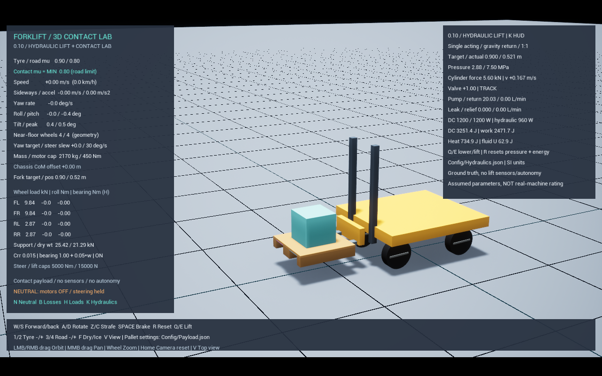
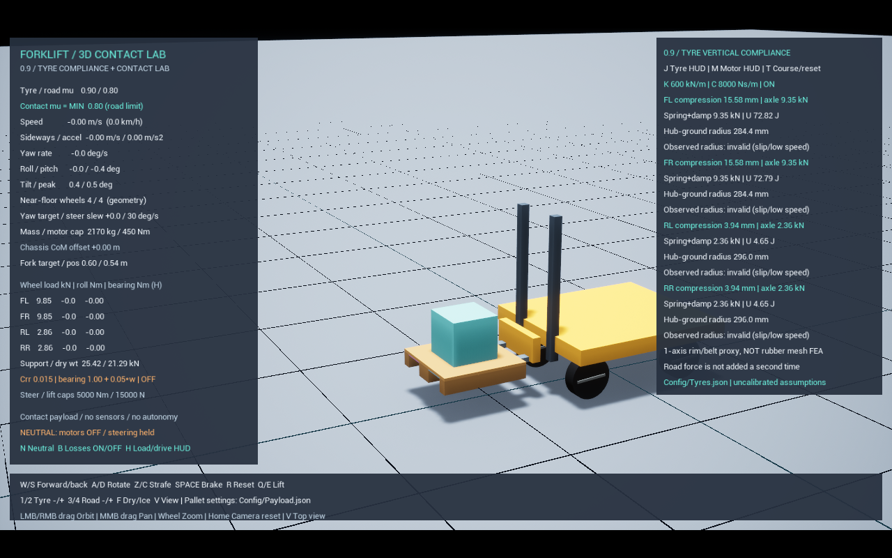
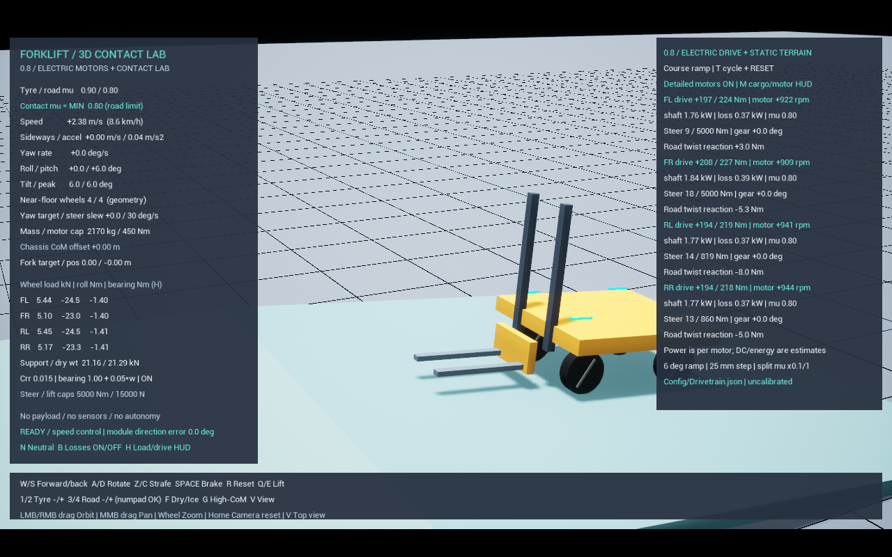
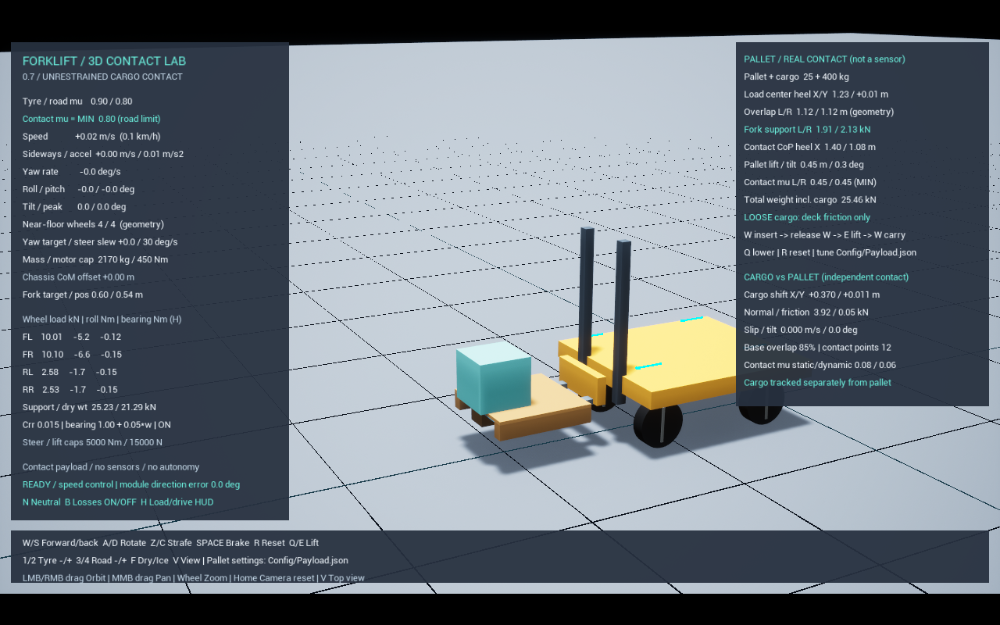
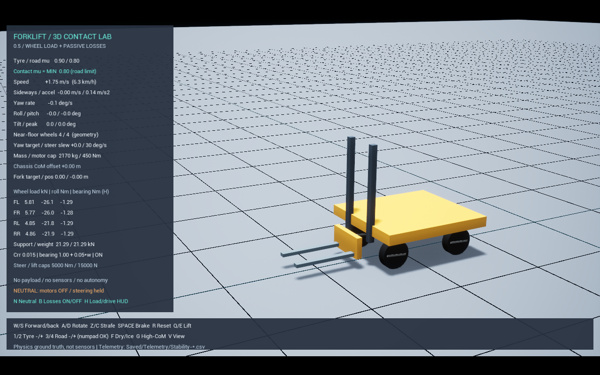
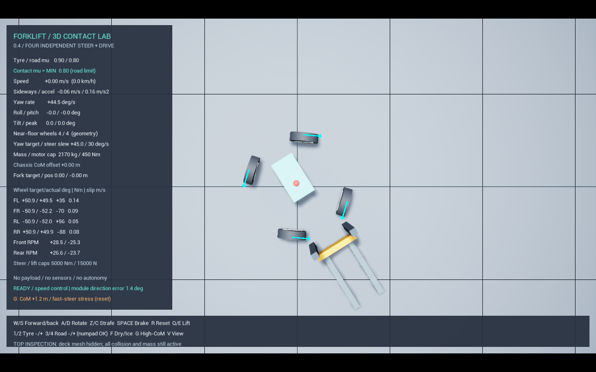
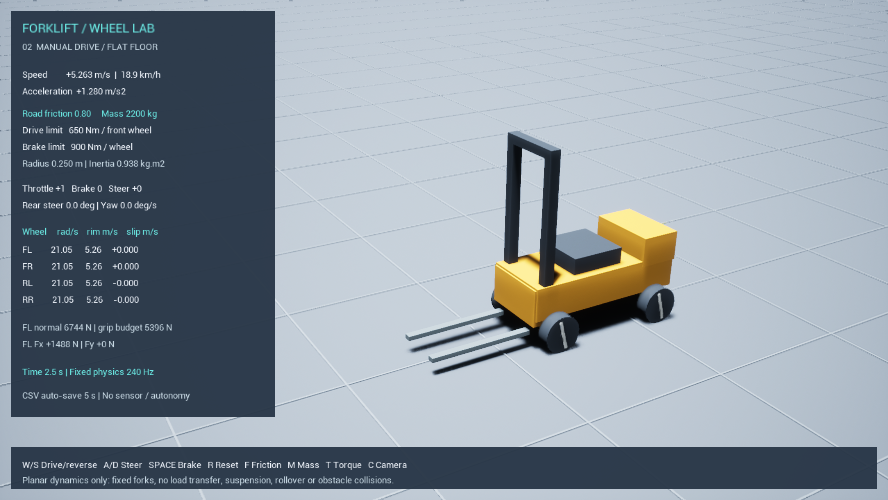
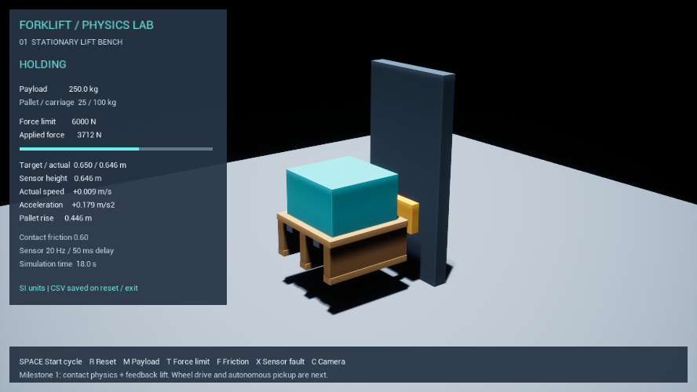

# ForkliftSim

Unreal Engine 5.6.1 기반 **물리·센서·제어를 검증하는 무인 지게차 프로젝트**입니다.
최종 목표는 센서로 팔레트를 찾아 정렬하고, 들어 올려 운반·하역하는 지게차 한 대입니다.

**자동화 5묶음 — 경로 주행·운반 임무:** 등록한 2D 지도와 센서 위치 추정으로 경로를 계획하고, 실제 LiDAR 장애물 관측에 따라 재계획합니다. 인식·삽입·인양→낮게 운반→랙 1/2단 하역을 임무로 연결했습니다. **Start.bat → Play → PageDown/Up으로 1/2단 선택 → Enter**로 시작합니다. **Backspace** 일시정지, **]** 명시적 재개, **0** 취소, **X** 비상정지, **Y** 고장 확인, **R** 초기화입니다. 웹에 실제 임무 상태·추정 위치·계획 경로와 수신 CSV 30열을 추가했습니다. 알려진 출발 구역·등록 지도/랙·고정 방향·평지 저속 범위이며 3D SLAM은 포함하지 않습니다. [전체 조작키·시험 조건·제한](Docs/MissionNavigation.md). 아래 1~4묶음의 완료 숫자와 당시 미연결 설명은 각 단계의 이력입니다.

최종 검증은 단위 **89/89**, Native **12조건**, 실제 웹 **10,808프레임·30열 CSV** 및 실제 GPU 카메라 회귀입니다. 기본 창고의 고정 기준 기둥 3개는 Play에서 자동 배치하며 실제 LiDAR 측정으로 지도 보정을 유지합니다. 같은 빌드의 기본 창고 1단 전체 임무는 평균 **41.79 FPS·0.970배속**으로 완료했습니다. 카메라·물리 주기는 유지하고 필요 없는 단계의 통로 탐색 계산을 줄였습니다. [최종 증거](Docs/References/MissionEvidence-20261107.json).

공개 저장소에는 프로젝트 소스·직접 제작한 모델·맵·웹·검증 요약을 포함합니다. Fab Warehouse 원본과 번들 문서·미리보기, 내려받은 제조사 원본은 로컬에 보관합니다. 다른 PC에서는 [모델링 안내](Docs/WarehouseModeling.md)에 따라 본인 권한으로 Warehouse 에셋을 추가해야 합니다. `Saved`의 원본 실행 CSV·로그와 빌드 출력은 업로드하지 않으며, 검증 요약·출처·해시는 `Docs/References`에 보관합니다.

**자동화 4묶음 — 로컬 자동 작업:** 깊이 인식과 센서 판정에서 자동 정렬·삽입·유압 인양·후퇴·랙 1/2단 하역을 연결했습니다. `Start.bat` → Play 후 **5** 바닥 인양, **6/7** 랙 1/2단 인양, **8/9** 랙 1/2단 하역, **0** 취소입니다. 수동 입력과 비상정지는 작업보다 우선하며, 웹에서 실제 단계·정지 사유·명령과 20열 CSV를 확인합니다. 단위 78/78, Native 16/16, 실제 웹 6,666프레임과 카메라 회귀를 통과했습니다. 알려진 팔레트 계열·등록된 가까운 랙 작업 범위이며 창고 전체 경로 계획은 후속입니다. [작업 순서·조작·제한·검증](Docs/HandlingControl.md).


**자동화 3묶음 — 팔레트 인식·삽입 판정:** 전방 실제 깊이 영상에서 현재 Warehouse 팔레트 계열의 앞면·두 통로와 위치·각도를 찾고, 근거리·존재·좌우 하중·높이 측정과 결합해 정렬 불량·부분 삽입·완전 삽입 증거·지지 상태를 구분합니다. 전방 카메라는 포크 위쪽으로 옮겨 아래로 기울였으며 두 카메라 구성은 유지했습니다. 초록 통로 표시와 웹 실시간 판정·29열 CSV를 추가했습니다. 단위 71/71·Native 12/12(실제 GPU 9·주행/물리 3)·실제 웹 238프레임과 카메라 회귀를 통과했습니다. 알려진 치수·제한된 가림 추적을 쓰는 모델이며 자동 삽입은 다음 묶음입니다. [구성·실제 기록·제한](Docs/PalletPerception.md).

**자동화 2묶음 — 센서 주행·2D 위치 추정:** 기본 integrated에서 네 바퀴 엔코더·IMU 측정값으로 토크와 방향을 제어하고, 취득 시각 이력을 반영한 오도메트리를 고정 창고 지도·LiDAR로 보정합니다. 시작할 때 이동 입력을 놓고 정지 바이어스 추정을 기다립니다. 주행 센서 고장·100ms 명령 만료는 전체 정지와 Y 복구에 연결했습니다. 단위 67/67·Unreal 11/11(새 주행 9·기존 물리 2)·실제 웹 384프레임/26열 CSV와 기존 카메라 회귀를 통과했습니다. 출발 구역과 정적 지도를 안다고 가정하며, 매우 낮은 마찰의 가속에서는 토크 진동이 남아 있습니다. 지도 작성·전역 재위치 추정·자율주행·팔레트 인식은 후속입니다. [구성·수치·제한](Docs/SensorDrive.md). 아래 이전 센서 묶음의 검증 숫자·미연결 설명은 각 단계의 이력입니다.

**자동화 1묶음 — 주변 감지·차량 정지/복구:** 기본 integrated에 2D LiDAR 2개(각 270광선·10Hz)를 연결했습니다. 실제 충돌 형상을 측정해 장애물이 보호 영역에 들어오면 주행을 정지하고, 센서 고장이나 X는 주행·승강을 함께 정지합니다. Y는 정상 수신·중립 상태에서 복구 확인, I는 광선 표시, Shift 유지 중에는 팔레트 수동 접근용 저속 작업 모드(목표 0.15m/s)입니다. Shift는 장애물 주행 정지를 일시 해제하지만 고장·비상정지는 우회하지 않습니다. 웹에 실제 스캔·정지 상태·별도 CSV를 추가했습니다. [구성·검증·제동 과도 운동 제한](Docs/LidarSafety.md), [자동화 작업 묶음](Docs/AutomationBatches.md). 주행 센서 피드백·위치 추정·팔레트 인식·삽입 판정·자율 작업은 후속입니다.

**현재 기본 모델:** `Start.bat`는 경량 메카넘 접촉 모델(960Hz·32/32회)과 balanced 렌더링을 사용합니다. 실제 바퀴 하중·접지 한계·슬립·축 반작용·팔레트/화물 접촉·유압을 계산하며, 롤러 48개의 개별 운동은 기본 모델에서 생략합니다. 기존 정밀 모델은 `Start.bat -MecanumModel detailed`로 보존합니다. [이전 성능·센서 구성](Docs/PerformanceAndSensors.md).

**현재 물리 우선 작업 4개:** 두 단 랙의 실제 적재·인출, 소형 차체 적재 노면 시험, 정하중 편향·접촉 수치 오차 수정, 공개 사양 대조를 진행했습니다. 현재 결과와 재현 방법은 [CurrentPhysicsQualification.md](Docs/CurrentPhysicsQualification.md)를 기준으로 확인하세요. 이전 정밀 휠·일반 타이어의 시험 수치를 현재 결과로 재사용하지 않습니다. 공개 자료 보정은 실차 실측 보정이나 커스텀 메카넘의 허용 하중 인증을 뜻하지 않습니다.

관절 센서 추가 전 물리 기준 빌드의 네이티브 조건 **32/32**, 시간 격자 비교 **8/8**, 단위 시험 **38/38**, 실제 웹 **600프레임·57열 CSV** 검증을 통과했습니다. 당시 실제 창고·기존 두 카메라·웹 전송을 켠 짧은 단독 실행은 평균 **56.14 FPS**, 진행 **0.984배**였습니다. 전체 에너지 폐합·실차 보정·충격 피크/휠 정격 판정은 미완료이며, 기본 관찰 시점의 랙 가림과 수동 검사 방법도 위 문서에 기록했습니다.

**관절 센서 첫 묶음:** 바퀴 출력축 엔코더 4개(100Hz), 캐리지 높이 센서(50Hz), 상·하단 리미트(100Hz)를 기본 integrated에 추가했습니다. 20ms 지연·잡음·양자화·누락·250ms stale 판정과 실제 웹/별도 센서 CSV를 제공합니다. **U**는 센서 통신 고장 주입/복구, **R**은 리셋입니다. 단위 **43/43**, 센서·물리 네이티브 **8/8**, 실제 웹 **1,091프레임·19열 CSV**를 확인했습니다. 새 센서 출력은 아직 구동·승강 제어에 연결하지 않았습니다. [구성·측정 의미·검증](Docs/JointSensors.md).

**IMU·압력·좌우 포크 접촉 하중:** 다음 센서 묶음을 기본 integrated에 추가했습니다. 현재 빌드의 단위 48/48·Native 9/9·실제 웹 538프레임·21열 CSV 검증과 기존 카메라 GPU 회귀를 통과했습니다. 각각 100Hz로 실제 물리 상태를 읽고 잡음·바이어스·양자화·포화·지연·누락을 적용합니다. 웹 실시간 값과 별도 CSV를 제공하며 U로 통신 고장을 함께 주입합니다. 가상 계측 모델이며 화물 저울·실측 보정·자동 제어는 아닙니다. [측정 정의·설정·검증](Docs/DynamicsSensors.md).

**센서 기반 승강 제어:** 현재 빌드의 단위 57/57·Native 9/9(센서 제어 7·기존 물리 비교 2)·실제 웹 788프레임/19열 CSV와 카메라 GPU 회귀를 통과했습니다. 기본 integrated에서 Q/E 목표 높이를 높이·리미트·압력 센서로 제어합니다. 필요한 센서가 끊기거나 밸브 명령이 만료되면 승강 정지를 유지하며 정상 신호 복구 후 Y 확인을 요구합니다. 복구 시 현재 측정 높이를 새 목표로 잡습니다. 주행은 수동이며 팔레트 인식·삽입 판정·자동 삽입은 미연결입니다. [제어 경로·설정·검증](Docs/SensorLiftControl.md). 아래 개별 센서 묶음의 검증 숫자와 당시 미연결 설명은 각 단계의 이력입니다.

**포크 근거리·존재 센서:** 전방 거리 4개와 위쪽 물체 감지 4개를 기본 integrated에 추가했습니다. 현재 빌드의 단위 52/52·네이티브 6/6·실제 형상 7/7·웹 461프레임/17열 CSV 검증을 통과했습니다. 실제 포크 조각을 따라 승강·휨을 반영하고 웹 실시간 값·별도 CSV를 제공합니다. L은 광선 표시, U는 센서 통신 중단/복구입니다. 물체 감지가 팔레트 인식·완전 삽입 판정·자동 제어를 뜻하지는 않습니다. [장착·측정 의미·검증](Docs/ProximitySensors.md).

**전방 깊이 + 후방 RGB-D:** Play 화면 오른쪽에 승강형 전방 깊이 영상과 차체 고정 후방 RGB 영상을 표시합니다. **O**는 후방 RGB/깊이 전환, **P**는 두 센서 촬영·표시 켜기/끄기입니다. 각 320×180·최대 8Hz이며 실제 장면 깊이에 범위·잡음·누락·지연을 적용합니다. 웹에도 실제 센서 중심 거리·유효 비율·측정 나이가 갱신됩니다. `Config/Cameras.json`으로 조정하며 `Start.bat -NoCameraViews`로 끌 수 있습니다. [구성·조작·측정 정의·검증](Docs/CameraSensors.md).

이전 RGB 관찰 화면 단계의 1280×800 오프스크린 30초 실행은 평균 약 **87 FPS**, 진행 약 **0.97배**였습니다. 현재 물리·깊이 센서 단계의 성능과 구분하며, 에디터 PIE나 모니터 표시 FPS 보장값은 아닙니다. 당시 경량 물리 회귀 15/15·물리 단위 시험 33/33·실제 웹 537프레임 [기록](Docs/References/RealtimeMecanumValidation.json)도 보존합니다. 깊이 센서 추가 당시 단위 시험은 36/36이었고, 접촉·저항 수치 보정 당시 단위 시험은 38/38, 관절 센서 추가 당시에는 43/43이었으며, 이후 묶음의 현재 검증은 각 센서 문서에서 확인합니다. 실제 GPU 거리·near/far 결측·지연·RGB-D 동기 검증 이력도 보존합니다. 팔레트 검출·센서 기반 제어·2단 자동 적재·3D SLAM은 후속 단계입니다.

**창고·장비 모델링:** 기본 `Start.bat`는 소유한 Fab Warehouse 에셋의 작은 창고와 실제 규격을 참고한 무인 지게차 모델을 엽니다. 0.985m 외폭·0.938m 축간거리로 실제 물리 배치를 조정하고 4개 메카넘을 유지합니다. 작업 팔레트는 21개 판재 접촉 형상, 화물은 별도의 느슨한 강체로 연결했습니다. [치수 출처·가정·실행 방법](Docs/WarehouseModeling.md)을 확인하세요. 모델링·통합 검증 뒤 카메라와 관절 센서를 추가했습니다.

**5번 물성 근거 정리 + 3번 손실 계측 보강:** 실제 산업용 메카넘의 공개 사양과 현재 가상 휠을 구별하고, 바퀴별 실제 질량·관성·프레임 평균/내부 스텝 하중을 웹으로 전달합니다. 빠졌던 체인 감쇠 손실도 별도 합산합니다. 이번 최종 빌드의 선택 회귀 5/5·단위 시험 32/32·실제 웹 600표본/192열을 확인했습니다. 한쪽 턱의 관찰 내부 충격 피크 약 96 kN은 강체 모델 진단값이며 실제 정격 판정에 쓰지 않습니다. 실측 물성 보정과 전체 에너지 폐합은 완료되지 않았습니다. [근거·비교·보정에 필요한 자료](Docs/MecanumPropertyCalibration.md).

**0.18 수치 오차 수정 이력:** 메카넘·포크·팔레트/화물·유압과 실제 Unreal 웹 계측을 함께 사용합니다. 롤러의 대칭 회전 적분·베어링 반작용, 접촉 계산 간격, 브레이크 기준각의 부호를 수정했습니다. 이 이력의 정밀 모델은 **1920Hz·32/32회**입니다. 현재 기본 모델과 구분하며, 실제 진행 배율과 게임 FPS는 웹에서 확인할 수 있습니다.

직전 0.18 빌드의 메카넘 행동 조건 **28/28**, 단위 시험 **31/31** 통과. 공중 각운동량 오차는 약 **45.86 → 0.18N·m·s**, 중립 주행은 스스로 가속하던 상태에서 정상 감속으로 바뀌었습니다. **전체 접촉·구조 손실 수지와 실차 보정·정격 판정은 미완료**입니다. [수정·실제 기록·남은 한계](Docs/MecanumConservation.md), [0.17 작업 이력](Docs/MecanumBatch1234.md)을 확인하세요. W/S 전후, Z/C 횡이동, A/D 회전, Space 제동, Q/E 승강, N 중립입니다.

대시보드는 ForkliftSim 전용 기본 포트 4174를 사용합니다. PortSim의 4173과 분리하며, 4174가 다른 프로젝트에 사용 중이면 4175부터 빈 포트를 자동 선택합니다. `-WebPort`로 명시한 포트는 자동 변경하지 않습니다. Fab Warehouse는 로컬에 추가되어 있으며, 기본 실행이 창고 모델링 장면을 선택합니다. 새 규격의 시험 기록은 모델링 문서에서 따로 확인합니다.

아래 0.15 이전의 수치 시험은 **일반 타이어 모델 이력**입니다. 메카넘의 검증 통과로 재사용하지 않습니다.

**3+4 묶음:** 스프링 기준축·각강성 단위 변환과 실제 반복 횟수 상한(127)을 수정하고, 포크 휨 에너지·내부 스텝의 일·모델 손실을 웹/CSV에 추가했습니다. 연결 링의 고정 허브 정적 반력은 960Hz에서 4/4 통과(최대 오차 1.40%)했습니다. 기본 타이어 회귀와 단위 시험 28개도 통과했습니다. 적재 턱의 변형 한계, 미소 토크의 간격 민감도, 전체 에너지 폐합·실측 보정은 남아 있습니다. [최종 시험과 보정 전제](Docs/NumericalCalibration.md)를 확인하세요.

현재 연결 링 옵션은 `Start.bat -CoupledTread` → Play이며 휠당 64조각·0.1배속·960Hz 설정으로 계산량이 큽니다. 이는 당시 비교 모델의 설명입니다. 현재 기본 `Start.bat`는 경량 메카넘입니다. 연결 링의 정적 검증 통과는 동적 적재 노면·실제 재료 보정 완료를 뜻하지 않습니다. [모델과 이전 1+2 시험 이력](Docs/CoupledTread.md)도 보존합니다.
기존 독립 반경 조각 비교는 같은 파일의 `Start.bat -DeformableTread`로 실행합니다. 현재 PC의 계산 부하 때문에 이 옵션은 명시적인 0.5배속 재생을 기본으로 하며 HUD·웹에 표시합니다. 별도 시작 배치 파일은 없습니다.
이전 독립 조각 모델은 바퀴마다 16개의 동적 조각과 반경 스프링·댐퍼를 연결합니다. 기존 수직 스프링을 대체하며 코어 44 kg + 조각 합계 6 kg으로 휠의 총질량 50 kg을 유지합니다. 실제 변형·조각별 반력이 Unreal 색 표시, 웹과 CSV에 연결됩니다. [기존 모델·단위·가정과 검증](Docs/DiscreteTread.md)을 참고하세요. 연속체 고무 FEM이나 실측 보정 완료 모델은 아닙니다.
Jungheinrich EKS 215a의 역사적 사양에서 총질량 목표·포크 치수, Blickle GVUN 304/60H7의 휠 치수, Cascade의 포크 재료 강도, Shell 유압유의 밀도·동점도를 참고합니다. 포크 휨·소성/연결 파손, 타이어 3축 탄성·비선형 수직 강성, 2단 마스트·체인, 배관 압력 변화와 오일 온도·점도를 추가했습니다. [실제 채택값·추정값·모델 한계](Docs/RealComponentPhysics.md)를 구분해서 확인하세요. 실제 장비의 복제·실측 보정 완료 모델은 아닙니다.
0.13.1에서는 바퀴 축과 평행한 박스 모서리 접촉을 원형 단면으로 보정하고, 솔버 접촉점의 폭 방향 하중 분포·하중 중심·법선력 모멘트를 웹과 CSV에 기록합니다. [접촉 계산과 검증 범위](Docs/TyreContact.md)를 참고하세요. 고무가 턱을 감싸는 변형과 실제 면압 분포는 여전히 별도 작업입니다.
**`Start.bat`를 더블클릭하면 Unreal Editor와 웹 대시보드가 함께 열립니다.** 에디터에서 Play를 누른 뒤 W로 삽입하고 E로 화물을 들면, 웹의 실제 포크 반력·바퀴별 하중·마찰력·유압·높이·그래프가 갱신됩니다.
웹 주소는 실행 시 표시됩니다(현재 `http://127.0.0.1:4174`). 웹만 열 때는 **`Website.bat`를 더블클릭**합니다. 내부적으로 `Start.bat -Website`를 호출하며 Unreal 에디터를 실행하지 않습니다. 다른 포트는 `Website.bat -WebPort 4175`처럼 지정할 수 있습니다. 전체 프로젝트는 계속 `Start.bat`로 실행하고, `-NoWebsite`는 기존처럼 Unreal만 실행합니다.
웹에서 가상 하중을 계산하던 슬라이더·재생은 실시간 화면에서 제거했습니다. [데이터 경로·측정 정의·검증](Docs/LiveTelemetry.md)을 참고하세요.
W로 팔레트에 삽입 → E로 낮게 양중 → 운반합니다. T는 평지/경사/전체 턱/왼쪽 턱/좌우 분할 마찰 전환과 초기화입니다.
**Space는 누르고 있는 동안 제동**합니다. Unreal Play 화면을 클릭한 뒤 조작하세요. HUD의 `SPACE brake ON`과 웹의 브레이크 입력 100%로 확인할 수 있습니다. [경사 제동 수정·검증·수치 한계](Docs/BrakeOnSlope.md)를 참고하세요.
가상 기준 사양의 하중·무게중심·유압 계산과 30/60 FPS, 물리 240/480 Hz 비교를 분리했습니다.
평면 내부의 바퀴 접촉점을 매끄러운 원통 표면으로 보정하고, 실제 노면 법선을 사용합니다. 마찰·질량·저항 계수는 바꾸지 않았습니다.
기본 정량 16/16, 단일 바퀴 12/12, 적재 통합 7/7과 추가 노면 2/2 시험을 통과했습니다. 바퀴 하중·유압 피크와 릴리프 배출량은 내부 물리 스텝에서 기록합니다.
**실차 보정 완료가 아닙니다.** 무동력 보존 시험과 동력 주행·적재 회귀를 분리 검증하며, 모서리 충돌·고무 변형·미세 손실의 실측 보정은 여전히 별도입니다.
[시험 방법·결과·보정 범위와 미해결 오차](Docs/PhysicsCalibration.md)를 참고합니다. 센서·자동화는 추가하지 않았습니다.

`0.10.0`에서 추가한 **전동 펌프·단동 유압 실린더를 이용한 포크 승강**을 유지합니다.
압력·유량·모터 출력·씰 마찰·밸브 누설에 따라 실제 상승 속도와 유지 높이가 달라집니다.
포크에는 실린더 힘, 차체에는 같은 작용선의 반력을 적용하며 기존 수직 위치 서보를 중복 사용하지 않습니다.
통합 시험장에서 W로 삽입, E 상승/Q 하강, K 유압 HUD입니다.
유압 시험장만 열려면 `Start.bat -Mode hydraulic` → Play입니다. 설정은 `Config/Hydraulics.json`, [모델·시험·한계](Docs/HydraulicLift.md)를 참고합니다.
직결 1:1 실린더의 미보정 시험 모델이며 실차 체인 배율·안전 정격이나 센서·자동화 기능은 아닙니다.



0.9의 **타이어 수직 탄성·감쇠와 하중 반경 계측**도 유지합니다.
바퀴의 회전과 노면 접촉을 유지하면서 휠 중심과 접촉 링 사이에 1축 스프링·댐퍼를 직렬로 연결했습니다.
실제 고무 형상 변형이나 접촉 패치 해석은 아니며, 강성·감쇠는 실측 보정 전 가정값입니다.
`Start.bat -Mode tyre` → Play → J로 타이어 HUD를 확인합니다.
기존 적재 시험장에서도 J로 적재에 따른 바퀴별 눌림과 반력을 확인할 수 있습니다.
[0.9 설정·모델·검증·한계](Docs/TyreCompliance.md), 설정 파일은 `Config/Tyres.json`입니다.
기본 최대 물리 간격은 1/480초입니다. 화면 FPS와는 별개이며 CPU 연산량이 늘어납니다. 0.11.1에서 평면 구름 접촉 오차를 보정했지만, 작은 베어링 손실의 실측 분해까지 검증한 것은 아닙니다.



0.8의 **구동·조향 모터 상세화 + 경사·턱·좌우 분할 마찰 시험**도 유지합니다.
모터 축 토크·출력·회전수, 감속비·효율·응답 지연·환산 관성, 조향 유격을 설정합니다.
`Start.bat -Mode terrain` → Play → T로 노면 전환(초기화), M으로 모터 HUD를 확인합니다.
[0.8 모델·설정·조작·시험·한계](Docs/DrivetrainAndTerrain.md).



0.7의 **비고정 화물 접촉·마찰·미끄럼·전도·낙하 계측**도 유지합니다.
`Start.bat -Mode payload` → Play입니다. W로 삽입 → W를 놓고 E로 양중 → W/S 운반, Q 하강입니다.
실제 구멍 형상, 삽입 깊이, 좌우 포크 간격, 화물 편심, 접촉 재질을 설정하고 좌우 포크 힘과 바퀴별 하중을 기록합니다.
팔레트는 포크에, 화물은 팔레트에 부착하지 않습니다. 실제 접촉으로 힘을 전달합니다.
팔레트–화물 각각의 정지·운동 마찰을 설정하고, 화물 자체의 상대 이동·접촉력·낙하와 바퀴 하중 변화를 기록합니다.
[0.7 당시 화물 설정·계측·시험](Docs/CargoContact.md), [남은 물리 상세화 작업 묶음](Docs/PhysicsRoadmap.md), [기존 팔레트 취급 조작법](Docs/PayloadLab.md).

0.6.1: 적재 W+D/W+A 정지 수정. 시험장에서도 마우스 드래그 회전·휠 줌·가운데 버튼 이동을 지원합니다.
0.6.2: 차체 순항 속도와 바퀴 속도 한계 분리, 조향 속도에 맞춘 공통 회전 명령으로 선회 감속·S자 전환 수정.
0.6.2의 고정 화물 425 kg 적재 S자 시험에서 평균 약 3.1 km/h, 최저 약 2.7 km/h를 기록했습니다(차체 명령 3.6 km/h).
`Start.bat`는 기본적으로 에디터로 엽니다. Play 후 Shift+F1 / F8로 마우스와 액터 검사로 전환합니다.



기존 `0.5` **4륜 독립 조향·구동 + 바퀴별 하중·구름/베어링 저항**도 그대로 유지합니다.
Chaos 접촉 충격량으로 바퀴별 하중을 기록하고, 하중에 비례하는 구름저항과 상대 회전 속도에
따른 베어링 저항을 적용합니다. N 중립, B 저항 켜기/끄기, H 하중/구동 표 전환으로 비교합니다.
[0.5 조작법·설정·모델·한계](Docs/WheelLoadsAndResistance.md).



전후·좌우 이동, 제자리 회전과 이동 중 회전을 바퀴별 각도·속도 제어로 수행합니다.
네 바퀴 각각의 구동 토크를 450 Nm로 제한합니다. 차체 아래 조향 공간을 확보하고 차체–타이어 충돌을 활성화했습니다.
차체, 바퀴 4개, 포크가 각각 독립 액터이며 Chaos 강체와 관절로 연결됩니다.
4륜 독립 조향·구동, 타이어/노면 마찰 독립 조절, 실제 기울어짐·바퀴 들림,
수동 포크 승강과 물리 상태 기록을 구현했습니다. 질량·토크·승강력·조향 속도는 설정 파일에서 변경합니다.
위 문단은 0.5 당시 주행 구조의 이력입니다. 현재 통합 모델은 높이·압력 센서 기반 유압 제어, 깊이 기반 팔레트 인식, 로컬 자동 삽입·인양·랙 하역까지 연결했습니다. 창고 전체 자율 운반은 후속이며, 이전 GT 시험 입력을 자율주행 구현으로 계산하지 않습니다.

**주행 구조:** [구조·조작법·설정·시험](Docs/SwerveDrive.md), [0.4 당시 검증 결과](Docs/SwerveValidation.md).
이전 0.3 기록: [물리 모델](Docs/StabilityPhysics.md), [조향 정지 수정 검증](Docs/DriveFixValidation.md).
무적재 시험장은 `Start.bat -Mode stability` → Play입니다. W/S 전후, A/D 회전, Z/C 좌우, Space 제동, V 시점 전환입니다.
1/2는 타이어 마찰, 3/4는 노면 마찰, Q/E는 포크 하강/상승입니다.
윗줄 숫자와 숫자패드를 모두 지원하며, 변경한 값과 실제 접촉 마찰을 화면에 표시합니다.
F는 노면 마찰 0.8 / 0.08 비교 전환입니다. 마찰은 접지 한계이며 일정한 주행 저항값이 아닙니다.
G는 높은 무게중심·빠른 조향의 시험 설정으로 전환합니다. 실제 지게차의 안전 한계를 보증하는 모델은 아닙니다.

`Start.bat -Mode rollover`는 이전 0.3 뒷바퀴 조향 장비로 2초 정지 후 8 m/s 초기 속도·고중심·고마찰 조건에서 급조향을 재생합니다.
총 12초 시험 후 자동으로 종료됩니다. 자동화 기능이 아닌 재현용 시험 입력입니다.


V를 누르면 데크 외형만 숨겨 네 바퀴의 실제 조향을 확인할 수 있습니다. 물리 충돌과 질량은 유지됩니다.



`Start.bat -Mode drive`는 0.2 평면 바퀴 모델을 비교용으로 엽니다.
[평면 모델 설명](Docs/WheelPhysics.md), [평면 검증 기록](Docs/WheelValidation.md).



기존 승강 시험장:



검증 결과: [Docs/Validation.md](Docs/Validation.md)

## 실행

실행 환경: Unreal Engine 5.6.1과 빌드된 프로젝트. 실행 파일은 Windows 기본 PowerShell을 사용하며,
PowerShell 7 설치나 `pwsh` PATH 설정이 필요하지 않습니다.
소스 빌드에는 추가로 Visual Studio 2022 C++ 도구와 Windows SDK가 필요합니다.
빌드·시험 스크립트도 Windows 기본 PowerShell 5.1과 호환됩니다.

현재 PC에서는 빌드가 되어 있으므로 **`Start.bat`를 더블클릭하고 Play**를 누르면 됩니다.
기본 통합 시험장에는 팔레트·화물, 유압 포크, 바퀴 탄성·저항과 경사로가 포함됩니다.
기존 실행기 14개는 하나로 통합했습니다. 앞으로 기능을 추가해도 이 파일을 계속 사용합니다.
GitHub에서 새로 내려받은 경우에는 아래 Build를 먼저 실행합니다.

```powershell
powershell -NoProfile -ExecutionPolicy Bypass -File .\Scripts\Build.ps1
.\Start.bat
# 에디터 없이 시험장 창만 실행할 때:
.\Start.bat -Game
# 필요한 경우에만 이전 시험장 선택 (기본은 integrated):
.\Start.bat -Mode tyre
.\Start.bat -Mode payload -Game
# 시작 노면 선택. 실행 중에는 T로 변경할 수 있습니다.
.\Start.bat -Terrain flat
```

`-Mode`는 `integrated`, `payload`, `hydraulic`, `tyre`, `terrain`, `stability`, `drive`, `lift`, `rollover`입니다.
전도 재생(`rollover`)은 자동 종료되는 시험 창으로 실행하고, 나머지는 기본 에디터 실행입니다.
엔진 설치 위치가 다르면 `-EngineRoot "D:\Epic Games\UE_5.6"`를 지정합니다.
`Scripts/Start.ps1`이 실행 구성을 관리하며, `Scripts/Run.ps1`은 내부 실행 도구입니다.

`ForkliftSim.uproject`를 Unreal Editor로 열고 Play를 눌러도 됩니다. 시작 맵은 엔진 내장
`/Engine/Maps/Entry`이며, GameMode가 시험장·조명·카메라·포크·팔레트를 실행 시 생성합니다.
편집기에서 Play 전 빈 맵으로 보이는 것은 정상입니다.

`공부` 같은 한글 상위 경로를 MSVC가 처리하지 못하는 문제를 피하기 위해 Build.ps1은
사용자의 TEMP에 영문 디렉터리 junction을 만듭니다. 원본 프로젝트는 이동·복제되지 않습니다.
생성된 Binaries, Intermediate, Saved, 빌드 캐시는 Git에 올리지 않습니다.

## 승강 시험장 구현 (기존 0.1)

- 고정된 마스트와 실제 질량을 가진 승강 캐리지·포크, 1축 물리 가이드
- 포크와 별개로 시뮬레이션되는 팔레트·화물 강체와 삽입구가 있는 충돌 형상
- 최대 인양력, 목표 승강 속도·가속도 제한, 가이드 마찰·감쇠
- 접촉 마찰 변경, 중력에 의한 하강, 힘 제한에 걸릴 때 정지·고장 감지
- 높이 센서 20 Hz, 1 mm 양자화, 50 ms 지연, 센서 끊김 주입
- 센서 피드백을 사용하는 속도 PI 제어와 포화 시 적분 누적 제한
- 실제 높이·속도·가속도·팔레트 상승량과 명령·센서값을 별도로 표시
- 승강 → 유지 → 하강 시험, CSV 기록, 무화면 자동 시험

제어기는 팔레트의 실제 질량이나 실제 높이를 직접 읽지 않습니다. 실제 위치와 속도는 센서
모델의 입력과 평가용 기록에 사용합니다. 캐리지 질량만 중력 보상에 사용합니다.

## 조작

| 키 | 동작 |
|---|---|
| SPACE | 승강·유지·하강 시험 시작 |
| R | 시험 리셋, 이전 CSV 저장 |
| M | 화물 질량 변경: 100 / 250 / 500 / 1,000 kg, 리셋 |
| T | 최대 인양력 변경: 1,500 / 6,000 / 14,000 N, 리셋 |
| F | 접촉 마찰계수 변경: 0.2 / 0.6 / 0.9, 리셋 |
| X | 높이 센서 갱신 중단/재개. 고장 해제는 R |
| C | 카메라 시점 변경 |

영구 설정은 `Config/ForkliftLab.json`에 있습니다. JSON을 수정한 뒤 다시 실행하면 적용됩니다.
고장 시에는 현재 위치를 고정하는 **이상적인 기계식 잠금**을 사용합니다. 실제 유압 브레이크를
재현한 것은 아닙니다. 순수 수직 시험에서는 접촉 마찰만 바꿔도 큰 차이가 없을 수 있습니다.
마찰의 횡방향 효과는 이후 삽입·급정지·기울임 시험에서 검증합니다.

## 시험과 기록

```powershell
powershell -NoProfile -ExecutionPolicy Bypass -File .\Scripts\Test.ps1
# 또는 -Mode Model / -Mode Physics
```

- 모델 시험: SI/Unreal 단위 변환, 힘·명령 가속도 제한, 설정 유효성 검사
- baseline: 독립 팔레트가 실제로 올라갔다가 바닥으로 돌아오는지 확인
- overload: 1,500 N으로 기본 화물을 들지 못하고 힘 한계 고장으로 전환되는지 확인
- sensor_timeout: 센서 갱신 중단 시 구동 명령 해제와 잠금 상태 전환 확인

`Saved/Telemetry/*.csv`에 시간, 상태, 목표 높이, 실제 높이, 센서 높이·시각,
실제 속도·가속도, 명령 속도, 인양력, 가이드 저항, 화물 질량, 마찰, 팔레트 상승량을 기록합니다.
`Saved/Logs`에는 시험별 로그가 남습니다. CSV는 리셋·정상 종료·사이클 완료 시 저장되므로
강제 종료 시 마지막 기록이 보존되지 않을 수 있습니다.
각 CSV 옆 `.meta.txt`에는 엔진 버전, 기본 설정, 키 조작으로 바뀐 활성 파라미터와
실제 물리 바디 질량을 함께 저장합니다.

## 모델의 범위

수치는 학습용 설계 가정이며 특정 제조사 장비의 검증된 파라미터가 아닙니다.
승강 시험장에서는 차체가 고정되어 있고 유압은 직접 수직 힘을 내는 액추에이터로 단순화했습니다.
마스트 롤러·체인·유압 회로·프레임 변형·전복 안정성은 아직 재현하지 않습니다.
팔레트와 화물은 하나의 용접 강체로 모델링하며, 포크에는 용접하지 않습니다.
캐리지 조립체 질량을 캐리지 60%·포크 각 20%로, 팔레트 질량을 상판 40%·세 받침 각 15%·
세 하판 각 5%로 나눕니다. 화물에는 별도 화물 질량을 부여하고 용접 후 실제 총질량을 검사합니다.
질량 분포 비율은 가정이며 실물 보정은 후속 단계입니다.

GPU 메모리 4 GB 노트북에서 작은 장면을 개발하도록 DX11, Lumen/레이 트레이싱 끄기,
가벼운 기본 형상을 사용합니다. 실제 성능은 장면과 실행 중인 프로그램에 따라 측정해야 합니다.

## 다음 단계

1. 바퀴 물리 시험의 조건 확장과 모델 한계 검토
2. 승강·주행의 통합, 적재 중 주행과 동적 하중·기울임·접촉 검증
3. 물리 범위 확인 후 거리 센서와 팔레트 면·삽입구 추정
4. 이후 자동 정렬·삽입·인양·하역, 짧은 경로 운반과 실패 복구

상세 설계: `Docs/Design.md`. 물리와 센서의 측정값·오차를 먼저 검증한 뒤 자율 작업을 연결합니다.
