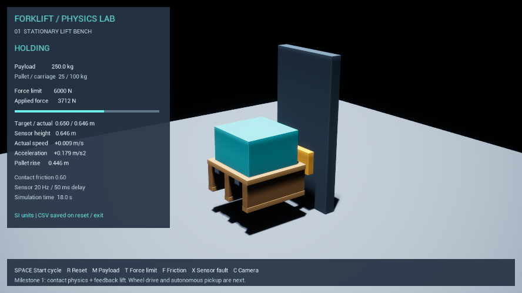

# ForkliftSim

Unreal Engine 5.6.1 기반 **물리·센서·제어를 검증하는 무인 지게차 프로젝트**입니다.
최종 목표는 센서로 팔레트를 찾아 정렬하고, 들어 올려 운반·하역하는 지게차 한 대입니다.

현재 버전 `0.1.0`은 첫 단계인 **정지식 포크 승강 시험장**입니다. 주행, 팔레트 인식,
자동 삽입·운반은 아직 구현되지 않았습니다. SPACE로 실행하는 승강 사이클은 장비 시험 자동화이며
완성된 자율 작업 시스템이 아닙니다.



검증 결과: [Docs/Validation.md](Docs/Validation.md)

## 실행

필요 환경: Unreal Engine 5.6.1, Visual Studio 2022 C++ 도구, Windows SDK, PowerShell 7.

현재 PC에서는 빌드가 되어 있으므로 `Start-Lab.bat`를 더블클릭하면 시험장이 열립니다.
GitHub에서 새로 내려받은 경우에는 아래 Build를 먼저 실행합니다.

```powershell
pwsh -File .\Scripts\Build.ps1
pwsh -File .\Scripts\Run.ps1
```

`ForkliftSim.uproject`를 Unreal Editor로 열고 Play를 눌러도 됩니다. 시작 맵은 엔진 내장
`/Engine/Maps/Entry`이며, GameMode가 시험장·조명·카메라·포크·팔레트를 실행 시 생성합니다.
편집기에서 Play 전 빈 맵으로 보이는 것은 정상입니다.

`공부` 같은 한글 상위 경로를 MSVC가 처리하지 못하는 문제를 피하기 위해 Build.ps1은
사용자의 TEMP에 영문 디렉터리 junction을 만듭니다. 원본 프로젝트는 이동·복제되지 않습니다.
생성된 Binaries, Intermediate, Saved, 빌드 캐시는 Git에 올리지 않습니다.

## 현재 구현

- 고정된 마스트와 실제 질량을 가진 승강 캐리지·포크, 1축 물리 가이드
- 포크와 별개로 시뮬레이션되는 팔레트·화물 강체와 삽입구가 있는 충돌 형상
- 최대 인양력, 목표 승강 속도·가속도 제한, 가이드 마찰·감쇠
- 접촉 마찰 변경, 중력에 의한 하강, 힘 제한에 걸릴 때 정지·고장 감지
- 높이 센서 20 Hz, 1 mm 양자화, 50 ms 지연, 센서 끊김 주입
- 센서 피드백을 사용하는 속도 PI 제어와 포화 시 적분 누적 제한
- 실제 높이·속도·가속도·팔레트 상승량과 명령·센서값을 별도로 표시
- 승강 → 유지 → 하강 시험, CSV 기록, 무화면 자동 시험

제어기는 팔레트의 실제 질량이나 실제 높이를 직접 읽지 않습니다. 실제 위치와 속도는 센서
모델의 입력과 평가용 기록에 사용합니다. 캐리지 질량만 중력 보상에 사용합니다.

## 조작

| 키 | 동작 |
|---|---|
| SPACE | 승강·유지·하강 시험 시작 |
| R | 시험 리셋, 이전 CSV 저장 |
| M | 화물 질량 변경: 100 / 250 / 500 / 1,000 kg, 리셋 |
| T | 최대 인양력 변경: 1,500 / 6,000 / 14,000 N, 리셋 |
| F | 접촉 마찰계수 변경: 0.2 / 0.6 / 0.9, 리셋 |
| X | 높이 센서 갱신 중단/재개. 고장 해제는 R |
| C | 카메라 시점 변경 |

영구 설정은 `Config/ForkliftLab.json`에 있습니다. JSON을 수정한 뒤 다시 실행하면 적용됩니다.
고장 시에는 현재 위치를 고정하는 **이상적인 기계식 잠금**을 사용합니다. 실제 유압 브레이크를
재현한 것은 아닙니다. 순수 수직 시험에서는 접촉 마찰만 바꿔도 큰 차이가 없을 수 있습니다.
마찰의 횡방향 효과는 이후 삽입·급정지·기울임 시험에서 검증합니다.

## 시험과 기록

```powershell
pwsh -File .\Scripts\Test.ps1
# 또는 -Mode Model / -Mode Physics
```

- 모델 시험: SI/Unreal 단위 변환, 힘·명령 가속도 제한, 설정 유효성 검사
- baseline: 독립 팔레트가 실제로 올라갔다가 바닥으로 돌아오는지 확인
- overload: 1,500 N으로 기본 화물을 들지 못하고 힘 한계 고장으로 전환되는지 확인
- sensor_timeout: 센서 갱신 중단 시 구동 명령 해제와 잠금 상태 전환 확인

`Saved/Telemetry/*.csv`에 시간, 상태, 목표 높이, 실제 높이, 센서 높이·시각,
실제 속도·가속도, 명령 속도, 인양력, 가이드 저항, 화물 질량, 마찰, 팔레트 상승량을 기록합니다.
`Saved/Logs`에는 시험별 로그가 남습니다. CSV는 리셋·정상 종료·사이클 완료 시 저장되므로
강제 종료 시 마지막 기록이 보존되지 않을 수 있습니다.
각 CSV 옆 `.meta.txt`에는 엔진 버전, 기본 설정, 키 조작으로 바뀐 활성 파라미터와
실제 물리 바디 질량을 함께 저장합니다.

## 모델의 범위

수치는 학습용 설계 가정이며 특정 제조사 장비의 검증된 파라미터가 아닙니다.
차체는 고정되어 있고 유압은 직접 수직 힘을 내는 액추에이터로 단순화했습니다.
마스트 롤러·체인·유압 회로·프레임 변형·전복 안정성은 아직 재현하지 않습니다.
팔레트와 화물은 하나의 용접 강체로 모델링하며, 포크에는 용접하지 않습니다.
캐리지 조립체 질량을 캐리지 60%·포크 각 20%로, 팔레트 질량을 상판 40%·세 받침 각 15%·
세 하판 각 5%로 나눕니다. 화물에는 별도 화물 질량을 부여하고 용접 후 실제 총질량을 검사합니다.
질량 분포 비율은 가정이며 실물 보정은 후속 단계입니다.

GPU 메모리 4 GB 노트북에서 작은 장면을 개발하도록 DX11, Lumen/레이 트레이싱 끄기,
가벼운 기본 형상을 사용합니다. 실제 성능은 장면과 실행 중인 프로그램에 따라 측정해야 합니다.

## 다음 단계

1. 캐리지·팔레트의 질량 분포와 기울임 시험, 하중 감지 모델 개선
2. 바퀴 토크·제동·조향·접지 마찰을 포함한 한 대의 주행 시험
3. 전방 거리 센서와 포크 근처 거리 배열, 팔레트 면·삽입구 추정
4. 자동 정렬·삽입·인양·하역 상태기계와 실패 복구
5. 알려진 짧은 경로의 운반과 장애물 정지, 조건별 반복 시험

상세 설계: `Docs/Design.md`. 물리와 센서의 측정값·오차를 먼저 검증한 뒤 자율 작업을 연결합니다.
